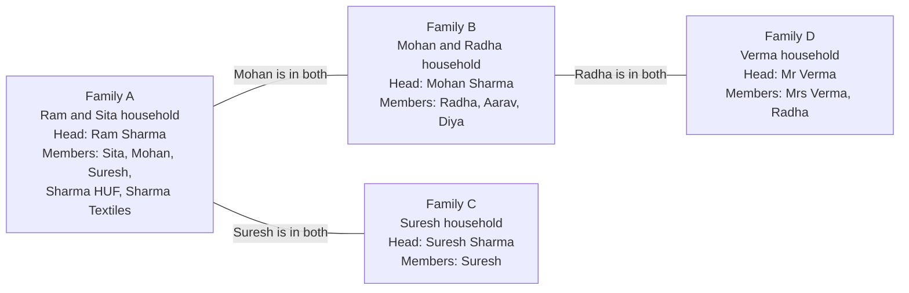
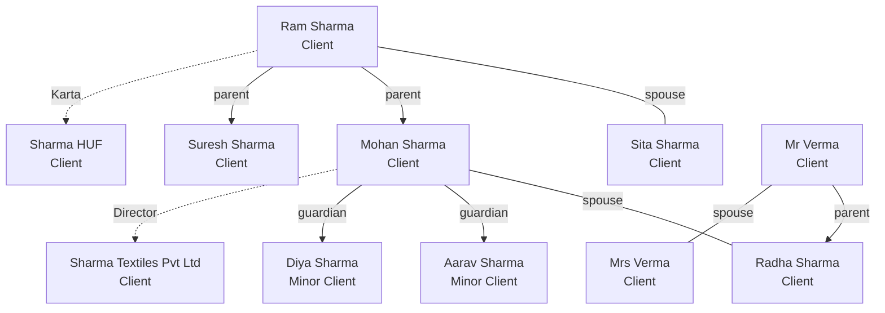
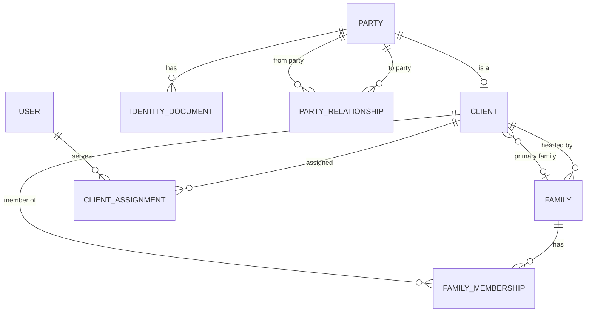

# Clients and families

Status: Draft. Last updated: 2026-11-14.

## 1. In plain words

A person or an organization that does business with KNAPS is a **Client**. A person who invests is a Client. A company, an HUF, or a trust can also be a Client.

A **Family** groups Clients who belong together. Ram, his wife, their sons, the family HUF, and the family company can sit in one Family. The Family is a label for employees. It has no PAN, no bank account, and no assets. It cannot own an Investment.

A Family can hold several generations. Mohan is a member of his father's Family and the head of his own Family. The link between the two Families is Mohan himself. Dhanada derives that link. It does not store a family tree.

This page uses the Sharma family in every example. The full cast is in [`../05-examples/sharma-family.md`](../05-examples/sharma-family.md).

## 2. Decisions at a glance

| Topic | Status | Decision |
|---|---|---|
| Identity layer | Decided | A hidden Party record holds identity. Client is a role record for a Party. |
| Internal key | Decided | UUID. PAN is not the primary key. |
| Client code | Decided | `CL-000001`, unique and immutable. |
| PAN | Decided | Optional and unique when present. Minors may have no PAN. |
| Client status | Decided | Onboarding, Active, Dormant, Closed. No Prospect. |
| Duplicate check | Decided | Strong and medium keys, review queue, no auto-merge. |
| Aadhaar | Deferred | Not collected in phase 1. |
| Family | Decided | A grouping, never a legal entity. |
| Membership | Decided | Many Families per Client, with one primary Family. |
| Membership scope | Decided | Back-office only. Current state with active and inactive members. |
| Family Head | Decided | Mandatory on every Active Family. Must be an Individual Client. |
| Family view | Decided | Families as nodes by default, plus a two-hop people map. |
| Lineage | Decided | Derived from Clients who are members of more than one Family. |
| Family data access | Decided | Employees only in phase 1. Client consent comes with the portal. |
| Entity AUM | Decided | Reported on a separate line, never added to the personal total. |
| Related-person search | Decided | Global employee search with masked PII and permission checks. |

## 3. Why a Party layer

A person can be a Client, a nominee, a guardian, a joint holder, a company signatory, and a Family member. A separate record for each role duplicates PII. It also breaks the link when a nominee becomes a Client.

The Party layer solves this:

- `Party` holds identity data.
- `Client` adds the client relationship.
- `Related Person` is a Party without a Client record.
- A role links to a Party, not to a copy of the person.
- When a Related Person becomes a Client, create the Client record for the same Party. Nothing is copied.

The UI shows Client and Related Person. Party stays behind the screen.

Worked example: [`../05-examples/joint-holders-and-nominee.md`](../05-examples/joint-holders-and-nominee.md) shows a nominee who later becomes a Client.

## 4. Client identity

### 4.1 Party and Client

A Party is one person or one organization. A Client is a Party with a client relationship. A Party has at most one Client record.

A Client can also hold related-party roles. For example, a Client can be a nominee on another Client's policy.

### 4.2 UUID and client code

The internal key is a UUID. It prevents easy enumeration in URLs and APIs. It is not a business identifier.

Every Client also has a client code, such as `CL-000123`. The code is unique and immutable. The UI shows the code and the name. The UUID stays internal.

A code never changes. If two Clients merge, keep the surviving code. Keep the retired code as a legacy reference.

Authorization still applies. A UUID and a code do not replace permissions.

### 4.3 PAN and identity documents

PAN is optional and unique when present. It is stored in uppercase and validated.

Minors may have no PAN. Other identity documents are stored in an Identity Document record:

- PAN
- Passport
- Voter ID
- Driving license
- Birth certificate
- CKYC number
- CIN or LLPIN
- Registration number
- Other

Each document has a verification status, a verification date, and an optional attachment.

Aadhaar is not collected in phase 1. Do not add the document type, a partial number, or an attachment. See OQ-004.

### 4.4 Minors

A minor is a Client of type Minor. The minor may have no PAN. A Guardian relationship is required before activation. The Guardian role has an end date at majority.

At majority, the Guardian role expires. Create a review task for KYC refresh and account control. The minor becomes the decision maker.

Worked example: [`../05-examples/minor-and-guardian.md`](../05-examples/minor-and-guardian.md).

### 4.5 Duplicate detection

Duplicate checks use strong and weak keys:

- Strong: PAN, CKYC number, passport number, CIN, LLPIN.
- Medium: mobile and name, email and name, name and date of birth and address.
- Weak: name and city.
- Minor: name, date of birth, guardian name, and guardian mobile.

A duplicate creates a review item. Do not merge automatically. A merge is an audited operation. The merged Party is marked as Merged Into. Links move to the surviving Party.

## 5. Client types

| Type | Legal person | PAN | Notes |
|---|---|---|---|
| Individual | Yes | Usually | Adult natural person. |
| Minor | Yes | Sometimes | Guardian required. No portal access until majority. |
| HUF | Yes | Yes | Karta manages the HUF. |
| Company | Yes | Yes | Authorized signatories. Beneficial owners. |
| Partnership | Yes | Yes | Partners are related parties. |
| LLP | Yes | Yes | Designated partners. |
| Trust | Yes | Usually | Trustee and settlor roles. |
| Society | Yes | Sometimes | Registration number and office bearers. |
| Other | Varies | Varies | Needs a note. |

A Family can contain individual Clients and entity Clients. An HUF or family business can be a Family member. A Family cannot be a Client.

## 6. Client lifecycle

### 6.1 Statuses

| Status | Plain meaning | What happens next |
|---|---|---|
| Onboarding | The person agreed to become a Client. KYC and documents are in progress. | Move to Active when KYC is verified and the first Application is issued. |
| Active | The relationship is live. The Client may hold zero or many Investments. | Move to Dormant after the dormant period with no activity. |
| Dormant | The relationship is quiet. Investments can still exist. | A new Application or contact moves the Client back to Active. |
| Closed | The relationship ended. Investments and history stay. | No automatic reopen. Create a new relationship if the person returns. |

A Client can be Active with zero Investments. Aarav is a minor Client with a KYC record and no Investments. He is a valid Client because the family relationship exists.

### 6.2 Why there is no Prospect

A **Lead** is a sales opportunity. A **Client** is a relationship. They are separate records, so the client list stays clean.

| Question | Lead | Client with status Onboarding |
|---|---|---|
| What is it? | A sales opportunity | A client relationship in progress |
| Is it a Client? | No | Yes |
| Has a Party record? | Optional | Yes |
| Has KYC? | No | In progress |
| Can hold an Application? | No | Yes |
| Can belong to a Family? | No | Yes |
| Can be lost or junk? | Yes | No, it can be Closed |
| How many per person? | Many over time | One |

When a Lead becomes a client, create a Client record and link the Lead as the source. Do not convert the Lead record. Do not create a Client record for a Lead that fails.

Rahul gives his phone number on the website. He is a Lead. He has no Party, no KYC, and no Family. He shares his PAN and KYC documents. Now create a Party and a Client with status Onboarding, and link the Lead. His first folio is issued. The Client becomes Active.

Six months later, Rahul asks about health insurance. Create a new Lead linked to his existing Client. Do not create a second Client.

Worked example: [`../05-examples/new-client-journey.md`](../05-examples/new-client-journey.md) and [`../05-examples/existing-client-cross-sell.md`](../05-examples/existing-client-cross-sell.md).

State diagram: [`../03-data-model/lifecycles.md`](../03-data-model/lifecycles.md).

## 7. Family model

### 7.1 Definition

A Family is a grouping of Clients for employee tracking, reporting, and relationship management. It has no PAN, no KYC, no bank account, and no Investment. It is not a legal entity.

The Family answers one employee question: "Which Clients belong together?"

### 7.2 Membership

- A Client may have no Family.
- A Client may belong to more than one Family.
- A Client has at most one primary Family. The primary Family is the Client's own household.
- Membership is back-office only. A client does not see it in phase 1.
- Membership has a role and an active or inactive status.
- Only the current state is kept. Inactive rows stay for reference. The system does not keep a full membership history.

### 7.3 Family Head

- Every Active Family has one Head. The Head is mandatory.
- The Head must be an Individual Client and an active member of the Family.
- A Client can head at most one active Family.
- An employee chooses the Head.
- The Head is a coordination label. Employees call the Head to coordinate the household.
- The Head label does not grant ownership of Family assets. It does not grant access to another member's data.

A Family cannot become Active without a Head. Build the Family first with status Draft, add the members, then set the Head and move to Active.

### 7.4 Lineage

Lineage comes from shared Clients. A Client who belongs to two Families links them. The system stores no parent-family field.

| Family | Head | Members | Link to the next generation |
|---|---|---|---|
| Family A | Ram Sharma | Sita, Mohan, Suresh, Sharma HUF, Sharma Textiles | Mohan is also in Family B. Suresh is also in Family C. |
| Family B | Mohan Sharma | Radha, Aarav, Diya | Radha is also in Family D. |
| Family C | Suresh Sharma | Suresh | Suresh is also in Family A. |
| Family D | Mr Verma | Mrs Verma, Radha | Radha is also in Family B. |

Each generation has its own Family. The employee sees the chain through the shared Clients. The full example is in [`../05-examples/sharma-family.md`](../05-examples/sharma-family.md).

### 7.5 Entity members

An HUF, company, or trust can be a Family member. The entity is the Client. The Karta, director, or trustee is a related party of the entity.

Entity Investments belong to the entity Client. Report them on a separate **Entity AUM** line. Never add them to the personal Family total. Otherwise the same money appears twice and the report hides who owns it.

Worked example: [`../05-examples/company-and-huf.md`](../05-examples/company-and-huf.md).

## 8. Employee family view

Employees need two views of the same data. Both are derived from Family, Family Membership, and Party Relationship. Neither view needs a new DocType.

### 8.1 Families as nodes

This is the default view. Each node is a Family. Each line is a Client who belongs to two Families.

The screen shows a list first:

| Family | Head | Members | Linked by | Personal AUM | Entity AUM |
|---|---|---|---|---|---|
| Family A | Ram Sharma | 6 Clients | Mohan, Suresh | ₹1.36 Cr | ₹1.68 Cr |
| Family B | Mohan Sharma | 4 Clients | Mohan, Radha | ₹59.00 L | None |
| Family C | Suresh Sharma | 1 Client | Suresh | ₹12.00 L | None |
| Family D | Mr Verma | 3 Clients | Radha | ₹92.00 L | None |

Open Family A and the card shows:

- The Head, with a link to the Client record.
- Each member with role, status, and personal value.
- Entity members with the role that links them: Karta, Director.
- Links to other Families: "Mohan Sharma is also in Family B".
- Primary RM and notes.

### 8.2 People as nodes

This is a read-only map. It answers "how are these people related?" Each node is a Party or Client. Solid lines are relationships. Dashed lines are roles.

Sita is also a parent of Mohan and Suresh. The line is left out to keep the drawing readable. The record exists.

The map opens from a Client or a Family. It shows two hops from the centre. Each node shows name, client code, type, and status. A node the employee cannot read shows as **Restricted**.

### 8.3 Why not a Frappe Tree DocType

A Tree DocType gives each record one parent. A family is a graph.

- Mohan has two parents, Ram and Sita.
- Radha has two parents, Mr and Mrs Verma.
- Mohan belongs to Family A and Family B.
- Radha belongs to Family B and Family D.

A tree allows one parent per record. To fit the Sharma family into a tree, you must duplicate memberships or pick one parent. Both choices corrupt the data.

Use a Tree DocType for the employee and Team hierarchy. Keep Family flat.

## 9. Family data access

### 9.1 Phase 1

- Employees see Family data by role and Client Assignment.
- The Family Head label does not open data to a client.
- A client cannot log in. There is no client-facing Family view.
- No Family record carries a consent flag in phase 1.

### 9.2 Portal phase

The portal adds one client-facing rule: a Client can see another Client's Family data only with a **Visibility Grant**. A grant records the grantor, the grantee, the scope, the purpose, the consent date, the expiry date, and the evidence.

The grant record is designed but not built in phase 1. The field list is in [`../03-data-model/field-dictionary/family.md`](../03-data-model/field-dictionary/family.md). The scope question is OQ-006 and the consent question is OQ-029.

## 10. Rules and invariants

1. One Party has at most one Client.
2. One Client links to exactly one Party.
3. A Client may belong to zero or many Families.
4. A Client has at most one primary Family.
5. A primary Family must contain the Client as an active member.
6. An Active Family has exactly one Head.
7. The Head must be an active member and an Individual Client.
8. A Client heads at most one active Family.
9. A Family cannot own an Investment.
10. A Family cannot be a Client.
11. A Related Person becomes a Client without a data copy.
12. A minor Client needs at least one active Guardian before activation.
13. PAN is unique when present.
14. Client code is unique and immutable.
15. Client, Party, and Family records are not hard deleted. Use status and merge.
16. A merge is audited and approved.
17. Entity Investments are never added to the personal Family total.

## 11. Data model

| DocType | Purpose | Key links |
|---|---|---|
| Party | Identity of a person or organization. | User, Address |
| Identity Document | Identity proof and verification. | Party |
| Client | Client role and client-specific data. | Party, Family, Lead |
| Family | Grouping of Clients. | Head Client |
| Family Membership | Link between a Client and a Family. | Family, Client |
| Party Relationship | Global relationship between two Parties. | Party, Party |
| Client Assignment | Link between a Client and an employee. | Client, User |
| Visibility Grant | Portal phase only. Consent for one Client to see another Client's data. | Family, Client, Client |

Field-level specifications are in [`../03-data-model/field-dictionary/README.md`](../03-data-model/field-dictionary/README.md).

## 12. Worked examples

| Example | What it shows |
|---|---|
| [The Sharma family](../05-examples/sharma-family.md) | The full cast, memberships, both views, and the AUM split. |
| [New client journey](../05-examples/new-client-journey.md) | Website Lead to Active Client. |
| [Existing client cross-sell](../05-examples/existing-client-cross-sell.md) | A new Lead for an existing Client. No second Client. |
| [Minor and guardian](../05-examples/minor-and-guardian.md) | A minor Client, the guardian role, and majority. |
| [Joint holders and nominee](../05-examples/joint-holders-and-nominee.md) | Shared ownership, AUM split, and a claim. |
| [Company and HUF](../05-examples/company-and-huf.md) | Entity Clients, signatory, Karta, and entity AUM. |

## 13. Open questions

- OQ-004: Aadhaar storage. Deferred.
- OQ-008: Can a Family contain non-Clients.
- OQ-009: Head limited to the primary Family.
- OQ-013: Multiple guardians and guardian eligibility.
- OQ-016: Related people in client reports.
- OQ-029: Portal consent capture.
- OQ-030: Data retention.
- OQ-031: Currency.
- OQ-032: Migration from the current branches.

See [`../04-decisions/open-questions.md`](../04-decisions/open-questions.md).
