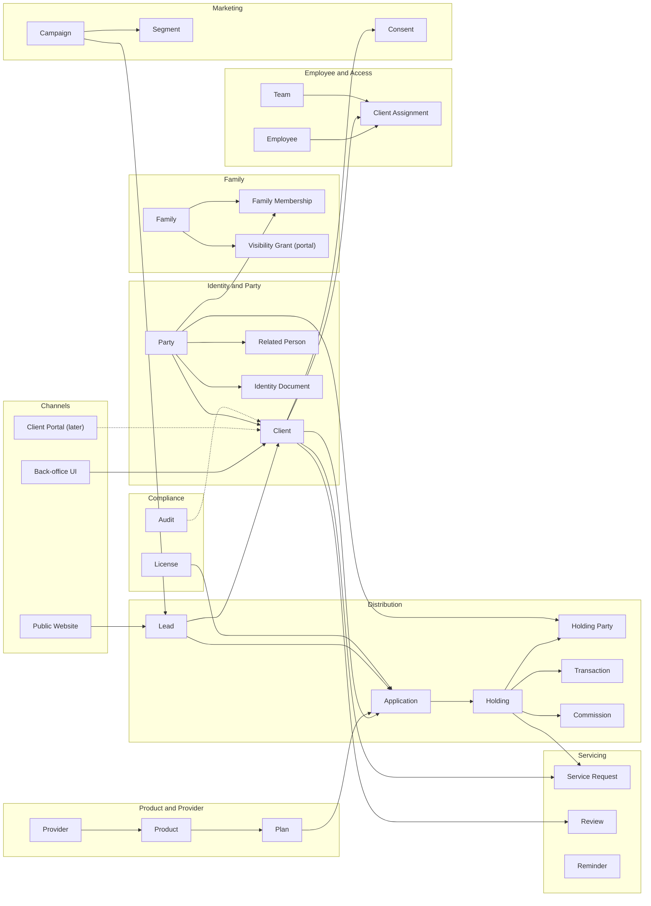

# Context map

Status: Draft. Last updated: 2026-11-16.

## Purpose

This page shows the main business contexts in Dhanada and how they connect. The map is logical. It does not show database foreign keys.

## Context diagram

## Contexts

| Context | Responsibility | Key records | Main links |
|---|---|---|---|
| Identity and Party | One identity per person or organization. Client role. Identity documents. | Party, Client, Related Person, Identity Document | Family, Distribution, Marketing |
| Family | Grouping of Parties. Membership, Head, and the employee view. | Family, Family Membership | Identity, Servicing |
| Product and Provider | Product catalog, providers, plans, rate cards, NAV. | Provider, Product, Plan, category detail, Rate Card, NAV History | Distribution |
| Distribution | Leads, applications, holdings, owners, transactions, commission. | Lead, Application, Holding, Holding Party, Transaction, Commission | Identity, Product, Servicing, Compliance |
| Employee and Access | Employees, teams, client assignments. | Employee, Team, Client Assignment | Identity, Distribution, Compliance |
| Servicing | Client requests, reviews, reminders. | Service Request, Review, Reminder | Identity, Distribution |
| Marketing | Campaigns, segments, consent use. | Campaign, Segment, Consent | Identity, Servicing |
| Compliance | Licenses, audit, approvals. | License, Audit | All contexts |
| Channels | Public website, back-office UI, client portal. | Website forms | Distribution, Identity |

## Boundaries and rules

1. Identity owns Party and Client. No other context stores name, PAN, or contact data.
2. Family links to Party. A Related Person can be a member before becoming a Client.
3. Product owns the catalog. Distribution stores a snapshot of the product and plan name on an Application or Holding, but the link is the source of truth.
4. Distribution owns Application, Holding, Holding Party, Transaction, and Commission. Servicing links to Holding.
5. An owner, nominee, or guardian role lives on Holding Party. Identity does not store it.
6. Marketing uses Consent from Identity. It does not keep a second consent state.
7. Compliance reads across contexts. It does not own client data.
8. The website is a channel. It creates Leads, Appointments, and Risk Profiler submissions through controlled forms.
9. Cross-context references use IDs. Do not share child tables across contexts.
10. A Related Person can become a Client without a data copy. The Party link stays.
11. Family, Holding, and Application records are never hard deleted. Use status and audit.

## Open questions

- OQ-017: Product model. See [`product-model/01-product-model.md`](product-model/01-product-model.md).
- OQ-018: Category depth. See [`product-model/02-category-catalog.md`](product-model/02-category-catalog.md).
- OQ-021: Website features.
- OQ-023: Employee and RM model.
- OQ-028: Frappe module split.
