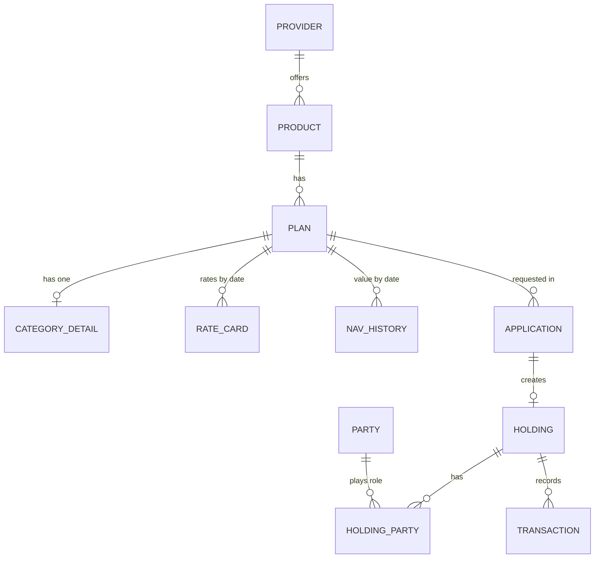

# The product model

Status: Proposed. Last updated: 2026-11-16. Needs confirmation. See OQ-017.

## In plain words

KNAPS sells many kinds of financial product. A mutual fund, a fixed deposit, a life policy, and a post office scheme do not behave the same way. Employees still need one place to see what a Client owns.

Dhanada uses one common spine and one detail form for each product family. The spine is small and stable. The detail form holds the facts that only that family needs.

A simple analogy is a car showroom:

- The manufacturer is the **Provider**.
- The car model is the **Product**.
- The variant is the **Plan**. Petrol or diesel. Manual or automatic. Base or top model.
- The car in your garage is the **Holding**.

You do not build a separate showroom for each variant. You also do not write "fuel type" on the showroom door. You put it on the variant.

## The problem

KNAPS works with at least eleven product families:

- Mutual funds (MF)
- Specialised Investment Funds (SIF)
- National Pension System (NPS)
- Life insurance
- Health insurance
- General insurance
- Bank and NBFC fixed deposits
- Government of India bonds
- Post office and small savings schemes
- Portfolio Management Services (PMS)
- Alternative Investment Funds (AIF)

Each family has facts the others do not need:

| Product | Facts that matter |
|---|---|
| Mutual fund | ISIN, units, NAV, exit load, expense ratio |
| Fixed deposit | Interest rate, tenure, payout, maturity date, premature penalty |
| Life insurance | Sum assured, premium, policy term, nominee, riders |
| NPS | PRAN, tier, scheme E or C or G, fund manager, units, NAV |
| Post office MIS | Account number, monthly payout, rate, maturity |

If one table held all of these, most columns would be empty on every row. The entry form would confuse employees and validation would be weak.

## Three ways to model it

| Option | What it means | Result |
|---|---|---|
| One big table | Every field for every product in one DocType | Sparse data, weak rules, a long confusing form |
| One table per family | A separate MF record, FD record, policy record, and so on | Twelve portfolios, twelve reports, duplicated application and commission logic |
| Common spine plus detail | One Product and Plan spine, one detail record per family | One portfolio, clean category fields, one application flow |

Dhanada uses the third option. It is called a **hybrid** model because it mixes a shared core with category records.

## The five records

| Record | Answers the question | Example |
|---|---|---|
| Provider | Who makes or manages it? | HDFC Asset Management Company |
| Product | Which product family is it? | HDFC Flexi Cap Fund |
| Plan | Which exact version can the Client buy? | HDFC Flexi Cap Fund, Direct, Growth |
| Category Detail | What else does this family need? | ISIN, benchmark, expense ratio, exit load |
| Holding | What does the Client own now? | Folio 1234567, 4,000 units |

The Client buys a **Plan**, never a bare Product. The Holding points to the Plan.

## Worked example 1: a mutual fund

Ram Sharma invests ₹10,00,000 in a flexi cap fund.

| Step | Record | Value |
|---|---|---|
| 1 | Provider | HDFC Asset Management Company |
| 2 | Product | HDFC Flexi Cap Fund |
| 3 | Plan | Direct, Growth |
| 4 | MF Detail | ISIN, flexi cap category, Nifty 500 benchmark, 0.65% expense ratio, 1% exit load |
| 5 | Holding | Folio 1234567, 4,000 units at NAV ₹250 |

The value is `units × NAV`. New NAV rows arrive over time. The Holding does not change when the NAV changes.

## Worked example 2: a fixed deposit

Sita Sharma opens a deposit with Bajaj Finance.

| Step | Record | Value |
|---|---|---|
| 1 | Provider | Bajaj Finance |
| 2 | Product | Bajaj Finance Fixed Deposit |
| 3 | Plan | 36 months, cumulative, non-senior |
| 4 | FD Detail | Compounding quarterly, premature penalty 2%, loan against deposit allowed |
| 5 | Rate Card | 8.15% effective 1 April 2026 to 30 June 2026 |
| 6 | Holding | Receipt 88921, principal ₹5,00,000, rate 8.15%, maturity 2029 |

The rate is copied to the Holding at the start. When the provider changes the card to 8.00%, the old Holding keeps 8.15%. A new deposit uses the new rate.

## Worked example 3: a life policy

Ram buys a term policy.

| Step | Record | Value |
|---|---|---|
| 1 | Provider | LIC of India |
| 2 | Product | LIC Jeevan Amar |
| 3 | Plan | 20-year term, annual premium, non-smoker |
| 4 | Insurance Detail | Sum assured ₹50,00,000, premium ₹20,000, waiting period 90 days |
| 5 | Holding | Policy 778812, start date, next premium date, nominee Sita |

The Holding keeps the sum assured and premium that the policy was issued with. A rider is a separate Plan, not a note on the base policy.

## Where each fact lives

| Fact | Record | Why |
|---|---|---|
| Who makes it | Provider | One provider sells many products. |
| Product name and category | Product | Shared by every plan under it. |
| Direct or Regular | Plan | A buyable choice. |
| Tenure and payout | Plan | A buyable choice. |
| ISIN, benchmark, expense ratio | MF Detail | Only mutual funds need them. |
| Interest rate by date | Rate Card | Rates change without changing the product. |
| NAV by date | NAV History | Values change every day. |
| Sum assured and premium | Insurance Detail | Only insurance needs them. |
| Who owns the Holding | Holding Party | Ownership is separate from the product. |
| What was bought | Holding | The Client's position. |

## What the employee sees

1. **Product list.** Search by name, provider, or category. Show the plan count and status.
2. **Product form.** Common fields, plus a category tab with the detail record.
3. **Plan form.** Buyable options, tenure, amount limits, rate or NAV, and status.
4. **Application.** Pick a Plan. The form shows only the fields that family needs.
5. **Holding.** Pick a Plan. The form asks for the provider reference, dates, amount, and holders.
6. **Product 360.** Who holds this plan, total value, and upcoming maturities.

The employee never picks a category detail directly. The Plan selects it.

## What the website uses

The public website reads Product and Plan only:

- Product name, provider, category, description, risk level.
- Plan options, minimum amount, current rate, latest NAV.
- A brochure or one-page summary.

The website never reads a Holding, a Client, or a Family. An "I am interested" button creates a Lead with the Plan attached.

This keeps public pages fast and keeps client data out of the public tier.

## What changes over time

| Change | What to do | What not to do |
|---|---|---|
| Interest rate changes | Add a Rate Card row with a new effective date | Do not edit the old rate |
| NAV changes | Add a NAV History row | Do not overwrite the last NAV |
| Provider stops a plan | Set Plan status to Closed to New Business | Do not delete the plan |
| Product is withdrawn | Set Product status to Discontinued | Do not delete the product |
| Plan terms change | Create a new Plan | Do not edit a Plan that Holdings use |

A Holding is a record of a deal. The deal keeps its terms.

## Rules and invariants

1. Every Product has at least one Plan before it can be sold.
2. Every Plan has exactly one category detail record.
3. A Holding points to exactly one Plan.
4. A Holding keeps a snapshot of the key terms at the start: plan name, provider name, rate, tenure, sum assured, and amount.
5. A Plan is never deleted. Use status.
6. A Rate Card or NAV row is never edited. Add a row.
7. The website reads Product and Plan only.
8. A category detail holds product facts, never Client identity.
9. An Application and a Holding link to the same Plan. A later Plan change does not rewrite history.
10. A Provider can also be a Distribution Partner. Keep the two roles separate.

## What this costs

- More DocTypes than one big table.
- Employees must pick the right Plan.
- The category detail must be filled for each Plan.
- Reports join the spine to the detail when they need category facts.

The gain is one portfolio, one application flow, one commission model, and clean fields for each family.

## What we need to confirm

| Check | Question | Recommendation |
|---|---|---|
| 1 | Do you accept Provider, Product, Plan, Category Detail, and Holding? | Yes |
| 2 | Is the Plan the unit of sale? | Yes |
| 3 | Is one category detail record per Plan enough? | Yes |
| 4 | Do we add rate and NAV rows instead of editing history? | Yes |
| 5 | Is the website limited to Product and Plan data? | Yes |

If all five are yes, OQ-017 can close.

## The shape

`CATEGORY_DETAIL` is a logical name. Each family has its own detail DocType, linked one-to-one to Plan.

## Related

- [Category catalog](02-category-catalog.md): how each family works.
- [Money, dates, and values](03-money-dates-and-values.md): what the numbers mean.
- [Question bank](04-question-bank.md): the decisions still needed.
- [Data model draft](05-data-model-draft.md): the DocTypes and fields.
- [Products and providers](../products-and-providers.md): the short domain summary.
