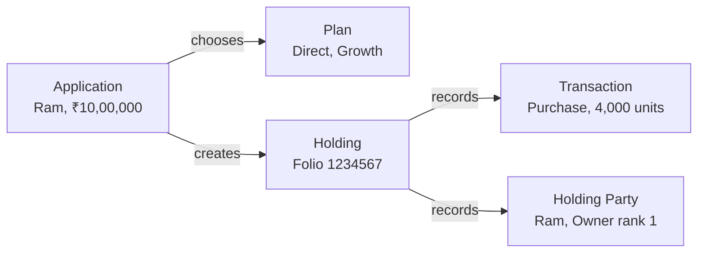
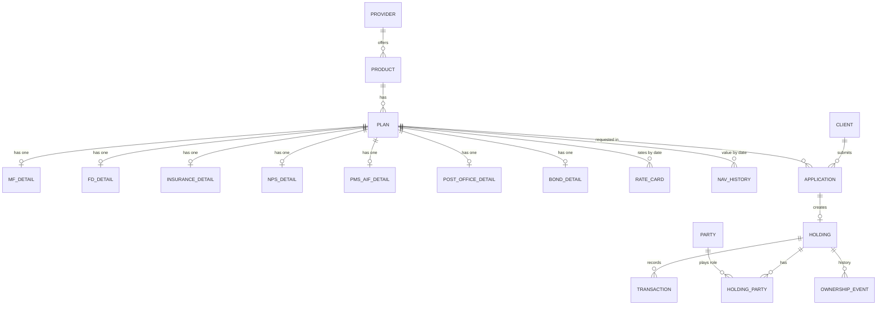

# Product data model draft

Status: Draft. Last updated: 2026-11-16. Depends on OQ-017 and OQ-018.

## What this page is

This page shows how the product spine fits together before any code is written. The field lists are in [`../../03-data-model/field-dictionary/distribution.md`](../../03-data-model/field-dictionary/distribution.md).

## 1. The records

| Record | One row means | Example |
|---|---|---|
| Provider | One legal organization | HDFC Asset Management Company |
| Product | One product family | HDFC Flexi Cap Fund |
| Plan | One buyable version | Direct, Growth |
| MF Detail | The extra fields for one Plan | ISIN, benchmark, expense ratio |
| Rate Card | One rate for one period and tenure band | 8.15%, 24 to 36 months, Apr to Jun 2026 |
| NAV History | One NAV for one date | ₹300 on 30 June 2026 |
| Application | One request to buy | Ram applies for ₹10,00,000 |
| Holding | One position | Folio 1234567, 4,000 units |
| Holding Party | One role on the position | Ram Owner rank 1, Sita Nominee 100% |
| Transaction | One change to the position | SIP instalment, redemption, maturity |
| Ownership Event | One recorded ownership change | Survivor transfer after death |

## 2. How a purchase flows

1. The employee picks a Plan. The category detail decides which fields the form shows.
2. The Application stores a snapshot of the provider, product, and plan names.
3. On issue, the Holding is created. It copies the deal terms.
4. The first Transaction records the money and units.
5. Holding Party records the owners, nominee, and guardian.

## 3. Why the snapshot matters

The catalog changes. The deal does not.

| Fact | Catalog record | Holding snapshot |
|---|---|---|
| Provider name | Provider | `provider_name_snapshot` |
| Product name | Product | `product_name_snapshot` |
| Plan name | Plan | `plan_name_snapshot` |
| FD rate | Rate Card | `interest_rate` |
| Allotment NAV | NAV History | `nav` and `nav_date` |
| Sum assured | Insurance Detail | `sum_assured` |
| Tenure | Plan | `maturity_date` |

A report reads the snapshot. A catalog page reads the live record. The two never fight.

## 4. Where a report joins

| Report | Reads | Joins |
|---|---|---|
| Client portfolio | Holding, Holding Party | Plan, Product |
| AUM by category | Holding, Product | Plan |
| Maturity calendar | Holding | Plan, Product |
| Commission by product | Commission, Holding | Plan, Product, Provider |
| Website product page | Product, Plan, Category Detail | None |
| Rate history | Rate Card | Plan |
| NAV chart | NAV History | Plan |

The client portfolio and the website never share a query path. That keeps client data out of the public tier.

## 5. The ERD

A Plan uses exactly one of the detail records. The diagram shows all of them for completeness.

## 6. Build order

| Step | Build | Why first |
|---|---|---|
| 1 | Provider, Product, Plan | The catalog is the base. |
| 2 | MF and FD detail, Rate Card, NAV History | These cover most of the book. |
| 3 | Application and Holding | The core transaction flow. |
| 4 | Holding Party | Owners, nominees, and guardian. |
| 5 | Insurance and NPS detail | Larger field sets. |
| 6 | Post office, bond, PMS, AIF detail | Lower volume. |
| 7 | Transaction types by family | Manual entry. |
| 8 | Website product pages | Public read of the catalog. |
| 9 | Reports and commission | After the data exists. |

## 7. What is still open

| Question | Impact |
|---|---|
| P-001 to P-005 | The spine itself. |
| P-023 to P-034 | Plan fields and variant design. |
| P-028 | NPS scheme modelling. |
| P-043 | Folio-level or scheme-level Holdings. |
| P-062 | Nominee shares on insurance. |
| P-073 to P-082 | NPS units, NAV, and tiers. |
| P-103 to P-114 | Holding and transaction entry. |
| OQ-019 | Legal entity for licenses and commission. |

## 8. What not to build yet

- A separate portfolio DocType per category.
- Fund accounting for PMS or AIF.
- Insurance quotes or benefit illustrations.
- Order placement with a provider.
- A public NAV or rate feed integration.
- A client portal view of the catalog.

## Related

- [The product model](01-product-model.md)
- [Question bank](04-question-bank.md)
- [Distribution field dictionary](../../03-data-model/field-dictionary/distribution.md)
- [ERD](../../03-data-model/erd.md)
