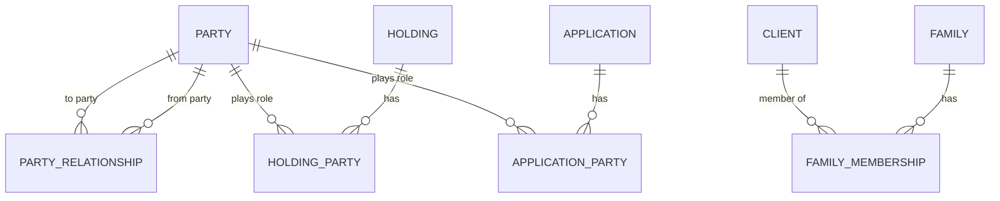

# Related parties

Status: Draft.

## In plain words

Not everyone linked to a Client is a Client. A nominee, a guardian, a company director, or a power-of-attorney holder can be a **Related Person**. A Related Person has an identity record but no client relationship.

A role links a person to a Client or an Investment. A role is not ownership. A nominee owns nothing until a claim. A guardian acts for a minor but does not own the minor's money. A director signs for a company but does not own the company's fixed deposit.

Only an **Owner** adds to AUM.

Worked examples: [joint holders and nominee](../05-examples/joint-holders-and-nominee.md) and [company and HUF](../05-examples/company-and-huf.md).

## 1. Purpose

This page defines how Dhanada models people and entities related to a Client or a Holding. It separates identity from roles and roles from ownership.

## 2. Principles

1. A Party is the identity. A role is a link to a Party.
2. A role is not ownership.
3. A Party can hold many roles across Clients and Holdings.
4. A Related Person can become a Client without a data copy.
5. Global relationships are separate from Holding roles.
6. AUM uses ownership, not roles.

## 3. Role catalog

| Role | Scope | Owner | Notes |
|---|---|---|---|
| Primary Owner | Holding | Yes | Sole owner has 100%. |
| Joint Holder | Holding | Yes, with share | Shares must sum to 100%. |
| Nominee | Holding | No | Receives on death, subject to claim. |
| Life Assured | Holding | No | Insurance only. |
| Beneficiary | Holding or trust | No | May become owner on vesting. |
| Guardian | Client or Holding | No | Acts for a minor. Expires at majority. |
| Payer | Holding | No | Premium or contribution payer. |
| Authorized Signatory | Client | No | Acts for an entity. |
| Beneficial Owner | Client | No | Owns or controls the entity, not its Holdings. |
| Karta | Client (HUF) | Yes, for the HUF | Manages the HUF. |
| Trustee | Client (Trust) | No | Manages trust assets. |
| Settlor | Client (Trust) | No | Creates the trust. |
| POA Holder | Client | No | Needs scope and expiry. |
| Referrer | Lead or Client | No | Attribution only. |
| Emergency Contact | Client | No | Service use only. |
| Family Head | Family | No | Coordination label for employees. No ownership and no data access. |
| Family Member | Family | No | Grouping only. |

## 4. Where roles live

| Record | Use | Examples |
|---|---|---|
| Party Relationship | A global link between two Parties. | Spouse, parent, child, guardian, ward, POA, authorized signatory, beneficial owner, referrer |
| Holding Party | A role on one Holding. | Owner, joint holder, nominee, life assured, beneficiary, payer, guardian |
| Application Party | A role during an Application. | Applicant, joint applicant, nominee, guardian, payer |
| Family Membership | A role in a Family. | Head, spouse, child, HUF, family business, family trust |
| Client Assignment | An employee role for a Client. | Primary RM, secondary RM, service RM |

Do not store a person's name and PAN on a Holding. Link to a Party.

## 5. Ownership rules

1. Every Holding has at least one Owner. A sole Owner has 100%. Joint Owners must sum to 100%.
2. An Owner must be a Client. Proposed. A Related Person who becomes an Owner must first become a Client.
3. A Nominee, Guardian, Life Assured, Beneficiary, Payer, POA Holder, Trustee, or Family Head is not an Owner unless a separate Owner row exists.
4. The legal Owner of an entity Holding is the entity Client. Its shareholders and Beneficial Owners are not Owners of the Holding.
5. The legal Owner of an HUF Holding is the HUF Client. The Karta acts for it. Family members are not Owners of HUF assets.
6. AUM uses Owner rows. It does not use roles.
7. At Family level, count each Holding once. At Client level, split joint ownership by share.
8. A related person can become a Client without changing any role row. The Party link stays.
9. A Guardian role has an end date. Create a review task at majority.
10. An ownership change on death, claim, gift, or transfer is a recorded event. Keep the current Owner and an ownership history.
11. A nominee change is a recorded event. Keep the current Nominee and a nominee history.
12. A POA has a scope, start date, end date, and status.

## 6. AUM and reporting

- Count each Holding once at the firm level.
- Count each Holding once per Family.
- Split joint ownership by share at Client level.
- Report personal AUM and entity AUM on separate lines at Family level.
- Entity Holdings belong to the entity Client. Do not count them again under directors or shareholders. Report them as Entity AUM.
- HUF Holdings belong to the HUF Client. Do not count them again under family members. Report them as Entity AUM.
- Nominee, Beneficiary, Guardian, and Payer roles do not add AUM.
- The same Holding can appear in two Family reports when joint Owners belong to different Families. The firm-level total counts it once.
- Use the current Owner for operational reports. Use ownership history for audit and claims.

Worked example: the [Sharma family](../05-examples/sharma-family.md) shows the personal and entity lines side by side.

## 7. Scenarios

### 7.1 Nominee becomes a Client

Mr. A names Mrs. B as Nominee. Mrs. B is a Party with a Nominee role and no Client record. Later, Mrs. B becomes a Client. Create the Client record for the same Party. The Nominee row now resolves to a Client. No data is copied.

### 7.2 Minor Client

The minor is a Client with no PAN. The Guardian is a Party with a Guardian relationship to the minor and a Guardian role on each Holding. The Guardian acts until the majority date. After that, the Guardian role expires and the minor becomes the decision maker.

### 7.3 Joint holders

Two Clients own one FD with 50% each. Both are Owner rows. Each Client sees their share. The Family report counts the FD once if both are in the same Family.

### 7.4 Company Client

The company is the Client and the Owner. The director is a Party with an Authorized Signatory role on the Client. The shareholders are Parties with Beneficial Owner roles on the Client. Company AUM stays with the company.

### 7.5 HUF Client

The HUF is the Client and the Owner. The Karta is a Party with a Karta role on the HUF Client. The HUF's assets are not personal assets of the Karta or the family members.

### 7.6 Death claim

The policyholder dies. The Nominee claims. The claim is a Service Request. On settlement, record an ownership transfer event, expire the Nominee role, and add the Nominee as Owner. Keep the history.

Full worked examples:

- [Minor and guardian](../05-examples/minor-and-guardian.md)
- [Joint holders and nominee](../05-examples/joint-holders-and-nominee.md)
- [Company and HUF](../05-examples/company-and-huf.md)

## 8. Data model

| DocType | Key fields |
|---|---|
| Party Relationship | From Party, To Party, Relationship Type, Status, Start Date, End Date, Scope, Notes |
| Holding Party | Holding, Party, Role, Share Percentage, Status, Effective From, Effective To, Notes |
| Application Party | Application, Party, Role, Share Percentage, Status, Notes |
| Family Membership | Family, Client, Role, Status, Joined On, Left On, Notes |

## 9. Rules and invariants

1. A Holding has at least one Owner.
2. Owner shares sum to 100%.
3. One Party has one active Owner role per Holding.
4. Owner and Nominee are conflicting roles for the same Party on the same Holding. Use one active role.
5. A Guardian role needs an end date for a minor.
6. A POA role needs a scope and an end date.
7. A Party can be both a Client and a related person.
8. A Related Person can hold non-owner roles without a Client record.
9. A Related Person must become a Client before becoming an Owner. Proposed.
10. A Family Head cannot own Family assets through the Head role.
11. Entity AUM is never added to personal AUM.

## 10. Open questions

- OQ-010: Joint ownership shares.
- OQ-011: Ownership history.
- OQ-012: Nominee history.
- OQ-013: Multiple guardians and guardian eligibility.
- OQ-014: POA scope and expiry in phase 1.
- OQ-015: Beneficial owner tracking in phase 1.
- OQ-016: Related people in client reports.

See [`../04-decisions/open-questions.md`](../04-decisions/open-questions.md).
