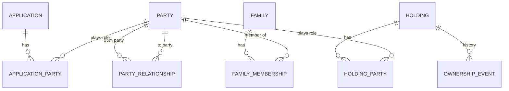

# Related parties

Status: Draft. Last updated: 2026-11-16.

## In plain words

Not everyone linked to a Client is a Client. A nominee, a guardian, a company director, or a family member can be a **Related Person**. A Related Person has an identity record but no client relationship.

A role links a person to a Client or an Investment. A role is not ownership. A nominee owns nothing until a claim. A guardian acts for a minor but does not own the minor's money. A director signs for a company but does not own the company's fixed deposit.

Only an **Owner** adds to AUM. A Holding has one to three Owners, in order. The first Owner is the Primary Holder. The others are Joint Holders. Dhanada stores the order, not a percentage, because providers do not record a percentage.

Worked examples: [joint holders and nominee](../05-examples/joint-holders-and-nominee.md), [minor and guardian](../05-examples/minor-and-guardian.md), and [company and HUF](../05-examples/company-and-huf.md).

## 1. Purpose

This page defines how Dhanada models people and entities related to a Client or a Holding. It separates identity from roles and roles from ownership.

## 2. Principles

1. A Party is the identity. A role is a link to a Party.
2. A role is not ownership.
3. A Party can hold many roles across Clients and Holdings.
4. A Related Person can become a Client without a data copy.
5. Global relationships are separate from Holding roles.
6. AUM uses ownership, not roles.
7. A minor is a sole owner. A guardian acts for the minor on a Holding.

## 3. Role catalog

| Role | Scope | Owner | Notes |
|---|---|---|---|
| Owner | Holding | Yes | Rank 1 to 3. Rank 1 is the Primary Holder. |
| Nominee | Holding | No | Receives on death, subject to claim. Share is stored when there are two or more. |
| Life Assured | Holding | No | Insurance only. |
| Beneficiary | Holding or trust | No | May become owner on vesting. |
| Guardian | Holding | No | Acts for a minor. One per minor per Holding. Expires at majority. |
| Payer | Holding | No | Premium or contribution payer. |
| Authorized Signatory | Client | No | Acts for an entity. |
| Beneficial Owner | Client | No | Owns or controls the entity, not its Holdings. |
| Karta | Client (HUF) | Yes, for the HUF | Manages the HUF. |
| Trustee | Client (Trust) | No | Manages trust assets. |
| Settlor | Client (Trust) | No | Creates the trust. |
| Referrer | Lead or Client | No | Attribution only. |
| Emergency Contact | Client | No | Service use only. |
| Family Head | Family | No | Coordination label for employees. No ownership and no data access. |
| Family Member | Family | No | Grouping only. A member can be a Related Person. |
| POA Holder | Client | No | Deferred. Not in phase 1. See OQ-014. |

The UI shows **Primary Holder** for rank 1 and **Joint Holder** for rank 2 or 3. Both are the Owner role in the data.

## 4. Where roles live

| Record | Use | Examples |
|---|---|---|
| Party Relationship | A global link between two Parties. | Spouse, parent, child, authorized signatory, beneficial owner, referrer |
| Holding Party | A role on one Holding. | Owner, nominee, life assured, beneficiary, payer, guardian |
| Application Party | A role during an Application. | Applicant, nominee, guardian, payer |
| Family Membership | A role in a Family. | Head, spouse, child, HUF, family business, family trust |
| Client Assignment | An employee role for a Client. | Primary RM, secondary RM, service RM |

Do not store a person's name and PAN on a Holding. Link to a Party.

A guardian exists only on a Holding. There is no guardian field on Client and no Guardian type in Party Relationship. One parent can act on one deposit, the other parent on another.

## 5. Ownership rules

1. Every Holding has at least one Owner and at most three.
2. Owners are ordered by `holder_rank`: 1, 2, and 3. Rank 1 is the Primary Holder.
3. Do not store an ownership share. Providers do not record one.
4. An Owner must be a Client. Proposed. A Related Person who becomes an Owner must first become a Client.
5. A minor owner is the only Owner. A minor cannot be a Joint Holder.
6. A Nominee, Guardian, Life Assured, Beneficiary, Payer, or Family Head is not an Owner unless a separate Owner row exists.
7. The legal Owner of an entity Holding is the entity Client. Its shareholders and Beneficial Owners are not Owners of the Holding.
8. The legal Owner of an HUF Holding is the HUF Client. The Karta acts for it. Family members are not Owners of HUF assets.
9. AUM uses Owner rows. It does not use roles.
10. A related person can become a Client without changing any role row. The Party link stays.
11. A Guardian role has an end date. Create a review task at majority.
12. An ownership change on death, claim, gift, or transfer is a recorded event. Keep the current Owner and an ownership history.
13. A nominee change is a Service Request, then an update of the current Nominee rows. There is no separate nominee history table.
14. POA is deferred.

## 6. AUM and reporting

- Credit the full Holding value to the rank 1 Owner.
- A Joint Holder sees the Holding in their portfolio with a **Joint** badge and no personal value.
- Count each Holding once at the firm level.
- Count each Holding once per Family.
- Report personal AUM and entity AUM on separate lines at Family level.
- Entity Holdings belong to the entity Client. Do not count them again under directors or shareholders. Report them as Entity AUM.
- HUF Holdings belong to the HUF Client. Do not count them again under family members. Report them as Entity AUM.
- Nominee, Beneficiary, Guardian, and Payer roles do not add AUM.
- A joint holder outside the Family sees a memo row: "Joint interest in FD with Ram Sharma". The memo row has no value.
- The same Holding can appear in two Family reports when the Owners belong to different Families. The firm-level total counts it once.
- Client reports are holding-based. They do not use the Family view. See [ADR-0008](../04-decisions/adr-0008-client-reports-are-holding-based.md).
- Use the current Owner for operational reports. Use ownership history for audit and claims.

Worked example: the [Sharma family](../05-examples/sharma-family.md) shows the personal and entity lines side by side.

## 7. Scenarios

### 7.1 Nominee becomes a Client

Mr. A names Mrs. B as Nominee. Mrs. B is a Party with a Nominee role and no Client record. Later, Mrs. B becomes a Client. Create the Client record for the same Party. The Nominee row now resolves to a Client. No data is copied.

### 7.2 Minor Client

Aarav is 12 and has no PAN. He is a Client of type Minor. He owns one FD as the only Owner, rank 1. Mohan is the Guardian on that FD. Sita is the Guardian on a second FD that Sita opened for him.

The Guardian row carries `acts_for` = Aarav. On the majority date, both Guardian rows expire and Aarav becomes the decision maker. Aarav is never a joint holder.

### 7.3 Joint holders

Ram and Sita open one FD. Ram is rank 1 and Sita is rank 2. No share is stored.

- Ram's personal AUM includes the full FD value.
- Sita sees the FD with a Joint badge and no personal value.
- Family A counts the FD once.
- The firm counts the FD once.

The bank statement also shows first holder and second holder only. The stored data matches the statement.

### 7.4 Company Client

The company is the Client and the Owner. The director is a Party with an Authorized Signatory role on the Client. The shareholders are Parties with Beneficial Owner roles on the Client. Company AUM stays with the company.

### 7.5 HUF Client

The HUF is the Client and the Owner. The Karta is a Party with a Karta role on the HUF Client. The HUF's assets are not personal assets of the Karta or the family members.

### 7.6 Death claim

The policyholder dies. The Nominee claims. The claim is a Service Request. On settlement, record an ownership event, expire the Nominee role, and add the Nominee as Owner. Keep the history.

For a joint deposit, the survivor becomes rank 1. Record an Ownership Event of type Survivor Transfer. Do not edit the old rows without an event.

Full worked examples:

- [Minor and guardian](../05-examples/minor-and-guardian.md)
- [Joint holders and nominee](../05-examples/joint-holders-and-nominee.md)
- [Company and HUF](../05-examples/company-and-huf.md)

## 8. Data model

| DocType | Key fields |
|---|---|
| Party Relationship | From Party, To Party, Relationship Type, Status, Start Date, End Date, Scope, Notes |
| Holding Party | Holding, Party, Role, Holder Rank, Nominee Share, Acts For, Status, Effective From, Effective To, Notes |
| Ownership Event | Holding, Event Date, Event Type, From Party, To Party, Service Request, Evidence, Notes |
| Application Party | Application, Party, Role, Holder Rank, Nominee Share, Acts For, Status, Notes |
| Family Membership | Family, Party, Optional Client, Role, Status, Joined On, Left On, Notes |

## 9. Rules and invariants

1. A Holding has at least one Owner and at most three.
2. Exactly one Owner has rank 1.
3. No ownership share is stored.
4. One Party has one active Owner role per Holding.
5. Owner and Nominee are conflicting roles for the same Party on the same Holding. Use one active role.
6. A minor owner is the only Owner on the Holding.
7. A Holding with a minor owner needs one active Guardian row with `acts_for`.
8. A Guardian role needs an end date for a minor.
9. Two or more Nominee rows on a Holding total 100.
10. A Party can be both a Client and a related person.
11. A Related Person can hold non-owner roles without a Client record.
12. A Related Person must become a Client before becoming an Owner. Proposed.
13. A Family Head cannot own Family assets through the Head role.
14. Entity AUM is never added to personal AUM.
15. Client reports never include related people. They list Holdings.

## 10. Open questions

- OQ-011: Ownership history options.
- OQ-014: POA scope and expiry. Deferred.
- OQ-015: Beneficial owner tracking in phase 1.

See [`../04-decisions/open-questions.md`](../04-decisions/open-questions.md).
