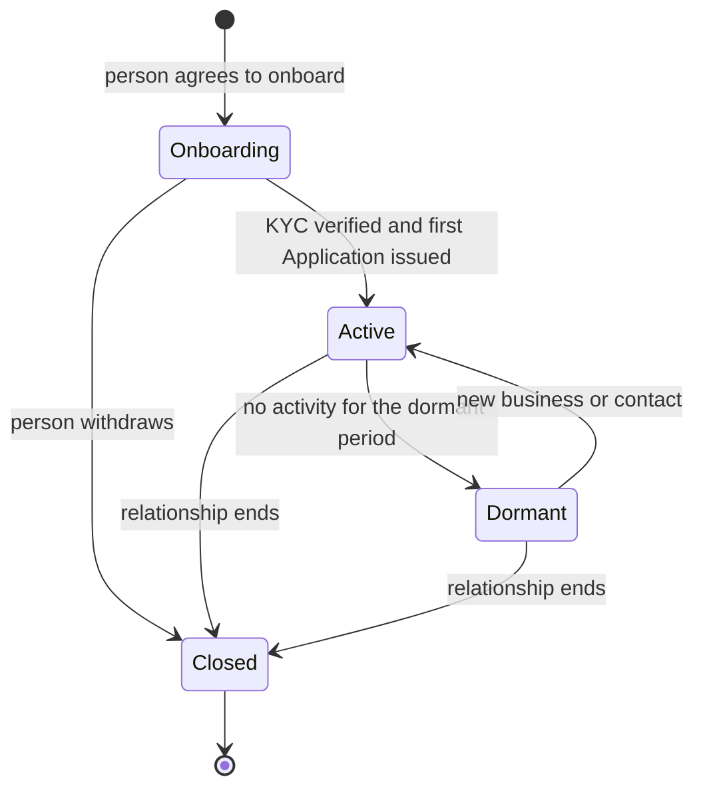

# Party and Client

Status: Draft. Last updated: 2026-11-16.

This page explains how Dhanada identifies a person or an organization, and when that identity becomes a Client. Read this page before any other model page.

## In plain words

A **Party** is any person or organization that KNAPS knows. A Party holds identity data: name, date of birth, PAN, mobile, and address.

A **Client** is a Party with a client relationship. A person who invests is a Client. A company, an HUF, or a trust can also be a Client.

A **Related Person** is a Party with no Client record. A nominee, a guardian, a company signatory, and a family member can be a Related Person.

The employee sees **Client** and **Related Person**. The Party record stays behind the screen.

| Term | What it means | Has a client code | Has KYC |
|---|---|---|---|
| Party | One person or organization | No | No |
| Client | A Party with a client relationship | Yes | Yes |
| Related Person | A Party with no client relationship | No | No |

## How it works

A person can be a Client, a nominee, a guardian, a joint holder, a company signatory, and a Family member. A separate record for each role duplicates PII. It also breaks the link when a nominee becomes a Client.

The Party layer solves this:

- `Party` holds identity data.
- `Client` adds the client relationship.
- A role links to a Party, not to a copy of the person.
- When a Related Person becomes a Client, create the Client record for the same Party. Nothing is copied.

The rule holds for every role: Client, nominee, guardian, joint holder, signatory, Karta, trustee, and Family member.

Worked example: [joint holders and nominee](../04-scenarios/joint-holders-and-nominee.md) shows a nominee who later becomes a Client.

## Client identity

### Internal key and client code

The internal key is a UUID. It prevents easy enumeration in URLs and APIs. It is not a business identifier.

Every Client also has a client code, such as `CL-000123`. The code is unique and immutable. The UI shows the code and the name. The UUID stays internal.

A code never changes. If two Clients merge, keep the surviving code. Keep the retired code as a legacy reference.

Authorization still applies. A UUID and a code do not replace permissions.

### PAN and identity documents

PAN is optional and unique when present. It is stored in uppercase and validated.

Minors may have no PAN. Other identity documents are stored in an Identity Document record:

- PAN
- Passport
- Voter ID
- Driving license
- Birth certificate
- CKYC number
- CIN or LLPIN
- Registration number
- Other

Each document has a verification status, a verification date, and an optional attachment.

Aadhaar is not collected in phase 1. Do not add the document type, a partial number, or an attachment. See [OQ-004](../03-reference/open-questions.md#oq-004-aadhaar-storage).

### Duplicate detection

Duplicate checks use strong and weak keys:

- Strong: PAN, CKYC number, passport number, CIN, LLPIN.
- Medium: mobile and name, email and name, name and date of birth and address.
- Weak: name and city.
- Minor: name, date of birth, guardian name, and guardian mobile.

A duplicate creates a review item. Do not merge automatically. A merge is an audited operation. The merged Party is marked as Merged Into. Links move to the surviving Party. The old UUID stays as a legacy reference.

## Client types

| Type | Legal person | PAN | Notes |
|---|---|---|---|
| Individual | Yes | Usually | Adult natural person. |
| Minor | Yes | Sometimes | Guardian required on a Holding. No portal access until majority. |
| HUF | Yes | Yes | Karta manages the HUF. |
| Company | Yes | Yes | Authorized signatories. Beneficial owners. |
| Partnership | Yes | Yes | Partners are related parties. |
| LLP | Yes | Yes | Designated partners. |
| Trust | Yes | Usually | Trustee and settlor roles. |
| Society | Yes | Sometimes | Registration number and office bearers. |
| Other | Varies | Varies | Needs a note. |

A Client can also hold related-party roles. For example, a Client can be a nominee on another Client's policy.

An HUF, company, trust, or LLP is a Client. A Family is never a Client. See [Family](02-family.md).

### Minors

A minor is a Client of type Minor. The minor may have no PAN. A minor can be Active with no Holding and no guardian.

The guardian is recorded on each Holding, not on the Client. One holding may name the father as guardian. Another holding may name the mother. At majority, the guardian roles on the Holdings expire. Create a review task for KYC refresh and account control. The minor becomes the decision maker.

A minor cannot be a joint holder. A minor owner is the only owner on the Holding.

Worked example: [minor and guardian](../04-scenarios/minor-and-guardian.md).

## Client lifecycle

| Status | Plain meaning | What happens next |
|---|---|---|
| Onboarding | The person agreed to become a Client. KYC and documents are in progress. | Move to Active when KYC is verified and the first Application is issued. |
| Active | The relationship is live. The Client may hold zero or many Investments. | Move to Dormant after the dormant period with no activity. |
| Dormant | The relationship is quiet. Investments can still exist. | A new Application or contact moves the Client back to Active. |
| Closed | The relationship ended. Investments and history stay. | No automatic reopen. Create a new relationship if the person returns. |

A Client can be Active with zero Investments. Aarav is a minor Client with a KYC record and no Investments. He is a valid Client because the family relationship exists.

There is no Prospect status. A sales opportunity is a Lead, not a Client. A Lead can link to an existing Client, and one Client can have many Leads over time. See [Leads and applications](05-leads-and-applications.md).

A death sets the status to Closed, with the reason Deceased, and starts a Family Head review. See [Family](02-family.md#family-head).

## Rules and invariants

1. One Party has at most one Client.
2. One Client links to exactly one Party.
3. A Party can hold many roles across Clients and Holdings.
4. A Related Person becomes a Client without a data copy.
5. PAN is unique when present. PAN is not the key.
6. Client code is unique and immutable.
7. A Client, Party, or Family record is not hard deleted. Use status and merge.
8. A merge is audited and approved.
9. A Client with status Closed keeps its Holdings and history.
10. A minor Client can be Active with no Holding and no guardian.

## Records and fields

The page uses three records. The full field lists are below.

| Record | Purpose | Key links |
|---|---|---|
| Party | Identity of a person or organization. | User, Address |
| Identity Document | Identity proof and verification. | Party |
| Client | Client role and client-specific data. | Party, Family, Lead |

Full field list: Party

| Field | Type | Required | Notes |
|---|---|---|---|
| name | Data (UUID) | Yes | Internal key. Read-only. |
| party_type | Select | Yes | Individual, Organization. |
| legal_name | Data | Yes | Full legal name. |
| display_name | Data | No | Name shown in the UI. Defaults to legal name. |
| date_of_birth | Date | Conditional | Required for Individual. |
| date_of_incorporation | Date | Conditional | Required for Organization. |
| organization_type | Select | Conditional | HUF, Company, Partnership, LLP, Trust, Society, Other. Required for Organization. |
| gender | Link (Gender) | No | Individual only. |
| primary_email | Data (Email) | No | Masked in list views. |
| primary_mobile | Data (Phone) | No | Masked in list views. |
| alternate_mobile | Data (Phone) | No | Masked in list views. |
| status | Select | Yes | Active, Inactive, Merged. |
| merged_into | Link (Party) | Conditional | Required when status is Merged. |
| notes | Small Text | No | Internal notes. |

Rules:

- A Party has at most one Client.
- A Party can hold many roles.
- A merged Party is read-only.
- A Party can be a Family member without a Client record.
- Addresses use Frappe Address with a link to Party. Do not copy the address into Party.
- A login is linked from Client, not from Party.

Full field list: Identity Document

| Field | Type | Required | Notes |
|---|---|---|---|
| name | Data (UUID) | Yes | Internal key. |
| party | Link (Party) | Yes | Document owner. |
| document_type | Select | Yes | PAN, Passport, Voter ID, Driving License, Birth Certificate, CKYC, CIN, LLPIN, Registration Number, Other. |
| document_number | Data | Yes | Full value. Restricted by field-level permission. Masked in lists. |
| issuing_country | Link (Country) | No | Defaults to India. |
| issue_date | Date | No | Date on the document. |
| expiry_date | Date | No | Used for expiry reminders. |
| verification_status | Select | Yes | Unverified, Pending, Verified, Failed, Expired. |
| verified_on | Datetime | No | Set when verification completes. |
| verified_by | Link (User) | No | Employee who verified. |
| attachment | Attach | No | Private file. |
| is_primary | Check | No | One primary document per Party. |
| notes | Small Text | No | Internal notes. |

Rules:

- PAN is unique when present.
- Aadhaar is not collected in phase 1. Do not store the number, a partial number, or an attachment. See OQ-004.
- One primary document per Party.
- A document with an expiry date creates a reminder before it expires.
- Do not show the full number in a list, report, URL, log, or error message.

Full field list: Client

| Field | Type | Required | Notes |
|---|---|---|---|
| name | Data (UUID) | Yes | Internal key. |
| party | Link (Party) | Yes | Unique. |
| client_code | Data | Yes | Unique and immutable. Format `CL-000001`. |
| client_type | Select | Yes | Individual, Minor, HUF, Company, Partnership, LLP, Trust, Society, Other. |
| client_status | Select | Yes | Onboarding, Active, Dormant, Closed. |
| onboarding_date | Date | No | Date the Client became Active. |
| kyc_status | Select | Yes | Pending, In Progress, Verified, Rejected, Expired. Phase 1 placeholder for the KYC record. |
| primary_family | Link (Family) | No | The Client's own household. |
| primary_rm | Link (User) | No | Derived from the active Primary RM assignment. Read-only in the UI. |
| segment | Select | No | Retail, HNI, Ultra HNI, Corporate, Institutional, Family Office. |
| risk_profile | Select | No | Conservative, Moderately Conservative, Moderate, Moderately Aggressive, Aggressive. |
| investment_objective | Select | No | Capital Preservation, Income, Balanced, Growth, Aggressive Growth. |
| source_lead | Link (Lead) | No | Lead that created the Client. |
| majority_date | Date | Conditional | Required for a Minor. Guardian roles expire on this date. |
| status_changed_on | Datetime | No | Last status change. |
| legacy_id | Data | No | Old ID from a migrated system. |
| notes | Small Text | No | Internal notes. |

Rules:

- One Client per Party.
- `client_type` is a business classification. It does not replace `Party.party_type`.
- There is no Prospect status. A sales opportunity is a Lead.
- A Minor Client can be Active with no Holding and no Guardian. The guardian is recorded on each Holding that names the minor.
- A Minor becomes an adult on `majority_date`. Create a review task and change `client_type` to Individual. The Guardian rows on Holdings expire on the same date.
- `primary_family` must have an active Family Membership for the Client's Party.
- `primary_rm` follows the active Client Assignment. Do not edit it directly.
- A Client with status Closed keeps its Holdings and history.
- A Client is not hard deleted.

### Client code format

The code uses the prefix `CL-` and a six-digit number, for example `CL-000123`.

- Assign the next number when the Client is created.
- Never reuse a number.
- Never change the code after creation.
- When two Clients merge, keep the surviving code. Keep the retired code as a legacy reference.

## Who can see or change it

- PII lives in Party and Identity Document. Do not copy it into another record.
- Mask PAN, mobile, email, and bank details in list views.
- Full values need a separate permission. Every full-PII view is logged.
- A Relationship Manager sees assigned Clients. Operations sees all Clients for data entry. Compliance reads all and approves high-risk actions.
- A Related Person follows stricter rules than a Client. Mask the PII by default.
- A Family Head does not get access to another member's data.

The full role matrix and row-level rules are in [Access and audit](09-access-and-audit.md).

## Decisions and open questions

| Topic | Status | Decision | Record |
|---|---|---|---|
| Identity layer | Decided | A hidden Party record holds identity. Client is a role record for a Party. | [ADR-0001](../03-reference/decisions/adr-0001-party-layer.md) |
| Internal key | Decided | UUID. PAN is not the primary key. | [ADR-0004](../03-reference/decisions/adr-0004-client-identity-and-lifecycle.md) |
| Client code | Decided | `CL-000001`, unique and immutable. | ADR-0004 |
| PAN | Decided | Optional and unique when present. Minors may have no PAN. | ADR-0004 |
| Client status | Decided | Onboarding, Active, Dormant, Closed. No Prospect. | ADR-0004 |
| Duplicate check | Decided | Strong and medium keys, review queue, no auto-merge. | ADR-0004 |
| Aadhaar | Deferred | Not collected in phase 1. | OQ-004 |
| Naming | Open | Are the chosen names acceptable? | OQ-026 |
| Retention | Open | What retention periods apply? | OQ-030 |
| Migration | Open | How do we migrate existing Client data? | OQ-032 |

The register is [Open questions](../03-reference/open-questions.md).

## Worked example

Rahul Mehta is 31. He gives his phone number on the website. He is a Lead. He has no Party, no KYC, and no Family.

He shares his PAN and KYC documents. Now create a Party and a Client with status Onboarding, and link the Lead. His first folio is issued. The Client becomes Active.

Six months later, Rahul asks about health insurance. Create a new Lead linked to his existing Client. Do not create a second Client.

Full story: [new client journey](../04-scenarios/new-client-journey.md) and [existing client cross-sell](../04-scenarios/existing-client-cross-sell.md).
