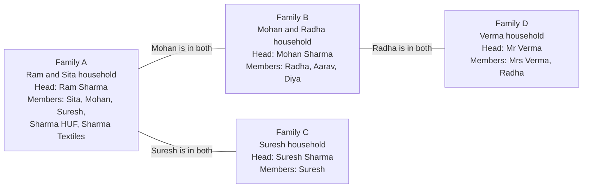
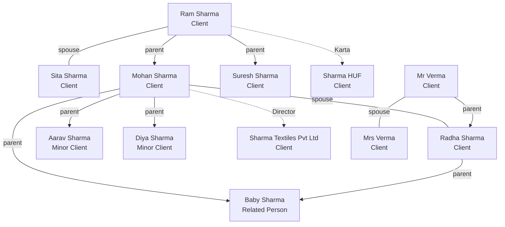
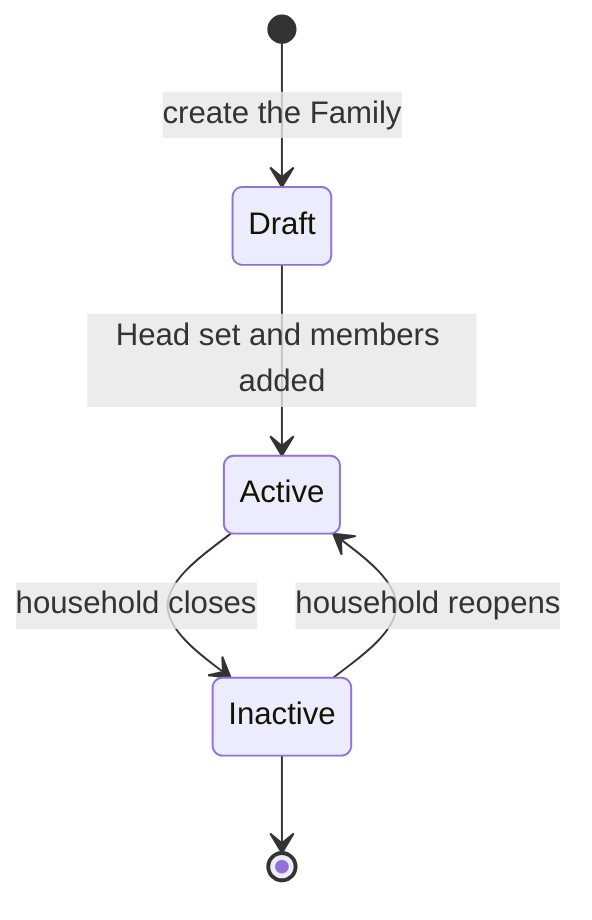

# Family

Status: Draft. Last updated: 2026-11-16.

This page explains how Dhanada groups Client and Related Person records into a household. A Family is an employee tool. It is not a legal entity.

## In plain words

A **Family** groups Parties who belong together. Ram, his wife, their sons, the family HUF, and the family company can sit in one Family.

The Family is a label for employees. It has no PAN, no bank account, and no assets. It cannot own an Investment. It is not a Client.

A Family can hold several generations. Mohan is a member of his father's Family and the head of his own Family. The link between the two Families is Mohan himself. Dhanada derives that link. It does not store a family tree.

A Family can also contain a Party who is not a Client, such as a newborn, a spouse who has not onboarded, or an elderly parent.

## How it works

| Record | What it does |
|---|---|
| Family | The group. It has a name, a code, a Head, and a status. |
| Family Membership | One link between one Party and one Family. It carries a role and a status. |
| Client.primary_family | The Client's own household. It is one pointer on the Client. |

A membership links a **Party**, not a Client. This is the key rule. It lets the Family show a baby before the baby has a Client record. When the Party gets a Client record, the membership does not change. The system fills the optional Client link.

### Membership

- A Party may have no Family.
- A Party may belong to more than one Family.
- A Client has at most one primary Family. The primary Family is the Client's own household.
- A member can be a Client or a Related Person.
- A non-client member has no KYC, no login, no Investment, and no AUM.
- Membership is back-office only. A client does not see it in phase 1.
- Membership has a role and an active or inactive status.
- Only the current state is kept. Inactive rows stay for reference. The system does not keep a full membership history.
- The membership links a Party. When the Party gets a Client record, the membership is unchanged.

The newborn case is the reason for the Party link. KNAPS knows the baby from day one. The baby has a name, a date of birth, and a place in the family. The baby has no PAN, no KYC, and no reason to be a Client yet. A Client record is created only when the family opens an Investment for the baby.

Worked example: [newborn in the family](../04-scenarios/newborn-in-family.md).

### Family Head

- Every Active Family has one Head. The Head is mandatory.
- The Head must be an Individual Client and an active member of the Family.
- A Client can head at most one active Family.
- The Head must head their **primary** Family. A Client cannot head a Family that is not their primary Family.
- An employee chooses the Head.
- The Head is a coordination label. Employees call the Head to coordinate the household.
- The Head label does not grant ownership of Family assets. It does not grant access to another member's data.

A Family cannot become Active without a Head. Build the Family first with status Draft, add the members, then set the Head and move to Active. A Family with no Client member stays in Draft.

### Lineage

Lineage comes from shared Parties. A Party who belongs to two Families links them. The system stores no parent-family field.

| Family | Head | Members | Link to the next generation |
|---|---|---|---|
| Family A | Ram Sharma | Sita, Mohan, Suresh, Sharma HUF, Sharma Textiles | Mohan is also in Family B. Suresh is also in Family C. |
| Family B | Mohan Sharma | Radha, Aarav, Diya, Baby Sharma (Related Person) | Radha is also in Family D. |
| Family C | Suresh Sharma | Suresh | Suresh is also in Family A. |
| Family D | Mr Verma | Mrs Verma, Radha | Radha is also in Family B. |

Each generation has its own Family. The employee sees the chain through the shared Parties. The full example is in [The Sharma family](../04-scenarios/sharma-family.md).

### Entity members

An HUF, company, or trust can be a Family member. The entity is the Client. The Karta, director, or trustee is a related party of the entity.

Entity Investments belong to the entity Client. Report them on a separate **Entity AUM** line. Never add them to the personal Family total. Otherwise the same money appears twice and the report hides who owns it.

Worked example: [company and HUF](../04-scenarios/company-and-huf.md).

## Employee family view

Employees need two views of the same data. Both are derived from Family, Family Membership, and Party Relationship. Neither view needs a new DocType.

### Families as nodes

This is the default view. Each node is a Family. Each line is a Party who belongs to two Families.

The screen shows a list first:

| Family | Head | Members | Linked by | Personal AUM | Entity AUM |
|---|---|---|---|---|---|
| Family A | Ram Sharma | 6 Clients | Mohan, Suresh | ₹1.36 Cr | ₹1.68 Cr |
| Family B | Mohan Sharma | 4 Clients + 1 Related Person | Mohan, Radha | ₹59.00 L | None |
| Family C | Suresh Sharma | 1 Client | Suresh | ₹12.00 L | None |
| Family D | Mr Verma | 3 Clients | Radha | ₹92.00 L | None |

Open Family A and the card shows:

- The Head, with a link to the Client record.
- Each member with role, status, and personal value.
- A **Related Person** badge on a member who is not a Client. Baby Sharma is an example.
- Entity members with the role that links them: Karta, Director.
- Links to other Families: "Mohan Sharma is also in Family B".
- Primary RM and notes.

### People as nodes

This is a read-only map. It answers "how are these people related?" Each node is a Party or Client. Solid lines are relationships. Dashed lines are roles.

Sita is also a parent of Mohan and Suresh. The line is left out to keep the drawing readable. The record exists.

Baby Sharma is a Related Person. The node shows the **Related Person** badge and no client code. The parent lines exist from birth. A guardian is not shown, because a guardian exists only on a Holding.

The map opens from a Client or a Family. It shows two hops from the centre. Each node shows name, client code, type, and status. A node the employee cannot read shows as **Restricted**.

### Why not a Frappe Tree DocType

A Tree DocType gives each record one parent. A family is a graph.

- Mohan has two parents, Ram and Sita.
- Radha has two parents, Mr and Mrs Verma.
- Mohan belongs to Family A and Family B.
- Radha belongs to Family B and Family D.

A tree allows one parent per record. To fit the Sharma family into a tree, you must duplicate memberships or pick one parent. Both choices corrupt the data.

Use a Tree DocType for the employee and Team hierarchy. Keep Family flat.

## Lifecycle

- A Family starts as Draft.
- A Family cannot become Active without a Head.
- A Family with no Client member stays in Draft.
- An Inactive Family keeps its memberships.
- A Family is never deleted.

## Rules and invariants

1. A Party may belong to zero or many Families.
2. A Client has at most one primary Family.
3. A primary Family must contain the Client as an active member.
4. An Active Family has exactly one Head.
5. The Head must be an active Client member, an Individual, and the Head of their primary Family.
6. A Client heads at most one active Family.
7. A Family cannot own an Investment.
8. A Family cannot be a Client.
9. A Family membership links a Party. A non-client member has no KYC, Investment, or AUM.
10. When a Party gets a Client record, the membership row does not change.
11. Lineage is derived from shared Parties. No parent-family field is stored.
12. Entity Investments are never added to the personal Family total.
13. Client reports are holding-based. They do not use the Family view.
14. Family records are not hard deleted. Use status.

## Who can see or change it

### Phase 1

- Employees see Family data by role and Client Assignment.
- The Family Head label does not open data to a client.
- A client cannot log in. There is no client-facing Family view.
- No Family record carries a consent flag in phase 1.
- The two family views follow the same access rules. A node the employee cannot read shows as **Restricted**.
- An employee can always see that a Party is a member. The member value, Holdings, and PII follow the access rules.

### Portal phase

The portal adds one client-facing rule: a Client can see another Client's Family data only with a **Visibility Grant**. A grant records the grantor, the grantee, the scope, the purpose, the consent date, the expiry date, and the evidence.

The grant record is designed but not built in phase 1. The scope question is OQ-006 and the consent question is OQ-029.

The full role matrix is in [Access and audit](09-access-and-audit.md).

## Records and fields

| Record | Purpose | Key links |
|---|---|---|
| Family | Grouping of Parties. | Head Client |
| Family Membership | Link between a Party and a Family. | Family, Party, optional Client |
| Visibility Grant | Portal phase only. Consent for one Client to see another Client's data. | Family, Client, Client |

Full field list: Family

| Field | Type | Required | Notes |
|---|---|---|---|
| name | Data (UUID) | Yes | Internal key. |
| family_code | Data | Yes | Unique. Format `FAM-000001`. |
| family_name | Data | Yes | Name shown to employees. |
| status | Select | Yes | Draft, Active, Inactive. |
| head | Link (Client) | Yes | Required before the Family becomes Active. Must be an active Individual Client member. The Head must head their primary Family. |
| primary_rm | Link (User) | No | Default RM for the Family. |
| legacy_id | Data | No | Old ID from a migrated system. |
| notes | Small Text | No | Internal notes. |

Rules:

- A Family has no PAN, no KYC, no bank account, and no Holding.
- A Family starts as Draft and becomes Active only when a Head is set.
- A Family has one active Head. The Head is a required field.
- The Head must be an active Family member and an Individual Client.
- A Client heads at most one active Family.
- The Head must head their **primary** Family. A Client cannot head a second Family that they joined by marriage or by membership.
- A Family with no Client member stays in Draft, because it has no valid Head.
- The Head role does not grant ownership or data access.
- A Family is not hard deleted. Use status.
- A Family has no consent field in phase 1.

Full field list: Family Membership

| Field | Type | Required | Notes |
|---|---|---|---|
| name | Data (UUID) | Yes | Internal key. |
| family | Link (Family) | Yes | Parent Family. |
| party | Link (Party) | Yes | Member. A Client or a Related Person. |
| client | Link (Client) | No | Read-only. Filled when the Party has a Client record. |
| role | Select | Yes | Head, Spouse, Child, Parent, Sibling, HUF, Family Business, Family Trust, Dependent, Beneficiary, Other. |
| status | Select | Yes | Active, Inactive. |
| joined_on | Date | No | Date the Party joined the Family. |
| left_on | Date | No | Date the Party became inactive. |
| notes | Small Text | No | Internal notes. |

Rules:

- Unique on `family` and `party`. One Party appears once in a Family.
- One active Head role per Family. It must match `Family.head`.
- The Head must have an active membership and must be a Client.
- A Party can have many memberships.
- A Client has one primary Family on the Client record. The primary Family must have an active membership.
- A non-client member has no KYC, no login, no Holding, and no AUM.
- A non-client member shows a **Related Person** badge in the family view and a **Create Client** action.
- When the Party gets a Client record, fill `client`. Do not create a second membership row.
- An inactive membership stays for reference. Do not keep a full membership history.
- Family counts and Family AUM include Clients only. A non-client member is never counted in AUM.

Full field list: Visibility Grant (portal phase, not built in phase 1)

| Field | Type | Required | Notes |
|---|---|---|---|
| name | Data (UUID) | Yes | Internal key. |
| family | Link (Family) | Yes | Family in scope. |
| grantor | Link (Client) | Yes | Client who gives consent. |
| grantee | Link (Client) | Yes | Client who receives access. |
| scope | Select | Yes | Family Summary, Family Holdings, Selected Holdings. |
| selected_holdings | Table (Visibility Grant Holding) | Conditional | Required when scope is Selected Holdings. |
| purpose | Data | Yes | Why the access is needed. |
| consent_date | Datetime | Yes | When consent was given. |
| expiry_date | Date | No | Optional end date. |
| status | Select | Yes | Active, Revoked, Expired. |
| evidence | Attach | No | Consent proof. Private file. |
| revoked_on | Datetime | No | When access was revoked. |
| revoked_by | Link (User) | No | Employee who recorded the revocation. |
| notes | Small Text | No | Internal notes. |

Rules:

- Grantor and grantee must be different Clients.
- Both must be active members of the Family.
- The grantee is normally the Family Head.
- An adult Client gives consent. A Guardian gives consent for a minor. An Authorized Signatory or Karta gives consent for an entity.
- A grant can be revoked at any time.
- An expired grant is read-only.
- The portal, when built, must check this record before showing another Client's data.
- Employees do not use Visibility Grant. They follow role-based access.

## Decisions and open questions

| Topic | Status | Decision | Record |
|---|---|---|---|
| Family | Decided | A grouping, never a legal entity. | [ADR-0002](../03-reference/decisions/adr-0002-family-model.md) |
| Membership | Decided | Many Families per Party, with one primary Family. | ADR-0002 |
| Membership scope | Decided | Back-office only. Current state with active and inactive members. | ADR-0002 |
| Family Head | Decided | Mandatory on every Active Family. Must be an Individual Client. | [ADR-0005](../03-reference/decisions/adr-0005-family-scope-and-employee-view.md) |
| Family view | Decided | Families as nodes by default, plus a two-hop people map. | ADR-0005 |
| Lineage | Decided | Derived from Parties who are members of more than one Family. | ADR-0005 |
| Membership by Party | Decided | A membership links a Party, not a Client. | [ADR-0006](../03-reference/decisions/adr-0006-family-membership-by-party.md) |
| Family data access | Decided | Employees only in phase 1. Client consent comes with the portal. | ADR-0005 |
| Entity AUM | Decided | Reported on a separate line, never added to the personal total. | [ADR-0008](../03-reference/decisions/adr-0008-client-reports-are-holding-based.md) |
| Portal consent | Open | When is the portal planned, and how is consent captured? | OQ-029 |
| Head visibility | Deferred | Does the Head see detailed holdings or only totals? | OQ-006 |
| POA | Deferred | POA is out of phase 1. | OQ-014 |

## Worked example

The Sharma family has four Families and three generations.

| Family | Head | Members |
|---|---|---|
| Family A | Ram Sharma | Sita, Mohan, Suresh, Sharma HUF, Sharma Textiles |
| Family B | Mohan Sharma | Radha, Aarav, Diya, Baby Sharma (Related Person) |
| Family C | Suresh Sharma | Suresh |
| Family D | Mr Verma | Mrs Verma, Radha |

Mohan and Suresh link Family A to Family B and Family C. Radha links Family B to Family D. The links are the people, not stored parent Families.

Family A reports personal AUM and entity AUM on two lines. The HUF and the company are never added to the personal total.

Full story: [The Sharma family](../04-scenarios/sharma-family.md). Related rules: [Party and Client](01-party-and-client.md) and [Related parties and ownership](03-related-parties-and-ownership.md).
