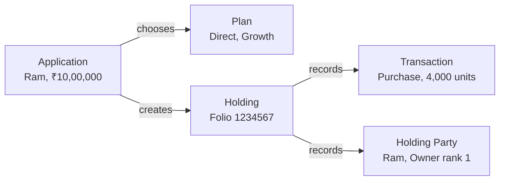

# Products and providers

Status: Proposed. Last updated: 2026-11-16. OQ-017 and OQ-018 are open.

This page explains how Dhanada describes what KNAPS can sell, and how that catalog becomes a Holding. It covers every product family in phase 1.

## In plain words

KNAPS sells more than one kind of product. A mutual fund, a life policy, a bank fixed deposit, and a post office scheme behave differently. Employees still need one list of what a Client owns.

Dhanada uses one **Product** catalog and one **Holding** record for every line. The details that belong to one category sit in a separate detail record. The employee sees the common parts: Client, Product, Plan, amount, dates, and status.

A simple analogy is a car showroom:

- The manufacturer is the **Provider**.
- The car model is the **Product**.
- The variant is the **Plan**. Petrol or diesel. Manual or automatic. Base or top model.
- The car in your garage is the **Holding**.

You do not build a separate showroom for each variant. You also do not write "fuel type" on the showroom door. You put it on the variant.

## Why a hybrid model

KNAPS works with at least eleven product families:

- Mutual funds (MF)
- Specialised Investment Funds (SIF)
- National Pension System (NPS)
- Life insurance
- Health insurance
- General insurance
- Bank and NBFC fixed deposits
- Government of India bonds
- Post office and small savings schemes
- Portfolio Management Services (PMS)
- Alternative Investment Funds (AIF)

Each family has facts the others do not need:

| Product | Facts that matter |
|---|---|
| Mutual fund | ISIN, units, NAV, exit load, expense ratio |
| Fixed deposit | Interest rate, tenure, payout, maturity date, premature penalty |
| Life insurance | Sum assured, premium, policy term, nominee, riders |
| NPS | PRAN, tier, scheme E or C or G, fund manager, units, NAV |
| Post office MIS | Account number, monthly payout, rate, maturity |

If one table held all of these, most columns would be empty on every row. The entry form would confuse employees and validation would be weak.

| Option | What it means | Result |
|---|---|---|
| One big table | Every field for every product in one DocType | Sparse data, weak rules, a long confusing form |
| One table per family | A separate MF record, FD record, policy record, and so on | Twelve portfolios, twelve reports, duplicated application and commission logic |
| Common spine plus detail | One Product and Plan spine, one detail record per family | One portfolio, clean category fields, one application flow |

Dhanada uses the third option. It is called a **hybrid** model because it mixes a shared core with category records.

## The five records

| Record | Answers the question | Example |
|---|---|---|
| Provider | Who makes or manages it? | HDFC Asset Management Company |
| Product | Which product family is it? | HDFC Flexi Cap Fund |
| Plan | Which exact version can the Client buy? | Direct, Growth |
| Category Detail | What else does this family need? | ISIN, benchmark, expense ratio |
| Holding | What does the Client own now? | Folio 1234567, 4,000 units |

A Client buys a Plan, never a bare Product. The Holding points to the Plan. The Plan has one category detail record.

`Rate Card` and `NAV History` hold time-based values. They are history rows, not edits.

## How a purchase flows

1. The employee picks a Plan. The category detail decides which fields the form shows.
2. The Application stores a snapshot of the provider, product, and plan names.
3. On issue, the Holding is created. It copies the deal terms.
4. The first Transaction records the money and units.
5. Holding Party records the owners, nominee, and guardian.

The Application, Holding, and Transaction records are in [Holdings and investments](06-holdings-and-investments.md). Ownership roles are in [Related parties and ownership](03-related-parties-and-ownership.md).

## Category catalog

| Family | Provider type | Main identifier | Value driver | Changes over time | Phase 1 |
|---|---|---|---|---|---|
| Mutual fund | AMC | Folio, ISIN | Units × NAV | Daily NAV | Full |
| SIF | AMC | Folio, ISIN | Units × NAV | Daily NAV | Full |
| NPS | NPS | PRAN | Units × NAV per scheme | Daily NAV | Full |
| Life insurance | Insurer | Policy number | Surrender or fund value | Premium, bonus, fund value | Full policy record |
| Health insurance | Insurer | Policy number | Cover, not AUM | Renewal, premium | Full policy record |
| General insurance | Insurer | Policy number | Cover, not AUM | Renewal, premium | Full policy record |
| Bank or NBFC FD | Bank, NBFC | Receipt number | Principal plus accrued interest | Rate card | Full |
| Government bond | RBI, bank | ISIN | Price plus accrued interest | Price, yield | Holding and coupon |
| Post office | India Post | Account number | Deposit plus accrued interest | Rate notification | Full |
| PMS | PMS manager | Account number | Manager valuation | Monthly or quarterly | Holding and statement |
| AIF | AIF manager | Account number | Manager valuation | Quarterly | Holding and statement |

A term or health policy is protection. Do not add the sum assured to AUM. Use the surrender value or fund value for a life policy, and show cover separately for health and general insurance.

### Where each fact lives

| Fact | Record | Why |
|---|---|---|
| Who makes it | Provider | One provider sells many products. |
| Product name and category | Product | Shared by every plan under it. |
| Direct or Regular | Plan | A buyable choice. |
| Tenure and payout | Plan | A buyable choice. |
| ISIN, benchmark, expense ratio | MF Detail | Only mutual funds need them. |
| Interest rate by date | Rate Card | Rates change without changing the product. |
| NAV by date | NAV History | Values change every day. |
| Sum assured and premium | Insurance Detail | Only insurance needs them. |
| Who owns the Holding | Holding Party | Ownership is separate from the product. |
| What was bought | Holding | The Client's position. |

## Rate cards and NAV

- `Rate Card` holds effective dates, tenure range, rate, senior citizen rate, and payout frequency. Use it for FD and post office.
- `NAV History` holds date, NAV, and source. Use it for MF, SIF, NPS, PMS, and AIF.
- A valuation uses the latest NAV or the accrued value at the valuation date.
- Manual entry is allowed in phase 1.
- A new rate or NAV is a new row. Do not edit an old row.

## What changes over time

| Change | What to do | What not to do |
|---|---|---|
| Interest rate changes | Add a Rate Card row with a new effective date | Do not edit the old rate |
| NAV changes | Add a NAV History row | Do not overwrite the last NAV |
| Provider stops a plan | Set Plan status to Closed to New Business | Do not delete the plan |
| Product is withdrawn | Set Product status to Discontinued | Do not delete the product |
| Plan terms change | Create a new Plan | Do not edit a Plan that Holdings use |

A Holding is a record of a deal. The deal keeps its terms. See the snapshot rule in [Holdings and investments](06-holdings-and-investments.md#the-snapshot-rule).

## What the employee and the website see

### Employee

1. **Product list.** Search by name, provider, or category. Show the plan count and status.
2. **Product form.** Common fields, plus a category tab with the detail record.
3. **Plan form.** Buyable options, tenure, amount limits, rate or NAV, and status.
4. **Application.** Pick a Plan. The form shows only the fields that family needs.
5. **Holding.** Pick a Plan. The form asks for the provider reference, dates, amount, and holders.
6. **Product 360.** Who holds this plan, total value, and upcoming maturities.

The employee never picks a category detail directly. The Plan selects it.

### Website

The public website reads Product and Plan only:

- Product name, provider, category, description, risk level.
- Plan options, minimum amount, current rate, latest NAV.
- A brochure or one-page summary.

The website never reads a Holding, a Client, or a Family. An "I am interested" button creates a Lead with the Plan attached. This keeps public pages fast and keeps client data out of the public tier.

## Phase 1 scope

- All product categories in the catalog and in Holdings.
- Full product detail per category. The depth per category is in the question bank.
- Manual transaction entry for every category.
- Rate cards for FD and post office.
- NAV for MF, SIF, and NPS when available.
- PMS and AIF: Holdings and statements only.
- Insurance: chosen plan and policy record only. No quotes, illustrations, or comparison.
- Website product pages read Product and Plan only.
- No order placement.

## Trade-offs

- More records than one wide table.
- The employee must pick the right Plan.
- Every Plan needs its category detail filled in.
- Reports join the spine to the detail when they need category facts.

The gain is one portfolio, one application flow, one commission model, and clean fields for each product family.

## Rules and invariants

1. Every Product has at least one Plan before it can be sold.
2. Every Plan has exactly one category detail record.
3. A Holding points to exactly one Plan.
4. A Holding keeps a snapshot of the key terms at the start: plan name, provider name, rate, tenure, sum assured, and amount.
5. A Plan is never deleted. Use status.
6. A Rate Card or NAV row is never edited. Add a row.
7. The website reads Product and Plan only.
8. A category detail holds product facts, never Client identity.
9. An Application and a Holding link to the same Plan. A later Plan change does not rewrite history.
10. A Provider can also be a Distribution Partner. Keep the two roles separate.
11. Do not put category-specific fields in Product.

## Records and fields

| Record | One row means | Example |
|---|---|---|
| Provider | One legal organization | HDFC Asset Management Company |
| Product | One product family | HDFC Flexi Cap Fund |
| Plan | One buyable version | Direct, Growth |
| Category Detail | The extra fields for one Plan | ISIN, benchmark, expense ratio |
| Rate Card | One rate for one period and tenure band | 8.15%, 24 to 36 months, Apr to Jun 2026 |
| NAV History | One NAV for one date | ₹300 on 30 June 2026 |

Full field list: Provider

| Field | Type | Required | Notes |
|---|---|---|---|
| name | Data (UUID) | Yes | Internal key. |
| provider_code | Data | Yes | Unique. Example `PRV-HDFC-AMC`. |
| provider_name | Data | Yes | Legal name. |
| display_name | Data | No | Brand shown in the UI. |
| provider_type | Select | Yes | AMC, Insurer, Bank, NBFC, Post Office, NPS, PMS Manager, AIF Manager, National Distributor, Other. |
| amfi_code | Data | No | AMC only. |
| irdai_registration | Data | No | Insurer only. |
| sebi_registration | Data | No | PMS, AIF, or distributor. |
| cin | Data | No | Company identity. |
| gstin | Data | No | Tax identity. |
| status | Select | Yes | Active, Suspended, Exited. |
| empanelled_on | Date | No | Start of the relationship. |
| exited_on | Date | No | End of the relationship. |
| commission_payer | Check | No | Provider pays commission directly. |
| website | Data (URL) | No | Public site. |
| portal_url | Data (URL) | No | Employee portal. Never store a password. |
| notes | Small Text | No | Internal notes. |

Rules:

- One Provider per legal entity. Use `display_name` for a brand.
- A national distributor can also be a Distribution Partner. Keep the roles separate.
- A Provider with existing Holdings is not deleted. Use status.

Full field list: Product

| Field | Type | Required | Notes |
|---|---|---|---|
| name | Data (UUID) | Yes | Internal key. |
| product_code | Data | Yes | Unique. Example `PRD-MF-0001`. |
| product_name | Data | Yes | Provider name plus the product family. |
| display_name | Data | No | Short name for the UI. |
| provider | Link (Provider) | Yes | Who offers it. |
| category | Select | Yes | Mutual Fund, SIF, NPS, Life Insurance, Health Insurance, General Insurance, Bank FD, NBFC FD, Government Bond, Post Office, PMS, AIF, Other. |
| status | Select | Yes | Active, Discontinued. |
| risk_level | Select | No | Low, Moderate, High, Very High. |
| minimum_amount | Currency | No | Default for the product. A Plan can override. |
| maximum_amount | Currency | No | Default for the product. A Plan can override. |
| tax_treatment | Select | No | EEE, EET, Taxable, Partly Taxable, Not Applicable. |
| description | Text | No | Website and internal use. |
| public_summary | Small Text | No | Short text for the website. |
| website_visible | Check | No | Show on the public site. |
| brochure | Attach | No | Private file. Public link is separate. |
| tags | Table (Product Tag) | No | Tax saving, retirement, child, liquidity. |
| notes | Small Text | No | Internal notes. |

Rules:

- Do not put category-specific fields in Product.
- A Product needs at least one active Plan before it can be sold.
- A Product with Holdings is never deleted. Use status.

Full field list: Plan

| Field | Type | Required | Notes |
|---|---|---|---|
| name | Data (UUID) | Yes | Internal key. |
| plan_code | Data | Yes | Unique. Example `PLN-000001`. |
| product | Link (Product) | Yes | Parent product. |
| plan_name | Data | Yes | Shown to employees. |
| variant | Data | No | Direct, Regular, Tier I, Cumulative, Base, Rider. |
| option | Data | No | Growth, IDCW Payout, IDCW Reinvestment, 3 Years, Annual Premium. |
| status | Select | Yes | Active, Closed to New Business, Matured. |
| minimum_amount | Currency | No | Overrides the Product value. |
| maximum_amount | Currency | No | Overrides the Product value. |
| tenure_months | Int | No | Fixed term. Blank for open-ended. |
| lock_in_months | Int | No | Minimum holding period. |
| payout_frequency | Select | No | None, Monthly, Quarterly, Half-Yearly, Yearly, At Maturity. |
| rate_type | Select | No | Fixed, Floating, Market Linked, Not Applicable. |
| website_visible | Check | No | Show on the public site. |
| effective_from | Date | No | Start of these terms. |
| effective_to | Date | No | End of these terms. |
| notes | Small Text | No | Internal notes. |

Rules:

- A Plan belongs to one Product.
- A Plan has exactly one category detail record.
- A Plan used by a Holding is never edited in a way that changes the deal terms. Create a new Plan instead.
- A closed Plan stays readable.

Full field lists: category detail records

Each detail record is linked one-to-one to a Plan. The detail holds only the facts for that family.

#### Mutual fund and SIF detail

| Field | Type | Required | Notes |
|---|---|---|---|
| plan | Link (Plan) | Yes | Unique. |
| isin | Data | Yes | Plan-level ISIN. |
| amfi_code | Data | No | Scheme code. |
| rta_code | Data | No | Registrar code. |
| scheme_category | Select | Yes | Large Cap, Flexi Cap, Mid Cap, Small Cap, Debt, Hybrid, Index, Long-Short, Sectoral, Thematic, Other. |
| strategy | Small Text | No | SIF only. |
| benchmark | Data | No | Index name. |
| expense_ratio | Percent | No | Current total expense ratio. |
| exit_load | Small Text | No | Rule and period. |
| fund_manager | Data | No | One or more names. |
| riskometer | Select | No | Low, Moderate, High, Very High. |
| scheme_aum | Currency | No | Size of the scheme. |
| idcw_frequency | Select | No | None, Monthly, Quarterly, Yearly. |

#### Fixed deposit detail

| Field | Type | Required | Notes |
|---|---|---|---|
| plan | Link (Plan) | Yes | Unique. |
| deposit_type | Select | Yes | Bank, NBFC, Corporate. |
| compounding | Select | No | Simple, Monthly, Quarterly, Half-Yearly, Yearly. |
| premature_penalty | Percent | No | Penalty on early withdrawal. |
| loan_allowed | Check | No | Loan against the deposit. |
| tds_applicable | Check | No | Tax deducted at source. |
| senior_citizen_rate | Percent | No | Default, if not on the Rate Card. |
| auto_renewal_allowed | Check | No | Renewal at maturity. |

#### Insurance detail

| Field | Type | Required | Notes |
|---|---|---|---|
| plan | Link (Plan) | Yes | Unique. |
| insurance_type | Select | Yes | Term, Endowment, Money Back, ULIP, Health, Motor, Home, Travel, Other. |
| sum_assured | Currency | Conditional | Life and health. |
| premium_amount | Currency | Conditional | One period. |
| premium_frequency | Select | No | Monthly, Quarterly, Half-Yearly, Yearly, Single. |
| policy_term_months | Int | No | Term of cover. |
| waiting_period_months | Int | No | Health. |
| room_rent_limit | Data | No | Health. |
| network_hospitals | Small Text | No | Health. |
| riders_allowed | Check | No | A rider is a separate Plan. |
| claim_ratio | Percent | No | Provider claim ratio. |
| surrender_value | Currency | No | Current surrender value. |
| maturity_value | Currency | No | Expected maturity value. |
| insured_asset_type | Data | No | Car, home, shop, travel. |

#### NPS detail

| Field | Type | Required | Notes |
|---|---|---|---|
| plan | Link (Plan) | Yes | Unique. |
| tier | Select | Yes | Tier I, Tier II. |
| scheme_option | Select | Yes | E, C, G, E+C+G, Active Choice, Auto Choice. |
| fund_manager | Data | No | Manager for the scheme. |
| asset_allocation | Small Text | No | Equity, corporate bond, government bond split. |
| annuity_option | Select | No | Not Applicable, Spouse, Child, Both. |
| employer_allowed | Check | No | Corporate NPS. |

#### PMS and AIF detail

| Field | Type | Required | Notes |
|---|---|---|---|
| plan | Link (Plan) | Yes | Unique. |
| strategy | Data | Yes | Strategy name. |
| benchmark | Data | No | Index or custom benchmark. |
| minimum_investment | Currency | Yes | Eligibility. |
| lock_in_months | Int | No | Lock-in. |
| management_fee | Percent | No | Fixed fee. |
| performance_fee | Percent | No | Profit share. |
| aif_category | Select | No | Category I, Category II, Category III, Not Applicable. |
| commitment_amount | Currency | No | AIF commitment. |
| drawdown_terms | Small Text | No | How the manager calls capital. |

#### Post office detail

| Field | Type | Required | Notes |
|---|---|---|---|
| plan | Link (Plan) | Yes | Unique. |
| scheme_type | Select | Yes | RD, TD, MIS, SCSS, NSC, KVP, PPF, SSY. |
| default_rule | Small Text | No | Missed instalment. |
| penalty_rule | Small Text | No | Premature closure. |
| agent_required | Check | No | Agent code at entry. |
| nomination_required | Check | No | Nomination at opening. |
| extension_allowed | Check | No | Maturity extension. |

#### Government bond detail

| Field | Type | Required | Notes |
|---|---|---|---|
| plan | Link (Plan) | Yes | Unique. |
| bond_type | Select | Yes | GoI Dated, Treasury Bill, Sovereign Gold Bond, State Development Loan, Other. |
| isin | Data | Yes | Market identifier. |
| face_value | Currency | Yes | Per unit or per bond. |
| coupon_rate | Percent | Conditional | Blank for a T-Bill. |
| coupon_frequency | Select | No | Half-Yearly, Yearly, At Maturity. |
| maturity_date | Date | Yes | Redemption date. |
| taxable | Check | No | Interest is taxable. |
| issue_price | Currency | No | Price at issue. |
| grams_per_unit | Decimal | No | SGB only. |

Full field list: Rate Card

| Field | Type | Required | Notes |
|---|---|---|---|
| name | Data (UUID) | Yes | Internal key. |
| plan | Link (Plan) | Yes | Parent plan. |
| effective_from | Date | Yes | Start date. |
| effective_to | Date | No | End date. Blank means current. |
| tenure_from_months | Int | No | Lower bound. |
| tenure_to_months | Int | No | Upper bound. |
| general_rate | Percent | Yes | Standard rate. |
| senior_citizen_rate | Percent | No | Rate for eligible holders. |
| payout_frequency | Select | No | Cumulative or periodic. |
| source | Data | No | Circular or provider page. |
| notes | Small Text | No | Internal notes. |

Rules:

- Two rows for the same Plan must not overlap on date and tenure band.
- A row is never edited after it is used by a Holding. Add a new row.
- The Holding stores the rate it was opened at.

Full field list: NAV History

| Field | Type | Required | Notes |
|---|---|---|---|
| name | Data (UUID) | Yes | Internal key. |
| plan | Link (Plan) | Yes | Parent plan. |
| nav_date | Date | Yes | Value date. |
| nav | Currency | Yes | Unit price. |
| source | Data | No | AMFI, AMC, NPS Trust, manual. |

Rules:

- Unique on `plan` and `nav_date`.
- A row is never edited. Add a new row.
- The Holding stores the NAV used for its current value, plus the date.

### Category recording guide

One example and the phase 1 depth per family

#### 1. Mutual fund

**In plain words.** Many investors pool money. A professional manager buys shares or bonds with the pool. Each investor owns units. The unit price is the NAV. The value is units multiplied by NAV.

**Example.** Ram invests ₹10,00,000 in HDFC Flexi Cap Fund, Direct plan, Growth option. He gets folio 1234567. On the allotment date the NAV is ₹250. He receives 4,000 units. Later the NAV is ₹300. His value is ₹12,00,000.

**Identifier.** Folio number. The plan carries the ISIN and the AMFI scheme code.

**Phase 1 depth.** Full. The employee enters units and NAV manually. A feed can come in phase 2.

**Decisions needed.** P-035 to P-046. See [Product question bank](../03-reference/product-question-bank.md).

#### 2. Specialised Investment Fund (SIF)

**In plain words.** A SIF is a SEBI product for strategies that a normal mutual fund cannot run, such as long-short equity or concentrated sector bets. It has a higher minimum investment, usually ₹10,00,000. It behaves like a mutual fund for units and NAV.

**Example.** Mohan invests ₹10,00,000 in an equity long-short SIF. He gets a folio and units. The manager can hold long and short positions. The NAV moves with the strategy.

**Identifier.** Folio and ISIN.

**Phase 1 depth.** Full catalog and Holding. Treat it as a mutual fund with a strategy field. Confirm the current SEBI minimum and lock-in.

**Decisions needed.** P-035 to P-046.

#### 3. National Pension System (NPS)

**In plain words.** NPS is a retirement account. The investor contributes money. The money is split across schemes: E for equity, C for corporate bonds, and G for government bonds. Each scheme has units and a NAV. The investor also chooses a fund manager. At retirement, part of the money buys an annuity.

**Example.** Suresh contributes ₹50,000 a year to Tier I. He chooses 75% Scheme E, 15% Scheme C, and 10% Scheme G, with one fund manager. His PRAN is 110012345678. Each contribution buys units in the three schemes.

**Identifier.** PRAN. Tier I and Tier II are separate Holdings.

**Phase 1 depth.** Full. The employee enters units and NAV. One Holding can carry three scheme sub-rows or three Holdings. Decide in P-073 to P-082.

**Decisions needed.** P-073 to P-082.

#### 4. Life insurance

**In plain words.** The insurer pays a sum assured when the life assured dies, or at maturity, depending on the plan. The owner pays a premium. A term plan pays only on death. An endowment or money-back plan also pays at maturity. A ULIP invests part of the premium in funds, so it has units and a NAV.

**Example.** Ram buys a 20-year term plan with a sum assured of ₹50,00,000. The annual premium is ₹20,000. Sita is the nominee. The policy number is 778812.

**Identifier.** Policy number.

**Phase 1 depth.** Full policy record. No quotes, illustrations, or comparison. Store the current value from the insurer statement.

**Decisions needed.** P-059 to P-072.

**Note on AUM.** A term policy has no surrender value. Do not add the sum assured to AUM. Use the surrender value or fund value.

#### 5. Health insurance

**In plain words.** The insurer pays hospital bills up to a sum insured. The Client pays a premium. The policy covers named members. It is protection, not an asset.

**Example.** Ram and Sita buy a family floater of ₹10,00,000. The annual premium is ₹28,000. The policy covers both of them. It renews each year.

**Identifier.** Policy number.

**Phase 1 depth.** Full policy record and renewal reminder. No claim adjudication. A claim is a Service Request.

**Decisions needed.** P-059 to P-072.

**Note on AUM.** A health policy has no surrender value. It is not AUM. Show the cover separately.

#### 6. General insurance

**In plain words.** Insurance for a car, home, shop, or travel. The insurer pays for damage or loss up to the cover. It is protection, not an asset.

**Example.** Mohan insures his car. The IDV is ₹8,00,000. The annual premium is ₹18,000. The policy number is 445120.

**Identifier.** Policy number.

**Phase 1 depth.** Full policy record and renewal reminder. Motor, home, and travel need a few extra fields.

**Decisions needed.** P-059 to P-072.

**Note on AUM.** A general policy is not AUM.

#### 7. Bank and NBFC fixed deposit

**In plain words.** The Client lends a lump sum to a bank or NBFC for a fixed period at a fixed rate. The provider pays interest. At maturity, the Client gets the principal and the interest. A cumulative deposit pays at maturity. A non-cumulative deposit pays interest at intervals.

**Example.** Sita opens a 36-month cumulative deposit of ₹5,00,000 with Bajaj Finance at 8.15%. The receipt number is 88921. The maturity value is about ₹6,36,000. The rate is fixed for the term.

**Identifier.** Receipt or deposit number.

**Phase 1 depth.** Full. Rate cards are phase 1. Store the rate on the Holding as a snapshot.

**Decisions needed.** P-047 to P-058.

#### 8. Government of India bonds

**In plain words.** The Client lends money to the Government of India or buys a government security. The government pays a coupon at intervals and repays the face value at maturity. A Treasury Bill has no coupon and is bought at a discount. A Sovereign Gold Bond is priced in grams of gold and pays a small coupon.

**Example.** Ram buys ₹5,00,000 of 7.18% GoI securities maturing in 2033. The ISIN is IN0020230085. The coupon is paid twice a year. If he sells before maturity, the price may be above or below face value.

**Identifier.** ISIN.

**Phase 1 depth.** Holding and coupon dates. A price history is useful but not required. Confirm in P-047 to P-058.

**Decisions needed.** P-047 to P-058.

**Note on SGB.** For Sovereign Gold Bonds, store grams, issue price, and the gold price used for valuation. Do not treat it as a rupee bond only.

#### 9. Post office and small savings

**In plain words.** India Post and the government run small savings schemes. A recurring deposit takes a fixed amount each month. A time deposit takes a lump sum. MIS pays monthly income. SCSS is for senior citizens. NSC and KVP grow a lump sum. PPF is a long-term savings account. SSY is for a girl child.

**Example.** Sita, 65, opens SCSS with ₹15,00,000 for five years. The account number is 556677. She receives quarterly interest. The deposit is repaid at maturity.

**Identifier.** Account number.

**Phase 1 depth.** Full. Rate cards are phase 1. RD and PPF need a deposit schedule.

**Decisions needed.** P-093 to P-102.

#### 10. Portfolio Management Service (PMS)

**In plain words.** The Client gives a manager a large sum. The manager runs a portfolio of shares or bonds in the Client's name. The Client owns the securities, but the manager makes the decisions. The minimum is usually ₹50,00,000.

**Example.** Mohan invests ₹75,00,000 in a PMS strategy. The manager sends a monthly statement with the portfolio value and holdings. The Client holds a PMS account, not a mutual fund folio.

**Identifier.** PMS account number.

**Phase 1 depth.** Holding and statement value. Do not rebuild the manager's portfolio in phase 1.

**Decisions needed.** P-083 to P-092.

#### 11. Alternative Investment Fund (AIF)

**In plain words.** An AIF pools money from a small number of large investors. It invests in private companies, real estate, credit, or other strategies. The investor commits a sum and the manager draws it down over time. The minimum is usually ₹1,00,00,000. The money is locked in for years.

**Example.** Radha commits ₹1,00,00,000 to a Category II credit fund. She pays ₹25,00,000 on the first drawdown. The manager values the fund quarterly. She cannot redeem early.

**Identifier.** AIF account number or commitment reference.

**Phase 1 depth.** Holding, commitment, drawdowns, and statement value. No fund accounting.

**Decisions needed.** P-083 to P-092.

## Who can see or change it

Provider, Product, Plan, category detail, Rate Card, and NAV History are master data. Every business role can read them. Only the Dhanada Administrator can change them. The website can read Product and Plan only. The full matrix is in [Access and audit](09-access-and-audit.md).

## Decisions and open questions

| Topic | Status | Decision | Record |
|---|---|---|---|
| Hybrid model | Proposed | One common spine plus one category detail record. | [ADR-0003](../03-reference/decisions/adr-0003-product-model.md) |
| Unit of sale | Proposed | The Plan. A Client never buys a bare Product. | ADR-0003 |
| Rate and NAV history | Proposed | Add rows, never edit history. | ADR-0003 |
| Website scope | Proposed | The website reads Product and Plan only. | ADR-0003 |
| Category depth | Open | Which category details are phase 1? | OQ-018 |
| Legal entity | Open | Which products sit in which legal entity? | OQ-019 |
| Commission | Open | Calculation, reconciliation, or both? | OQ-020 |
| P-001 to P-126 | Open | The product question bank. | [Product question bank](../03-reference/product-question-bank.md) |

## Worked example

### A mutual fund

Ram Sharma invests ₹10,00,000 in a flexi cap fund.

| Step | Record | Value |
|---|---|---|
| 1 | Provider | HDFC Asset Management Company |
| 2 | Product | HDFC Flexi Cap Fund |
| 3 | Plan | Direct, Growth |
| 4 | MF Detail | ISIN, flexi cap category, Nifty 500 benchmark, 0.65% expense ratio, 1% exit load |
| 5 | Holding | Folio 1234567, 4,000 units at NAV ₹250 |

The value is `units × NAV`. New NAV rows arrive over time. The Holding does not change when the NAV changes.

### A fixed deposit

Sita Sharma opens a deposit with Bajaj Finance.

| Step | Record | Value |
|---|---|---|
| 1 | Provider | Bajaj Finance |
| 2 | Product | Bajaj Finance Fixed Deposit |
| 3 | Plan | 36 months, cumulative, non-senior |
| 4 | FD Detail | Compounding quarterly, premature penalty 2%, loan against deposit allowed |
| 5 | Rate Card | 8.15% effective 1 April 2026 to 30 June 2026 |
| 6 | Holding | Receipt 88921, principal ₹5,00,000, rate 8.15%, maturity 2029 |

The rate is copied to the Holding at the start. When the provider changes the card to 8.00%, the old Holding keeps 8.15%. A new deposit uses the new rate.
