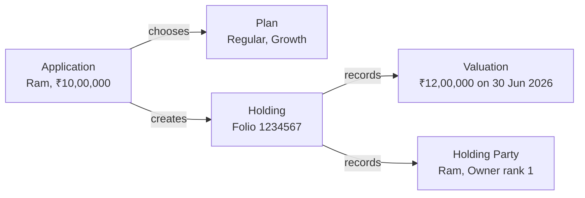

# Products and providers

Status: Proposed. Last updated: 2026-11-16. OQ-017, OQ-018, and OQ-039 are open.

This page explains how Dhanada describes what KNAPS can sell, and how that catalog becomes a Holding. It covers the investment and protection lines. The three referral lines are in [Referrals](10-referrals.md).

## In plain words

KNAPS sells more than one kind of product. A mutual fund, a life policy, a fixed deposit, and a post office scheme behave differently. Employees still need one list of what a Client owns.

Dhanada uses one **Product** catalog and one **Holding** record for every line. The details that belong to one category sit in a separate detail record. The employee sees the common parts: Client, Product, Plan, amount, dates, and status.

A simple analogy is a car showroom:

- The manufacturer is the **Provider**.
- The car model is the **Product**.
- The variant is the **Plan**. Petrol or diesel. Manual or automatic. Base or top model.
- The car in your garage is the **Holding**.

You do not build a separate showroom for each variant. You also do not write "fuel type" on the showroom door. You put it on the variant.

## Three commercial shapes

The book has three shapes. Do not force one shape onto another.

| Shape | Lines | Record | In AUM? |
|---|---|---|---|
| Investment and deposit | MF, SIF, fixed deposits, RBI savings bonds, 54EC bonds, NPS, PMS, AIF, post office | Holding | Yes, with per-family valuation |
| Protection | Life, health, and general insurance | Holding with cover, no asset value | No |
| Referral | Demat, CASA, loans | Referral Case | No |

A referral is not a Product, a Plan, or a Holding. See [Referrals](10-referrals.md).

## Why a hybrid model

KNAPS works with twelve investment and protection lines:

- Mutual funds (MF), regular plans only
- Specialised Investment Funds (SIF), regular plans only
- Fixed deposits: bank, corporate, and NBFC
- RBI Floating Rate Savings Bonds
- 54EC Capital Gains Bonds
- Life insurance
- Health insurance
- General insurance
- National Pension System (NPS): individual, corporate, and Vatsalya
- Portfolio Management Services (PMS)
- Alternative Investment Funds (AIF)
- Post office and small savings schemes

Each family has facts the others do not need:

| Product | Facts that matter |
|---|---|
| Mutual fund | ISIN, units, NAV, exit load, expense ratio |
| Fixed deposit | Issuer type, interest rate, tenure, payout, credit rating, maturity date |
| Life insurance | Sum assured, premium, policy term, nominee, riders |
| NPS | PRAN, tier, scheme E or C or G, fund manager, units, NAV |
| RBI savings bond | Coupon reset, taxable interest, no ISIN, no market price |
| Post office MIS | Account number, monthly payout, rate, maturity |

If one table held all of these, most columns would be empty on every row. The entry form would confuse employees and validation would be weak.

| Option | What it means | Result |
|---|---|---|
| One big table | Every field for every product in one DocType | Sparse data, weak rules, a long confusing form |
| One table per family | A separate MF record, FD record, policy record, and so on | Twelve portfolios, twelve reports, duplicated application logic |
| Common spine plus detail | One Product and Plan spine, one detail record per family | One portfolio, clean category fields, one application flow |

Dhanada uses the third option. It is called a **hybrid** model because it mixes a shared core with category records.

## The five catalog records

| Record | Answers the question | Example |
|---|---|---|
| Provider | Who makes or manages it? | HDFC Asset Management Company |
| Product | Which product family is it? | HDFC Flexi Cap Fund |
| Plan | Which exact version can the Client buy? | Regular, Growth |
| Category Detail | What else does this family need? | Scheme category, benchmark, expense ratio |
| Holding | What does the Client own now? | Folio 1234567, 4,000 units |

A Client buys a Plan, never a bare Product. The Holding points to the Plan. The Plan has one category detail record.

`Rate Card` and `NAV History` hold time-based values. They are history rows, not edits.

Two records sit beside the catalog and are not part of it:

- **Plan Transaction Rule** holds the per-plan purchase, redemption, SIP, STP, SWP, and switch rules.
- **Distributor Code** holds the firm ARN, APMI, AMC codes, and NBFC codes.

## How a purchase flows

1. The employee picks a Plan. The category detail decides which fields the form shows.
2. The Application stores a snapshot of the provider, product, and plan names.
3. On issue, the Holding is created. It copies the deal terms.
4. A Valuation row records the value at allotment.
5. Holding Party records the owners, nominee, and guardian.

A Holding can also be entered directly at the service desk with a reason. A Transaction record is phase 2. Phase 1 records the position and its value, not the movement.

The Application and Holding records are in [Holdings and investments](06-holdings-and-investments.md). Ownership roles are in [Related parties and ownership](03-related-parties-and-ownership.md).

## Category catalog

| Family | Provider type | Main identifier | Value driver | Changes over time | Phase 1 |
|---|---|---|---|---|---|
| Mutual fund | AMC | Folio, ISIN | Units × NAV | Daily NAV | Full, regular only |
| SIF | AMC | Folio, ISIN | Units × NAV | Daily NAV | Full, regular only |
| Fixed deposit | Bank, Corporate, NBFC | Receipt number | Principal plus accrued interest | Rate card | Full |
| RBI savings bond | RBI, bank | Certificate or ledger number | Principal plus accrued interest | Coupon reset | Full |
| 54EC bond | REC, NHAI, PFC, IRFC | Certificate number | Principal plus accrued interest | Fixed coupon | Full |
| Life insurance | Insurer | Policy number | Surrender or fund value | Premium, bonus, fund value | Full policy record |
| Health insurance | Insurer | Policy number | Cover, not AUM | Renewal, premium | Full policy record |
| General insurance | Insurer | Policy number | Cover, not AUM | Renewal, premium | Full policy record |
| NPS | NPS | PRAN | Units × NAV per scheme | Daily NAV | Full |
| PMS | PMS manager | Account number | Manager valuation | Monthly or quarterly | Holding and statement |
| AIF | AIF manager | Account number | Manager valuation | Quarterly | Holding and statement |
| Post office | India Post | Account number | Deposit plus accrued interest | Rate notification | Full |

A term or health policy is protection. Do not add the sum assured to AUM. Use the surrender value or fund value for a life policy, and show cover separately for health and general insurance.

### Where each fact lives

| Fact | Record | Why |
|---|---|---|
| Who makes it | Provider | One provider sells many products. |
| Product name and category | Product | Shared by every plan under it. |
| Regular variant | Plan | KNAPS sells regular plans only. |
| Tenure and payout | Plan | A buyable choice. |
| ISIN | Plan | A plan-level identifier. Two plans can share an ISIN. |
| Benchmark, expense ratio, riskometer | MF and SIF Detail | Scheme facts, not deal terms. |
| Interest rate by date | Rate Card | Rates change without changing the product. |
| NAV by date | NAV History | Values change every day. |
| Sum assured and premium | Insurance Detail | Only insurance needs them. |
| Who owns the Holding | Holding Party | Ownership is separate from the product. |
| What was bought | Holding | The Client's position. |
| What it is worth on a date | Valuation | The value history. |

## Fixed deposits: one family

Bank, corporate, and NBFC deposits are the same product shape. They differ by issuer, credit quality, and rate. Do not create a separate family for each.

- Use one `Fixed Deposit` category.
- Use `Provider.provider_type` = Bank, Corporate, or NBFC.
- Store the credit rating on the FD detail.
- Store the rate on a Rate Card, and copy the opening rate to the Holding.

A corporate deposit is an FD, not a bond. Do not add NCD or corporate bond fields.

## Bonds: savings bonds only

KNAPS sells two non-traded savings bonds. It does not sell Treasury Bills, State Development Loans, dated GoI securities, or Sovereign Gold Bonds.

| Bond | Identifier | Coupon | Lock-in | Tax |
|---|---|---|---|---|
| RBI Floating Rate Savings Bond | Certificate or ledger number | Floating, resets at intervals | Per scheme | Interest taxable |
| 54EC Capital Gains Bond | Certificate number | Fixed | Five years | Capital gain exempt under Section 54EC; interest taxable |

Both are non-transferable and have no market price. Valuation is principal plus accrued interest. Do not store a traded price, a yield, or grams of gold.

A 54EC bond has an annual investment cap. Store the cap and the tax section on the bond detail, and check the Client's investment for the financial year.

## NPS: three subscriber types

| Subscriber type | Who operates it | Main fields |
|---|---|---|
| Individual | The Client | PRAN, tier, scheme mix, fund manager |
| Corporate | The Client and the employer | Employer name, employer contribution, payroll reference |
| Minor (Vatsalya) | The guardian | PRAN, guardian on the Holding, conversion at majority |

One subscriber can hold Tier I and Tier II. Each is a separate Holding. A scheme switch is a transaction, which is phase 2.

The guardian for a Vatsalya account is a Holding Party role, the same rule as any minor Holding. The role ends on the Client's majority date. See [Minor and guardian](../04-scenarios/minor-and-guardian.md).

## Rate cards and NAV

- `Rate Card` holds effective dates, tenure range, rate, senior citizen rate, and payout frequency. Use it for FD and post office.
- `NAV History` holds date, NAV, and source. Use it for MF, SIF, NPS, PMS, and AIF.
- A valuation uses the latest NAV or the accrued value at the valuation date.
- Manual entry is allowed in phase 1.
- A new rate or NAV is a new row. Do not edit an old row.
- NAV History links to the plan and stores the ISIN when the plan has one. Two plans that share an ISIN can read the same NAV.

## Scheme master and plan rules

AMFI and BSE Star publish the MF and SIF scheme master. Dhanada will have a separate importer and filter for each source in phase 2. The model must fit the file now, so a one-time seed does not have to be rebuilt later.

One row in the scheme master is one sellable plan. A row carries identifiers, purchase and redemption rules, cutoffs, flags, exit load, lock-in, and dates.

### Import rules

1. Keep regular plans. Exclude `Scheme Plan = DIRECT`.
2. Map `Scheme Plan = NORMAL` to `variant = Regular`.
3. Exclude rows whose name ends with `INSURED` and codes that end with `-I`. They are not sold.
4. Keep closed rows in the catalog with `purchase_allowed` set to No.
5. Do not enforce a unique ISIN. Two plans can share one ISIN.
6. Treat a maximum amount of `0` as no limit.
7. Treat an end date of 2049 or 2099 as open-ended.
8. Read `Scheme Name` into product name, option, and IDCW frequency.
9. Keep the raw row in an import staging record. Normalise it into Product, Plan, and Plan Transaction Rule.
10. Do not import benchmark, expense ratio, fund manager, or riskometer from this file. They come from AMFI or the AMC factsheet.

The `L1` transaction-plan rows and the `AMC_IND` column are not yet explained. See OQ-041.

### Column mapping

| Scheme master column | Record | Field |
|---|---|---|
| Unique No | Plan | `provider_row_id` |
| Scheme Code | Plan | `provider_plan_code` |
| RTA Scheme Code | Plan | `rta_scheme_code` |
| AMC Scheme Code | Plan | `amc_scheme_code` |
| ISIN | Plan | `isin` |
| AMC Code | Provider | `amc_code` |
| Scheme Type | Plan | `asset_class` |
| Scheme Plan | Plan | `variant` |
| Scheme Name | Product and Plan | `product_name`, `plan_name`, `option` |
| Purchase Allowed | Plan | `purchase_allowed` |
| Purchase Transaction Mode | Plan Transaction Rule | `mode` |
| Minimum Purchase Amount | Plan Transaction Rule | `minimum_amount` |
| Additional Purchase Amount | Plan Transaction Rule | `minimum_amount` on the Additional Purchase rule |
| Maximum Purchase Amount | Plan Transaction Rule | `maximum_amount` |
| Purchase Amount Multiplier | Plan Transaction Rule | `amount_multiple` |
| Purchase Cutoff Time | Plan Transaction Rule | `cutoff_time` |
| Redemption Allowed | Plan | `redemption_allowed` |
| Redemption Transaction Mode | Plan Transaction Rule | `mode` |
| Minimum Redemption Qty | Plan Transaction Rule | `minimum_units` |
| Redemption Qty Multiplier | Plan Transaction Rule | `unit_multiple` |
| Maximum Redemption Qty | Plan Transaction Rule | `maximum_units` |
| Redemption Amount Minimum | Plan Transaction Rule | `minimum_amount` |
| Redemption Amount Maximum | Plan Transaction Rule | `maximum_amount` |
| Redemption Amount Multiple | Plan Transaction Rule | `amount_multiple` |
| Redemption Cutoff Time | Plan Transaction Rule | `cutoff_time` |
| RTA Agent Code | Plan | `rta_name`, with `rta_agent_code` separate |
| AMC Active Flag | Plan | `amc_active` |
| Dividend Reinvestment Flag | Plan | `idcw_reinvestment_allowed` |
| SIP, STP, SWP, Switch Flag | Plan | `sip_allowed`, `stp_allowed`, `swp_allowed`, `switch_allowed` |
| Settlement Type | Plan | `settlement_code` |
| AMC_IND | Plan | Open. See OQ-041. |
| Face Value | Plan | `face_value` |
| Start Date | Plan | `start_date` |
| End Date | Plan | `end_date` |
| Exit Load Flag and Exit Load | Plan | `exit_load_flag`, `exit_load` |
| Lock-in Period Flag and Period | Plan | `lock_in_flag`, `lock_in_months` |
| Channel Partner Code | Distributor Code | `code_value` |
| ReOpening Date | Plan | `reopening_date` |

## Distributor Code

The firm holds its registrations in one record, not on each Plan.

| Field | Type | Required | Notes |
|---|---|---|---|
| name | Data (UUID) | Yes | Internal key. |
| code_type | Select | Yes | ARN, APMI, AMC Channel Code, RTA Code, NBFC Code, DP Code, Bank Code, Insurer Code, NPS POP Code, Post Office Agent Code, AIF Distributor Code, Other. |
| provider | Link (Provider) | No | Blank for ARN and APMI. |
| code_value | Data | Yes | The code. |
| is_primary | Check | No | One primary ARN and one primary APMI. |
| valid_from | Date | No | Start of validity. |
| valid_to | Date | No | End of validity. |
| status | Select | Yes | Active, Suspended, Expired. |
| notes | Small Text | No | Internal notes. |

Rules:

- One active primary ARN and one active primary APMI.
- One active code per `code_type` and `provider`.
- The AMC channel code is the code the RTA gives KNAPS for that AMC.
- The NBFC code is the code the lender gives KNAPS.
- Do not store a code on a Product or a Plan.

## What changes over time

| Change | What to do | What not to do |
|---|---|---|
| Interest rate changes | Add a Rate Card row with a new effective date | Do not edit the old rate |
| NAV changes | Add a NAV History row | Do not overwrite the last NAV |
| Purchase or redemption is suspended | Set the plan flag to No | Do not delete the plan |
| A plan opens an NFO | Set status to NFO and store the reopening date | Do not create a second plan |
| An NFO closes | Set status to Closed to New Business until the reopening date | Do not delete the plan |
| Provider stops a plan | Set Plan status to Closed to New Business | Do not delete the plan |
| Product is withdrawn | Set Product status to Discontinued | Do not delete the product |
| Plan terms change | Create a new Plan, or add an effective-dated rule | Do not edit a Plan that Holdings use |

A Holding is a record of a deal. The deal keeps its terms. See the snapshot rule in [Holdings and investments](06-holdings-and-investments.md#the-snapshot-rule).

## What the employee and the website see

### Employee

1. **Product list.** Search by name, provider, or category. Show the plan count and status.
2. **Product form.** Common fields, plus a category tab with the detail record.
3. **Plan form.** Buyable options, status, identifiers, transactability flags, exit load, and lock-in.
4. **Plan Transaction Rule.** The purchase, redemption, SIP, STP, SWP, and switch rules.
5. **Application.** Pick a Plan. The form shows only the fields that family needs.
6. **Holding.** Pick a Plan. The form asks for the provider reference, dates, amount, and holders.
7. **Product 360.** Who holds this plan, total value, and upcoming maturities.

The employee never picks a category detail directly. The Plan selects it.

### Website

The public website reads Product, Plan, and the Purchase rule:

- Product name, provider, category, description, risk level.
- Plan options, minimum amount, current rate, latest NAV.
- A brochure or one-page summary.
- Regular plans only. Never show a direct plan.

The website never reads a Holding, a Client, or a Family. An "I am interested" button creates a Lead with the Plan attached. This keeps public pages fast and keeps client data out of the public tier.

## Phase 1 scope

- All twelve investment and protection categories in the catalog and in Holdings.
- Regular plans only.
- Manual product and plan entry. The AMFI and BSE Star importers are phase 2.
- Manual Holding entry and Valuation rows.
- Rate cards for FD and post office.
- NAV for MF, SIF, and NPS when available, entered manually.
- PMS and AIF: Holdings and statements only.
- Insurance: chosen plan and policy record only. No quotes, illustrations, or comparison.
- Website product pages read Product, Plan, and the Purchase rule only.
- No transactions, commission, feeds, or order placement.

## Trade-offs

- More records than one wide table.
- The employee must pick the right Plan.
- Every Plan needs its category detail filled in.
- Reports join the spine to the detail when they need category facts.
- Plan Transaction Rules add a child table, but they stop the Plan form from growing a column for every provider rule.

The gain is one portfolio, one application flow, clean fields for each product family, and a model that accepts the AMFI and BSE Star files without a rebuild.

## Rules and invariants

1. Every Product has at least one Plan before it can be sold.
2. Every Plan has exactly one category detail record.
3. A Holding points to exactly one Plan.
4. A Holding keeps a snapshot of the key terms at the start: plan name, provider name, rate, tenure, sum assured, and amount.
5. A Plan is never deleted. Use status.
6. A Rate Card or NAV row is never edited. Add a row.
7. The website reads Product, Plan, and the Purchase rule only.
8. A category detail holds product facts, never Client identity.
9. An Application and a Holding link to the same Plan. A later Plan change does not rewrite history.
10. A Provider can also be a Distribution Partner. Keep the two roles separate.
11. Do not put category-specific fields in Product.
12. Sell regular plans only. Never create a direct plan.
13. Bank, corporate, and NBFC FDs are one family. Use the Provider type, not a new category.
14. A savings bond is not a traded security. Do not add T-Bill, SDL, or dated GoI fields.
15. Transactability flags are current state. Deal terms are effective-dated and never rewritten.
16. A Referral Case is not a Product or a Holding.
17. Keep the firm codes in Distributor Code, not on the catalog.

## Records and fields

| Record | One row means | Example |
|---|---|---|
| Provider | One legal organization | HDFC Asset Management Company |
| Product | One product family | HDFC Flexi Cap Fund |
| Plan | One buyable version | Regular, Growth |
| Category Detail | The extra fields for one Plan | Scheme category, benchmark, expense ratio |
| Plan Transaction Rule | One rule for one transaction type | Purchase, minimum ₹500, cutoff 14:30 |
| Rate Card | One rate for one period and tenure band | 8.15%, 24 to 36 months, Apr to Jun 2026 |
| NAV History | One NAV for one date | ₹300 on 30 June 2026 |
| Distributor Code | One firm or partner code | ARN, or the NBFC code for Bajaj Finance |

Full field list: Provider

| Field | Type | Required | Notes |
|---|---|---|---|
| name | Data (UUID) | Yes | Internal key. |
| provider_code | Data | Yes | Unique. Example `PRV-HDFC-AMC`. |
| provider_name | Data | Yes | Legal name. |
| display_name | Data | No | Brand shown in the UI. |
| provider_type | Select | Yes | AMC, Insurer, Bank, NBFC, Corporate, Post Office, NPS, PMS Manager, AIF Manager, National Distributor, Depository Participant, Other. |
| amc_code | Data | No | AMC identity. Not the KNAPS channel code. |
| amfi_code | Data | No | AMFI code for the AMC. |
| irdai_registration | Data | No | Insurer only. |
| sebi_registration | Data | No | PMS, AIF, or distributor. |
| cin | Data | No | Company identity. |
| gstin | Data | No | Tax identity. |
| credit_rating | Select | No | Issuer rating for a corporate or NBFC deposit. |
| rating_agency | Data | No | CRISIL, ICRA, CARE, India Ratings, Other. |
| status | Select | Yes | Active, Suspended, Exited. |
| empanelled_on | Date | No | Start of the relationship. |
| exited_on | Date | No | End of the relationship. |
| website | Data (URL) | No | Public site. |
| portal_url | Data (URL) | No | Employee portal. Never store a password. |
| notes | Small Text | No | Internal notes. |

Rules:

- One Provider per legal entity. Use `display_name` for a brand.
- A national distributor can also be a Distribution Partner. Keep the roles separate.
- A Provider with existing Holdings is not deleted. Use status.
- Store the firm code for each provider in Distributor Code.

Full field list: Product

| Field | Type | Required | Notes |
|---|---|---|---|
| name | Data (UUID) | Yes | Internal key. |
| product_code | Data | Yes | Unique. Example `PRD-MF-0001`. |
| product_name | Data | Yes | Provider name plus the product family. |
| display_name | Data | No | Short name for the UI. |
| provider | Link (Provider) | Yes | Who offers it. |
| category | Select | Yes | Mutual Fund, SIF, Fixed Deposit, RBI Savings Bond, 54EC Bond, Life Insurance, Health Insurance, General Insurance, NPS, PMS, AIF, Post Office, Other. |
| status | Select | Yes | Active, Discontinued. |
| risk_level | Select | No | Low, Moderate, High, Very High. |
| tax_treatment | Select | No | EEE, EET, Taxable, Partly Taxable, Exempt Under Section, Not Applicable. |
| description | Text | No | Website and internal use. |
| public_summary | Small Text | No | Short text for the website. |
| website_visible | Check | No | Show on the public site. |
| brochure | Attach | No | Private file. Public link is separate. |
| tags | Table (Product Tag) | No | Tax saving, retirement, child, liquidity. |
| notes | Small Text | No | Internal notes. |

Rules:

- Do not put category-specific fields in Product.
- A Product needs at least one active Plan before it can be sold.
- A Product with Holdings is never deleted. Use status.

Full field list: Plan

| Field | Type | Required | Notes |
|---|---|---|---|
| name | Data (UUID) | Yes | Internal key. |
| plan_code | Data | Yes | Unique. Example `PLN-000001`. |
| product | Link (Product) | Yes | Parent product. |
| plan_name | Data | Yes | Shown to employees. Can repeat across transaction plans. |
| variant | Select | Yes | Regular. Direct is not sold. |
| option | Select | No | Growth, IDCW Payout, IDCW Reinvestment, Cumulative, Non-Cumulative, Annual Premium, Single Premium, Other. |
| idcw_frequency | Select | No | None, Monthly, Quarterly, Half-Yearly, Yearly, Annual. |
| status | Select | Yes | Active, NFO, Closed to New Business, Matured. |
| purchase_allowed | Check | No | Current provider flag. |
| redemption_allowed | Check | No | Current provider flag. |
| sip_allowed | Check | No | Current provider flag. |
| stp_allowed | Check | No | Current provider flag. |
| swp_allowed | Check | No | Current provider flag. |
| switch_allowed | Check | No | Current provider flag. |
| amc_active | Check | No | Provider says the scheme is live. |
| isin | Data | No | Plan-level. Two plans can share an ISIN. |
| asset_class | Select | No | Equity, Debt, Hybrid, Other. |
| provider_row_id | Data | No | Row key in the scheme master. |
| provider_plan_code | Data | No | Scheme Code in the scheme master. |
| amc_scheme_code | Data | No | AMC Scheme Code. |
| rta_scheme_code | Data | No | RTA Scheme Code. |
| rta_name | Data | No | CAMS, KFin, Karvy, Other. |
| rta_agent_code | Data | No | KNAPS agent code at the RTA. |
| settlement_code | Data | No | T2, T3, L1, MF, Other. |
| face_value | Currency | No | Unit face value. |
| start_date | Date | No | Start of the plan. |
| end_date | Date | No | End of the plan. 2049 or 2099 means open-ended. |
| reopening_date | Date | No | Date after an NFO. |
| exit_load_flag | Check | No | Exit load applies. |
| exit_load | Small Text | No | Rule and period. |
| lock_in_flag | Check | No | Lock-in applies. |
| lock_in_months | Int | No | Lock-in period. |
| website_visible | Check | No | Show on the public site. |
| notes | Small Text | No | Internal notes. |

Rules:

- A Plan belongs to one Product.
- A Plan has exactly one category detail record.
- A Plan used by a Holding is never edited in a way that changes the deal terms. Create a new Plan instead.
- A closed Plan stays readable.
- Two plans can share an ISIN. Do not enforce a unique ISIN.
- Only regular plans are created.

Full field list: Plan Transaction Rule

| Field | Type | Required | Notes |
|---|---|---|---|
| name | Data (UUID) | Yes | Internal key. |
| plan | Link (Plan) | Yes | Parent plan. |
| transaction_type | Select | Yes | Purchase, Additional Purchase, Redemption, SIP, STP, SWP, Switch. |
| allowed | Check | Yes | Current provider flag. |
| mode | Select | No | Demat, Physical, Online, Other. |
| minimum_amount | Currency | No | Minimum amount. |
| maximum_amount | Currency | No | Maximum amount. 0 means no limit. |
| amount_multiple | Currency | No | Amount must be a multiple. |
| minimum_units | Decimal | No | Minimum units. |
| maximum_units | Decimal | No | Maximum units. 0 means no limit. |
| unit_multiple | Decimal | No | Units must be a multiple. |
| cutoff_time | Time | No | Cutoff for the day. |
| settlement_code | Data | No | Provider settlement code. |
| source | Data | No | Scheme master, provider page, manual. |
| notes | Small Text | No | Internal notes. |

Rules:

- One rule per plan and transaction type.
- A maximum of 0 means no limit.
- The rule is current state. Keep the import batch that produced it.

Full field lists: category detail records

Each detail record is linked one-to-one to a Plan. The detail holds only the facts for that family.

#### Mutual fund and SIF detail

| Field | Type | Required | Notes |
|---|---|---|---|
| plan | Link (Plan) | Yes | Unique. |
| amfi_scheme_code | Data | No | Scheme code. |
| rta_code | Data | No | Registrar scheme code. |
| scheme_category | Select | Yes | Large Cap, Flexi Cap, Mid Cap, Small Cap, Debt, Hybrid, Index, Long-Short, Sectoral, Thematic, ELSS, Other. |
| strategy | Small Text | No | SIF only. |
| benchmark | Data | No | Index name. |
| expense_ratio | Percent | No | Current total expense ratio. |
| fund_manager | Data | No | One or more names. |
| riskometer | Select | No | Low, Moderate, High, Very High. |
| scheme_aum | Currency | No | Size of the scheme. |

#### Fixed deposit detail

Bank, corporate, and NBFC deposits use this one record. The issuer type comes from the Provider.

| Field | Type | Required | Notes |
|---|---|---|---|
| plan | Link (Plan) | Yes | Unique. |
| compounding | Select | No | Simple, Monthly, Quarterly, Half-Yearly, Yearly. |
| premature_penalty | Percent | No | Penalty on early withdrawal. |
| loan_allowed | Check | No | Loan against the deposit. |
| tds_applicable | Check | No | Tax deducted at source. |
| form_15g_h_allowed | Check | No | Client can submit Form 15G or 15H. |
| senior_citizen_rate | Percent | No | Default, if not on the Rate Card. |
| auto_renewal_allowed | Check | No | Renewal at maturity. |
| is_secured | Check | No | Secured by assets. |
| dicgc_covered | Check | No | Bank deposit insurance. |

#### Insurance detail

| Field | Type | Required | Notes |
|---|---|---|---|
| plan | Link (Plan) | Yes | Unique. |
| insurance_type | Select | Yes | Term, Endowment, Money Back, ULIP, Health, Personal Accident, Critical Illness, Motor, Home, Travel, Group Health, Commercial, Other. |
| sum_assured | Currency | Conditional | Life and health. |
| premium_amount | Currency | Conditional | One period. |
| premium_frequency | Select | No | Monthly, Quarterly, Half-Yearly, Yearly, Single. |
| policy_term_months | Int | No | Term of cover. |
| waiting_period_months | Int | No | Health. |
| room_rent_limit | Data | No | Health. |
| network_hospitals | Small Text | No | Health. |
| riders_allowed | Check | No | A rider is a separate Plan. |
| claim_ratio | Percent | No | Provider claim ratio. |
| surrender_value | Currency | No | Current surrender value. |
| maturity_value | Currency | No | Expected maturity value. |
| insured_asset_type | Data | No | Car, home, shop, travel. |

#### NPS detail

| Field | Type | Required | Notes |
|---|---|---|---|
| plan | Link (Plan) | Yes | Unique. |
| subscriber_type | Select | Yes | Individual, Corporate, Minor. |
| tier | Select | Yes | Tier I, Tier II. |
| scheme_option | Select | Yes | E, C, G, E+C+G, Active Choice, Auto Choice. |
| fund_manager | Data | No | Manager for the scheme. |
| asset_allocation | Small Text | No | Equity, corporate bond, government bond split. |
| annuity_option | Select | No | Not Applicable, Spouse, Child, Both. |
| employer_name | Data | No | Corporate NPS. |
| employer_contribution_allowed | Check | No | Corporate NPS. |
| payroll_reference | Data | No | Corporate NPS. |

#### PMS and AIF detail

| Field | Type | Required | Notes |
|---|---|---|---|
| plan | Link (Plan) | Yes | Unique. |
| strategy | Data | Yes | Strategy name. |
| benchmark | Data | No | Index or custom benchmark. |
| minimum_investment | Currency | Yes | Eligibility. |
| lock_in_months | Int | No | Lock-in. |
| management_fee | Percent | No | Fixed fee. |
| performance_fee | Percent | No | Profit share. |
| aif_category | Select | No | Category I, Category II, Category III, Not Applicable. |
| commitment_amount | Currency | No | AIF commitment. |
| drawdown_terms | Small Text | No | How the manager calls capital. |

#### Post office detail

| Field | Type | Required | Notes |
|---|---|---|---|
| plan | Link (Plan) | Yes | Unique. |
| scheme_type | Select | Yes | RD, TD, MIS, SCSS, NSC, KVP, PPF, SSY. |
| default_rule | Small Text | No | Missed instalment. |
| penalty_rule | Small Text | No | Premature closure. |
| agent_required | Check | No | Agent code at entry. |
| nomination_required | Check | No | Nomination at opening. |
| extension_allowed | Check | No | Maturity extension. |

#### Savings bond detail

RBI Floating Rate Savings Bonds and 54EC Capital Gains Bonds use this one record.

| Field | Type | Required | Notes |
|---|---|---|---|
| plan | Link (Plan) | Yes | Unique. |
| bond_type | Select | Yes | RBI Floating Rate Savings Bond, 54EC Capital Gains Bond. |
| certificate_no | Data | No | Certificate or ledger number. |
| face_value | Currency | Yes | Per certificate. |
| coupon_type | Select | Yes | Floating, Fixed. |
| coupon_rate | Percent | Conditional | Fixed coupon. |
| reset_frequency | Select | No | Half-Yearly, Yearly, Not Applicable. |
| taxable | Check | No | Interest is taxable. |
| tax_section | Data | No | Example `54EC`. |
| annual_investment_cap | Currency | No | 54EC cap for a financial year. |
| lock_in_months | Int | No | Lock-in. |
| premature_terms | Small Text | No | When early exit is allowed. |
| is_transferable | Check | No | Both products are non-transferable. |

Full field list: Rate Card

| Field | Type | Required | Notes |
|---|---|---|---|
| name | Data (UUID) | Yes | Internal key. |
| plan | Link (Plan) | Yes | Parent plan. |
| effective_from | Date | Yes | Start date. |
| effective_to | Date | No | End date. Blank means current. |
| tenure_from_months | Int | No | Lower bound. |
| tenure_to_months | Int | No | Upper bound. |
| general_rate | Percent | Yes | Standard rate. |
| senior_citizen_rate | Percent | No | Rate for eligible holders. |
| payout_frequency | Select | No | Cumulative or periodic. |
| source | Data | No | Circular or provider page. |
| notes | Small Text | No | Internal notes. |

Rules:

- Two rows for the same Plan must not overlap on date and tenure band.
- A row is never edited after it is used by a Holding. Add a new row.
- The Holding stores the rate it was opened at.

Full field list: NAV History

| Field | Type | Required | Notes |
|---|---|---|---|
| name | Data (UUID) | Yes | Internal key. |
| plan | Link (Plan) | Yes | Parent plan. |
| isin | Data | No | Shared by plans with the same ISIN. |
| nav_date | Date | Yes | Value date. |
| nav | Currency | Yes | Unit price. |
| source | Data | No | AMFI, AMC, NPS Trust, BSE Star, manual. |

Rules:

- Unique on `isin` and `nav_date` when an ISIN is present.
- Unique on `plan` and `nav_date` when no ISIN is present.
- A row is never edited. Add a new row.
- The Holding stores the NAV used for its current value, plus the date.

## Category recording guide

One example and the phase 1 depth per family

#### 1. Mutual fund

**In plain words.** Many investors pool money. A professional manager buys shares or bonds with the pool. Each investor owns units. The unit price is the NAV. The value is units multiplied by NAV.

**Example.** Ram invests ₹10,00,000 in HDFC Flexi Cap Fund, Regular plan, Growth option. He gets folio 1234567. On the allotment date the NAV is ₹250. He receives 4,000 units. Later the NAV is ₹300. His value is ₹12,00,000.

**Identifier.** Folio number. The plan carries the ISIN, the AMC scheme code, and the RTA scheme code.

**Phase 1 depth.** Full catalog and Holding. Regular plans only. The employee enters units and NAV manually. AMFI and BSE Star importers come in phase 2.

**Decisions needed.** OQ-039 and OQ-041.

#### 2. Specialised Investment Fund (SIF)

**In plain words.** A SIF is a SEBI product for strategies that a normal mutual fund cannot run, such as long-short equity or concentrated sector bets. It has a higher minimum investment than a mutual fund. It behaves like a mutual fund for units and NAV.

**Example.** Mohan invests ₹1,00,000 in an equity long-short SIF. He gets a folio and units. The manager can hold long and short positions. The NAV moves with the strategy.

**Identifier.** Folio and ISIN.

**Phase 1 depth.** Full catalog and Holding. Treat it as a mutual fund with a strategy field. The scheme master shows a ₹1,00,000 minimum. Confirm the current SEBI minimum in OQ-036.

**Decisions needed.** OQ-036.

#### 3. Fixed deposit

**In plain words.** The Client lends a lump sum to a bank, a company, or an NBFC for a fixed period at a fixed rate. The provider pays interest. At maturity, the Client gets the principal and the interest. A cumulative deposit pays at maturity. A non-cumulative deposit pays interest at intervals.

**Example.** Sita opens a 36-month cumulative deposit of ₹5,00,000 with Bajaj Finance at 8.15%. The receipt number is 88921. The maturity value is about ₹6,36,000. The rate is fixed for the term.

**Identifier.** Receipt or deposit number.

**Phase 1 depth.** Full. Rate cards are phase 1. Store the rate on the Holding as a snapshot. Store the issuer type on the Provider and the credit rating on the FD detail.

**Decisions needed.** None. The family is decided.

#### 4. RBI Floating Rate Savings Bond

**In plain words.** The Client lends money to the Government of India through a savings bond. The bond pays interest that resets at intervals. It is not traded. The Client holds a certificate or a ledger entry.

**Example.** Ram buys ₹5,00,000 of RBI Floating Rate Savings Bonds. The certificate number is 778812. The coupon resets every six months. Interest is taxable. He cannot sell the bond in the market.

**Identifier.** Certificate or ledger number.

**Phase 1 depth.** Holding and coupon dates. Value is principal plus accrued interest. No ISIN and no market price.

**Decisions needed.** OQ-037.

#### 5. 54EC Capital Gains Bond

**In plain words.** A Client who sells land or a building and makes a long-term capital gain can invest the gain in a 54EC bond. The gain is exempt from tax if the Client invests within six months and holds the bond for five years. There is a yearly investment cap.

**Example.** Suresh sells a plot. He invests ₹50,00,000 in a 54EC bond from REC. He must hold it for five years. The interest is taxable.

**Identifier.** Certificate number.

**Phase 1 depth.** Holding, certificate, cap check, and maturity. Value is principal plus accrued interest. No market price.

**Decisions needed.** OQ-037.

#### 6. Life insurance

**In plain words.** The insurer pays a sum assured when the life assured dies, or at maturity, depending on the plan. The owner pays a premium. A term plan pays only on death. An endowment or money-back plan also pays at maturity. A ULIP invests part of the premium in funds, so it has units and a NAV.

**Example.** Ram buys a 20-year term plan with a sum assured of ₹50,00,000. The annual premium is ₹20,000. Sita is the nominee. The policy number is 778812.

**Identifier.** Policy number.

**Phase 1 depth.** Full policy record. No quotes, illustrations, or comparison. Store the current value from the insurer statement.

**Note on AUM.** A term policy has no surrender value. Do not add the sum assured to AUM. Use the surrender value or fund value.

**Decisions needed.** P-063.

#### 7. Health insurance

**In plain words.** The insurer pays hospital bills up to a sum insured. The Client pays a premium. The policy covers named members. It is protection, not an asset.

**Example.** Ram and Sita buy a family floater of ₹10,00,000. The annual premium is ₹28,000. The policy covers both of them. It renews each year.

**Identifier.** Policy number.

**Phase 1 depth.** Full policy record and renewal reminder. No claim adjudication. A claim is a Service Request.

**Note on AUM.** A health policy has no surrender value. It is not AUM. Show the cover separately.

#### 8. General insurance

**In plain words.** Insurance for a car, home, shop, or travel. The insurer pays for damage or loss up to the cover. It is protection, not an asset.

**Example.** Mohan insures his car. The IDV is ₹8,00,000. The annual premium is ₹18,000. The policy number is 445120.

**Identifier.** Policy number.

**Phase 1 depth.** Full policy record and renewal reminder. Motor, home, and travel need a few extra fields.

**Note on AUM.** A general policy is not AUM.

#### 9. National Pension System

**In plain words.** NPS is a retirement account. The investor contributes money. The money is split across schemes: E for equity, C for corporate bonds, and G for government bonds. Each scheme has units and a NAV. The investor also chooses a fund manager. At retirement, part of the money buys an annuity.

**Example.** Suresh contributes ₹50,000 a year to Tier I. He chooses 75% Scheme E, 15% Scheme C, and 10% Scheme G, with one fund manager. His PRAN is 110012345678. Each contribution buys units in the three schemes.

**Example, corporate.** Mohan's company adds an employer contribution to his Tier I account. The employer name and payroll reference are on the NPS detail.

**Example, Vatsalya.** Aarav is 12. Mohan opens an NPS Vatsalya account for him. Aarav is the subscriber. Mohan is the guardian on the Holding. The guardian role ends on Aarav's 18th birthday.

**Identifier.** PRAN. Tier I and Tier II are separate Holdings.

**Phase 1 depth.** Full. The employee enters units and NAV. One Holding can carry three scheme sub-rows or three Holdings. Decide in P-080.

**Decisions needed.** P-075 to P-084.

#### 10. Portfolio Management Service (PMS)

**In plain words.** The Client gives a manager a large sum. The manager runs a portfolio of shares or bonds in the Client's name. The Client owns the securities, but the manager makes the decisions. The minimum is usually ₹50,00,000.

**Example.** Mohan invests ₹75,00,000 in a PMS strategy. The manager sends a monthly statement with the portfolio value and holdings. The Client holds a PMS account, not a mutual fund folio.

**Identifier.** PMS account number.

**Phase 1 depth.** Holding and statement value. Do not rebuild the manager's portfolio in phase 1.

**Decisions needed.** P-085 to P-092.

#### 11. Alternative Investment Fund (AIF)

**In plain words.** An AIF pools money from a small number of large investors. It invests in private companies, real estate, credit, or other strategies. The investor commits a sum and the manager draws it down over time. The minimum is usually ₹1,00,00,000. The money is locked in for years.

**Example.** Radha commits ₹1,00,00,000 to a Category II credit fund. She pays ₹25,00,000 on the first drawdown. The manager values the fund quarterly. She cannot redeem early.

**Identifier.** AIF account number or commitment reference.

**Phase 1 depth.** Holding, commitment, drawdowns, and statement value. No fund accounting.

**Decisions needed.** P-085 to P-092.

#### 12. Post office and small savings

**In plain words.** India Post and the government run small savings schemes. A recurring deposit takes a fixed amount each month. A time deposit takes a lump sum. MIS pays monthly income. SCSS is for senior citizens. NSC and KVP grow a lump sum. PPF is a long-term savings account. SSY is for a girl child.

**Example.** Sita, 65, opens SCSS with ₹15,00,000 for five years. The account number is 556677. She receives quarterly interest. The deposit is repaid at maturity.

**Identifier.** Account number.

**Phase 1 depth.** Full. Rate cards are phase 1. RD and PPF need a deposit schedule.

**Decisions needed.** P-093 to P-102.

## Who can see or change it

Provider, Product, Plan, category detail, Plan Transaction Rule, Rate Card, NAV History, and Distributor Code are master data. Every business role can read them. Only the Dhanada Administrator can change them. Operations creates and Compliance approves a new Product or Plan. The website can read Product, Plan, and the Purchase rule only. The full matrix is in [Access and audit](09-access-and-audit.md).

## Decisions and open questions

| Topic | Status | Decision | Record |
|---|---|---|---|
| Hybrid model | Proposed | One common spine plus one category detail record. | [ADR-0003](../03-reference/decisions/adr-0003-product-model.md) |
| Product scope | Accepted | 15 lines in three shapes. Regular plans only. One FD family. Savings bonds only. | [ADR-0009](../03-reference/decisions/adr-0009-phase-1-product-scope.md) |
| Unit of sale | Proposed | The Plan. A Client never buys a bare Product. | ADR-0003 |
| Rate and NAV history | Proposed | Add rows, never edit history. | ADR-0003 |
| Website scope | Proposed | The website reads Product, Plan, and the Purchase rule. | ADR-0003 |
| Category depth | Open | Which category details are phase 1? | OQ-018 |
| Legal entity | Open | Which products sit in which legal entity? | OQ-019 |
| Commission | Deferred | No commission tracking in phase 1. | OQ-020 |
| Scheme master import | Open | Which source and filter rules? | OQ-039 |
| Scheme master codes | Open | What do L1, AMC_IND, and the INSURED rows mean? | OQ-041 |
| P-001 to P-126 | Open | The product question bank. | [Product question bank](../03-reference/product-question-bank.md) |

## Worked example

### A mutual fund

Ram Sharma invests ₹10,00,000 in a flexi cap fund, regular plan.

| Step | Record | Value |
|---|---|---|
| 1 | Provider | HDFC Asset Management Company |
| 2 | Product | HDFC Flexi Cap Fund |
| 3 | Plan | Regular, Growth |
| 4 | MF Detail | Flexi cap category, Nifty 500 benchmark, 0.65% expense ratio |
| 5 | Plan Transaction Rule | Purchase minimum ₹500, cutoff 14:30 |
| 6 | Holding | Folio 1234567, 4,000 units at NAV ₹250 |
| 7 | Valuation | ₹10,00,000 on the allotment date |

The value is `units × NAV`. New NAV rows arrive over time. The Holding does not change when the NAV changes. A new Valuation row records the new value.

### A fixed deposit

Sita Sharma opens a deposit with Bajaj Finance.

| Step | Record | Value |
|---|---|---|
| 1 | Provider | Bajaj Finance, type NBFC |
| 2 | Product | Bajaj Finance Fixed Deposit |
| 3 | Plan | 36 months, cumulative, non-senior |
| 4 | FD Detail | Compounding quarterly, premature penalty 2%, loan against deposit allowed, CRISIL AAA |
| 5 | Rate Card | 8.15% effective 1 April 2026 to 30 June 2026 |
| 6 | Holding | Receipt 88921, principal ₹5,00,000, rate 8.15%, maturity 2029 |

The rate is copied to the Holding at the start. When the provider changes the card to 8.00%, the old Holding keeps 8.15%. A new deposit uses the new rate.

### A 54EC bond

Suresh Sharma invests a long-term capital gain.

| Step | Record | Value |
|---|---|---|
| 1 | Provider | REC Limited |
| 2 | Product | REC 54EC Capital Gains Bond |
| 3 | Plan | Five-year, fixed coupon |
| 4 | Savings Bond Detail | 54EC, cap ₹50,00,000 per financial year, lock-in 60 months |
| 5 | Holding | Certificate 445120, principal ₹50,00,000, maturity 2031 |
| 6 | Valuation | ₹50,00,000 plus accrued interest on the value date |

The Client must hold the bond for five years. Interest is taxable. The capital gain is exempt under Section 54EC.
