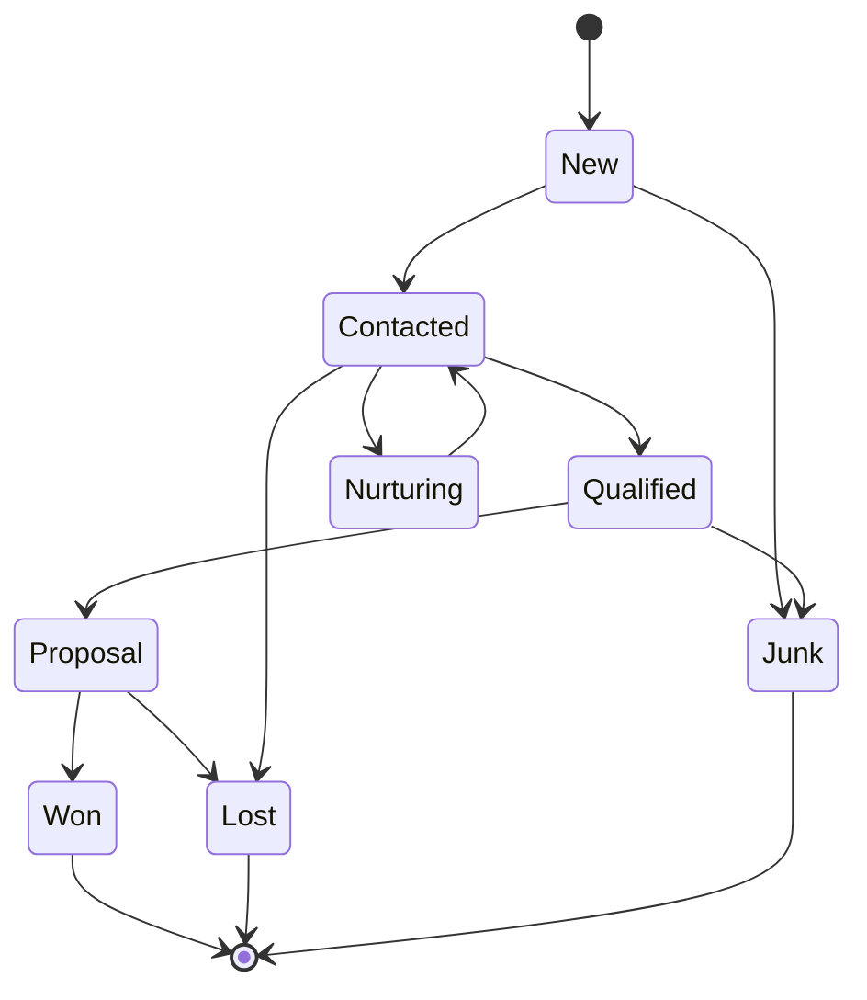
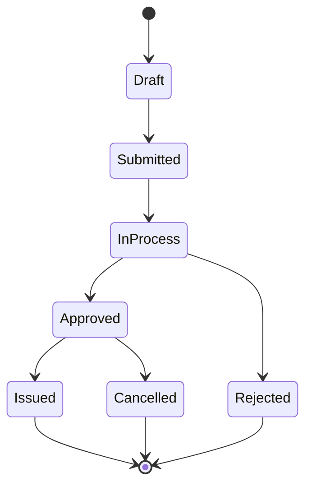

# Leads and applications

Status: Draft. Last updated: 2026-11-16.

This page explains how a sales opportunity moves through the pipeline, and how a Client buys a product.

## In plain words

A **Lead** is a sales opportunity. It is not a Client. A person can give a phone number on the website and stay a Lead. The client list stays clean.

A **Client** is a relationship. Create a Client record only when the person or entity agrees to onboard.

An **Application** is a request to buy a product or onboard into it. An Application links one Client to one Plan. It can create at most one Holding.

The two records answer different questions:

| Question | Lead | Client with status Onboarding |
|---|---|---|
| What is it? | A sales opportunity | A client relationship in progress |
| Is it a Client? | No | Yes |
| Has a Party record? | Optional | Yes |
| Has KYC? | No | In progress |
| Can hold an Application? | No | Yes |
| Can belong to a Family? | No | Yes |
| Can be lost or junk? | Yes | No, it can be Closed |
| How many per person? | Many over time | One |

## How a Lead works

A Lead records where the interest came from and who owns the follow-up.

- A Lead can come from the website, phone, walk-in, referral, or campaign.
- A Lead can link to an existing Client. One Client can have many Leads over time.
- A Lead can carry a product interest, a source, a campaign, an owner, and a next follow-up date.
- A duplicate warning runs before an employee creates a Lead.
- A failed or lost Lead leaves no Client record.
- A Won Lead either creates a Client or starts an Application for an existing Client.
- Do not convert the Lead record. Create the Client and link the Lead as the source.

### Lead lifecycle

A Won Lead converts to a Client, or starts an Application for an existing Client. The Client then starts at Onboarding.

## How an Application works

An Application is the bridge between the sales work and the Holding.

- An Application belongs to one Client and one Plan.
- An Application can create at most one Holding.
- The Application stores a snapshot of the provider, product, and plan names at submission.
- A manual entry can start at Issued for migrated data.
- An Application is never deleted. Use status.
- An Application can carry Application Party rows: applicant, nominee, life assured, guardian, payer, and signatory. See [Related parties and ownership](03-related-parties-and-ownership.md).

A referral does not use an Application. Demat, CASA, and loan referrals use a **Referral Case**. A referral has no Plan and creates no Holding. See [Referrals](10-referrals.md).

### Application lifecycle

`In Process` was called `Under Review` in an earlier draft. Use one label.

Issued means the Holding exists. The product may use Allotted or Policy Issued as the label.

## Conversion cases

### New client from the website

Rahul gives his phone number on the website. He is a Lead. He has no Party, no KYC, and no Family.

He shares his PAN and KYC documents. Create a Party and a Client with status Onboarding, and link the Lead. His first folio is issued. The Client becomes Active.

Full story: [new client journey](../04-scenarios/new-client-journey.md).

### Existing client cross-sell

Ram already has a Client record and several Investments. He asks about health insurance. Create a new Lead linked to his existing Client. Do not create a second Client. When he agrees, start an Application.

Full story: [existing client cross-sell](../04-scenarios/existing-client-cross-sell.md).

### Related Person to Client

A newborn or a nominee can be a Party before becoming a Client. The Lead is optional. Create the Client for the same Party when the family agrees to invest. See [newborn in the family](../04-scenarios/newborn-in-family.md).

## Rules and invariants

1. A Lead is not a Client.
2. One Client can have many Leads over time.
3. A Lead can link to an existing Client.
4. A Client can be created only when the person or entity agrees to onboard.
5. A Won Lead does not become a Client record. It links to the Client it created or to the existing Client.
6. A duplicate warning runs before a Lead or Client is created.
7. An Application belongs to one Client and one Plan.
8. An Application can create at most one Holding.
9. An Application keeps the name snapshots it was submitted with.
10. A Lead or Application with history is not hard deleted. Use status.
11. A referral line uses a Referral Case, not an Application.

## Records and fields

| Record | Purpose | Key links |
|---|---|---|
| Lead | A sales opportunity. | Client, Application, Campaign |
| Application | A request to buy one Plan. | Client, Plan, Holding |
| Application Party | A role during the Application. | Application, Party |

The Lead field list is proposed. Phase 1 is not fully specified.

Proposed field list: Lead

| Field | Type | Required | Notes |
|---|---|---|---|
| name | Data | Yes | Naming series `LEAD-2026-00001`. |
| lead_name | Data | Yes | Person or organization name. |
| party | Link (Party) | No | Filled when the Lead is linked to a known Party. |
| client | Link (Client) | No | Existing Client for a cross-sell. |
| mobile_no | Data (Phone) | No | Masked in lists. |
| email | Data (Email) | No | Masked in lists. |
| source | Select | Yes | Website, Phone, Walk-in, Referral, Campaign, Other. |
| campaign | Link (Campaign) | No | Attribution. |
| product_interest | Link (Product) | No | What the Lead asked about. |
| plan_interest | Link (Plan) | No | Optional. A Lead can name a Plan. |
| referral_type | Select | No | Demat, CASA, Loan. Set when the Lead asks for a referral line. |
| assigned_to | Link (User) | No | RM who owns the follow-up. |
| status | Select | Yes | New, Contacted, Qualified, Nurturing, Proposal, Won, Lost, Junk. |
| lost_reason | Small Text | Conditional | Required for Lost or Junk. |
| next_follow_up_on | Date | No | Next action date. |
| converted_client | Link (Client) | No | Client created or matched at Won. |
| application | Link (Application) | No | Application started from this Lead. |
| legacy_id | Data | No | Old ID from a migrated system. |
| notes | Small Text | No | Internal notes. |

Rules:

- A Lead with status Won must point to a Client.
- A Lost or Junk Lead keeps its history.
- A Lead does not carry KYC or a client code.

Full field list: Application

| Field | Type | Required | Notes |
|---|---|---|---|
| name | Data | Yes | Naming series `APP-2026-00001`. |
| client | Link (Client) | Yes | Main applicant. |
| plan | Link (Plan) | Yes | What is being bought. |
| provider_name_snapshot | Data | Yes | Copied at submission. |
| product_name_snapshot | Data | Yes | Copied at submission. |
| plan_name_snapshot | Data | Yes | Copied at submission. |
| application_type | Select | Yes | New, Additional, Switch, Renewal, Transfer. |
| business_source | Select | Yes | Direct, National Distributor, Website, Referral, Campaign. |
| distribution_partner | Link (Provider) | No | If a national distributor is involved. |
| amount | Currency | Yes | Application amount. |
| payment_mode | Select | No | Cheque, NEFT, UPI, Auto Debit, Cash, Other. |
| application_date | Date | Yes | Date of submission. |
| status | Select | Yes | Draft, Submitted, In Process, Approved, Rejected, Issued, Cancelled. |
| notes | Small Text | No | Internal notes. |

## Who can see or change it

- A Relationship Manager can create Leads and Applications for assigned Clients.
- Operations can create and update Applications, but cannot change commission rules or approve a merge.
- Compliance can read all and approve high-risk actions.
- A Lead with no Client is not visible to a client user. The portal is a later phase.
- The full matrix is in [Access and audit](09-access-and-audit.md).

## Decisions and open questions

| Topic | Status | Decision | Record |
|---|---|---|---|
| Lead and Client split | Decided | A Lead is a sales opportunity. A Client is a relationship. | [ADR-0004](../03-reference/decisions/adr-0004-client-identity-and-lifecycle.md) |
| Application and Holding | Decided | An Application can create at most one Holding. | ADR-0003 |
| Website features | Open | Product pages, lead capture, appointment, risk profiler, blog. | OQ-021 |
| RM model | Open | One primary RM per Client, optional secondary RM. | OQ-023 |
| Migration | Open | Map existing Lead data and keep a legacy ID. | OQ-032 |
| P-103 | Open | Can a Holding be entered without an Application? | P-103 |
| Referrals | Accepted | Demat, CASA, and loans use a Referral Case, not an Application. | [ADR-0009](../03-reference/decisions/adr-0009-phase-1-product-scope.md) |

## Worked examples

- [New client journey](../04-scenarios/new-client-journey.md): website Lead to Active Client.
- [Existing client cross-sell](../04-scenarios/existing-client-cross-sell.md): a new Lead for an existing Client.
- [Newborn in the family](../04-scenarios/newborn-in-family.md): a Related Person becomes a Client with no Lead.
