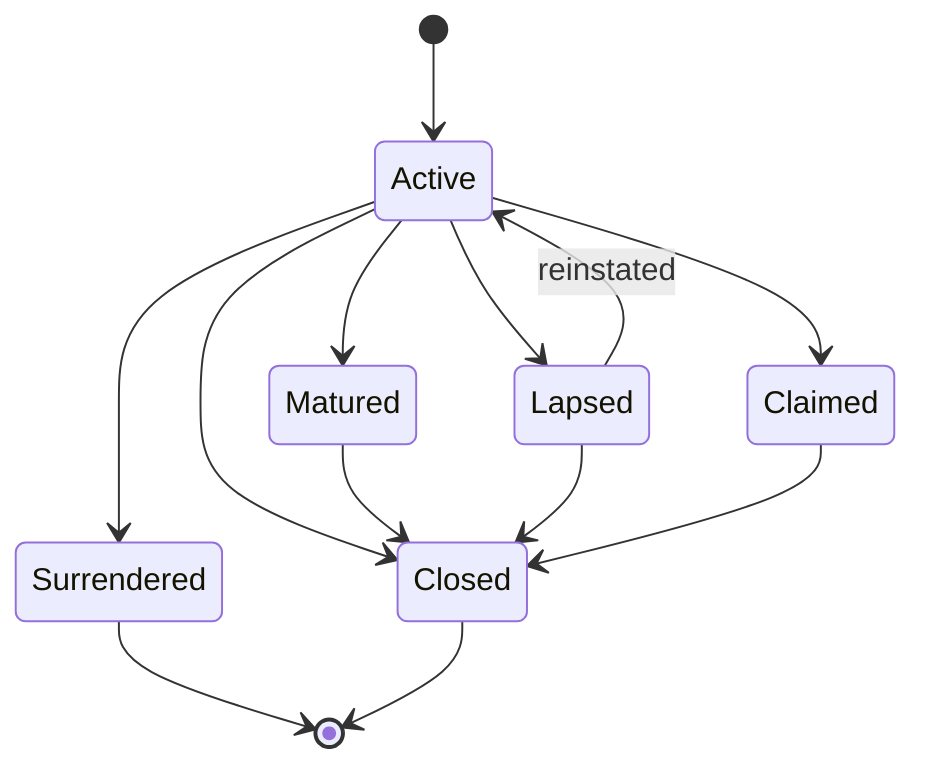

# Holdings and investments

Status: Draft. Last updated: 2026-11-16.

This page explains what a Client owns, how Dhanada values it, and how it changes over time.

## In plain words

A **Holding** is the Client's position in one Plan. The UI label is **Investment**. Show the type beside it: Policy, Folio, FD, PRAN.

A Holding answers "what does the Client own now?" A Product answers "what can be bought?" The two are separate.

| Record | One row means | Example |
|---|---|---|
| Application | One request to buy | Ram applies for ₹10,00,000 |
| Holding | One position | Folio 1234567, 4,000 units |
| Holding Party | One role on the position | Ram Owner rank 1, Sita Nominee 100% |
| Transaction | One change to the position | SIP instalment, redemption, maturity |
| Ownership Event | One recorded ownership change | Survivor transfer after death |

A Holding points to one Plan. It keeps a snapshot of the terms the deal fixed. A later catalog change does not rewrite the deal.

## How a Holding is created

1. The employee picks a Plan. The category detail decides which fields the form shows.
2. The Application stores a snapshot of the provider, product, and plan names.
3. On issue, the Holding is created. It copies the deal terms.
4. The first Transaction records the money and units.
5. Holding Party records the owners, nominee, and guardian.

Manual entry can create a Holding without an Application for migrated data. Add a reason. See P-103.

### Provider reference

The provider reference identifies the position at the provider:

- Folio number
- Policy number
- PRAN
- FD receipt number
- Post office account number
- PMS account number
- AIF account number

The provider reference must be unique per provider and type. Confirm in OQ-032.

## Money, dates, and value

A Holding must mean the same thing across every product family, or the portfolio total is wrong.

### Four money ideas

| Idea | Plain meaning | Example |
|---|---|---|
| Invested amount | What the Client put in | ₹5,00,000 deposit |
| Current value | What it is worth today | ₹5,42,000 after accrued interest |
| Maturity value | What it will pay at the end | ₹6,36,000 on the maturity date |
| Income received | What the Client has already received | ₹30,000 interest paid last year |

Do not use one field for more than one idea. A deposit can have all four.

### Amount fields

| Field | Meaning | Used by |
|---|---|---|
| `invested_amount` | Money paid in, before charges | Every Holding |
| `current_value` | Value on `value_on` | Every Holding |
| `maturity_value` | Expected or actual value at maturity | FD, bond, post office, insurance maturity |
| `income_received` | Cash already paid to the Client | FD interest, IDCW, coupon, pension |
| `premium_amount` | Insurance premium for one period | Life, health, general |
| `sum_assured` | Insurance cover | Life, health, general |
| `units` | Units held | MF, SIF, NPS, ULIP |
| `nav` | Unit price on `nav_date` | MF, SIF, NPS, ULIP |
| `price` | Bond price per ₹100 face value | Bonds |
| `accrued_interest` | Interest earned but not yet paid | FD, bond |
| `interest_rate` | Rate on the Holding at start | FD, post office, bond |
| `coupon_rate` | Fixed bond coupon | Bonds |

Use Currency fields for money. Use Percent for rates. Use Decimal for units, not Currency.

### Units and NAV

For market-linked products, value is:

```
current_value = units × nav
```

- Store units to three or four decimals. Confirm in P-034.
- Store the NAV used for the value, and its date.
- A new NAV is a new row. Do not overwrite the old row.
- A purchase adds units. A redemption removes units. A switch moves units between two Holdings.
- An IDCW payout does not change the unit count. A reinvestment adds units.

Example: 4,000 units at NAV ₹300 = ₹12,00,000.

### Rate and accrual

For deposits and bonds, value grows with time:

```
accrued_value = principal × (1 + rate / periods) ^ (periods × years)
```

The exact formula depends on compounding. Store the rate, the compounding method, and the start date. Store the current value from the provider when possible.

Example: ₹5,00,000 at 8.15% compounded quarterly for 3 years is about ₹6,36,000 at maturity.

Do not recompute history. Store what the provider says, with a date and a source.

### Dates

| Date | Meaning | Example |
|---|---|---|
| `application_date` | Date the Client applied | 1 April 2026 |
| `allotment_date` | Date units or the policy were issued | 5 April 2026 |
| `start_date` | Date the Holding begins | 5 April 2026 |
| `maturity_date` | Date the Holding ends | 5 April 2029 |
| `next_due_date` | Next premium, contribution, or instalment | 5 April 2027 |
| `lock_in_end_date` | First date the Client can exit | 5 April 2029 |
| `value_on` | Date of the current value | 30 June 2026 |
| `closed_on` | Date the Holding was closed | 5 April 2029 |

Rules:

- Every value needs a date. A value with no date is not usable.
- A maturity date is not a guarantee. A ULIP has no maturity value. A policy can lapse.
- A date change needs a reason. Do not silently move a maturity date.

### Valuation by family

| Family | How to value | Source | Frequency |
|---|---|---|---|
| Mutual fund | Units × NAV | AMFI, RTA, or manual | Daily |
| SIF | Units × NAV | AMC or manual | Daily |
| NPS | Units × NAV per scheme | NPS Trust or manual | Daily |
| Life insurance, traditional | Surrender value | Insurer statement | Monthly or quarterly |
| Life insurance, ULIP | Units × NAV | Insurer statement | Daily or monthly |
| Health and general insurance | No value. Show cover. | Policy | Not AUM |
| FD | Principal plus accrued interest | Provider or manual | Monthly |
| Government bond | Price plus accrued interest | Market price or manual | Daily or monthly |
| Post office | Deposit plus accrued interest | India Post or manual | Quarterly |
| PMS | Manager valuation | Manager statement | Monthly |
| AIF | Manager valuation | Manager statement | Quarterly |

Do not add health or general insurance cover to AUM. Cover is not money the Client can access.

## The snapshot rule

At the start of a Holding, copy the terms that the deal fixed:

- Plan name and provider name.
- Rate or NAV at allotment.
- Tenure and maturity date.
- Sum assured and premium.
- Payout frequency.

The Holding keeps these values even after the catalog changes. The Plan can change for new business. The old Holding stays correct.

| Fact | Catalog record | Holding snapshot |
|---|---|---|
| Provider name | Provider | `provider_name_snapshot` |
| Product name | Product | `product_name_snapshot` |
| Plan name | Plan | `plan_name_snapshot` |
| FD rate | Rate Card | `interest_rate` |
| Allotment NAV | NAV History | `nav` and `nav_date` |
| Sum assured | Insurance Detail | `sum_assured` |
| Tenure | Plan | `maturity_date` |

A report reads the snapshot. A catalog page reads the live record. The two never fight.

## Transactions

| Transaction | Effect on the Holding |
|---|---|
| Purchase | Adds units or principal |
| SIP or RD instalment | Adds units or deposit |
| Additional purchase | Adds units or principal |
| Redemption or withdrawal | Removes units or principal |
| Switch out | Removes units from one Holding |
| Switch in | Adds units to another Holding |
| IDCW payout | Cash out, units unchanged |
| IDCW reinvestment | Adds units |
| Premium payment | Records a payment, value may rise |
| Contribution | Adds units to NPS |
| Interest or coupon payout | Cash out, principal unchanged |
| Maturity | Closes the Holding and records the payout |
| Renewal | Extends the Holding or creates a new one |
| Claim | Closes the Holding and records the settlement |

Rules:

- A transaction never edits the old value. It creates a new value with a date.
- A switch needs two linked transactions.
- A maturity closes the Holding. A renewal creates a new Holding or a new term. Do not overwrite the old terms.
- A failed or reversed transaction stays visible with a status.
- A transaction is not deleted. Use a reversal.
- A partial withdrawal keeps the Holding open and reduces units or principal.

## Lifecycle



- Not every product uses every state. An FD matures. A policy lapses. A folio closes.
- A maturity or lapse creates a Reminder and a Service Request.
- An ownership transfer is a separate event. It does not change the Holding status by itself.
- A closed Holding stays readable and appears in reports with a zero current value.

## Reports and AUM

- A client report lists the Holdings where the Client is an Owner.
- A Holding where the Client is a Joint Holder shows with a **Joint** badge and no value. The value belongs to the Primary Holder.
- A client report never walks the Family. It never includes another member's Holding or a Related Person.
- An employee Family report may use Family. It shows personal AUM and entity AUM on separate lines.
- An entity Holding belongs to the entity Client. Do not count it again under a director or shareholder.
- A joint holder outside the Family sees a memo row with no value.
- The same Holding can appear in two Family reports. The firm total counts it once.
- The client portfolio and the website never share a query path. The website reads the catalog only.

Ownership and AUM attribution rules are in [Related parties and ownership](03-related-parties-and-ownership.md).

## Rules and invariants

1. A Holding points to one Plan.
2. A Holding has one to three Owners, ranked 1 to 3.
3. `mode_of_holding` is required when there are two or more Owners.
4. A Holding keeps the rate, NAV, and terms it started with.
5. A Rate Card or NAV row is not edited after use.
6. A Holding is never hard deleted. Use status.
7. A provider reference is unique per provider and type.
8. A closed Holding stays readable.
9. Every current value has `value_on` and a source.
10. A value is stored, not guessed, when a provider statement is available.
11. Cover is not AUM.
12. A switch is two transactions.
13. A currency is INR in phase 1. See OQ-031.

## Records and fields

| Record | Purpose | Key links |
|---|---|---|
| Holding | The Client's position in one Plan. | Plan, Application |
| Transaction | One change to a Holding. | Holding |
| Holding Party | An owner, nominee, guardian, or other role. | Holding, Party |

Holding Party fields are in [Related parties and ownership](03-related-parties-and-ownership.md#records-and-fields).

<details>
<summary>Full field list: Holding</summary>

| Field | Type | Required | Notes |
|---|---|---|---|
| name | Data (UUID) | Yes | Internal key. A short code `HLD-2026-00001` is shown. |
| plan | Link (Plan) | Yes | What the Client holds. |
| provider_name_snapshot | Data | Yes | Copied at start. |
| product_name_snapshot | Data | Yes | Copied at start. |
| plan_name_snapshot | Data | Yes | Copied at start. |
| provider_reference | Data | Yes | Folio, policy, PRAN, receipt, account. |
| holding_type | Select | Yes | Folio, Policy, PRAN, FD, Bond, Post Office, PMS, AIF. |
| mode_of_holding | Select | Conditional | Single, Joint, Anyone or Survivor, Former or Survivor. Required when there are two or more owners. |
| status | Select | Yes | Active, Matured, Closed, Lapsed, Surrendered, Claimed. |
| start_date | Date | Yes | Start of the Holding. |
| maturity_date | Date | No | End date, if any. |
| invested_amount | Currency | Yes | Money paid in. |
| current_value | Currency | No | Value on `value_on`. |
| value_on | Date | No | As-of date. |
| value_source | Select | No | Manual, Provider Statement, NAV, Data Feed. |
| units | Decimal | No | MF, SIF, NPS, ULIP. |
| nav | Currency | No | NAV used for the value. |
| nav_date | Date | No | Date of that NAV. |
| interest_rate | Percent | No | FD or post office rate at start. |
| premium_amount | Currency | No | Insurance. |
| sum_assured | Currency | No | Insurance. |
| maturity_value | Currency | No | Expected or actual. |
| source_application | Link (Application) | No | The Application that created it. |
| notes | Small Text | No | Internal notes. |

Rules:

- A Holding points to one Plan.
- A Holding keeps its start terms.
- A Holding is never hard deleted. Use status.
- A provider reference is unique per provider and type. Confirm in OQ-032.

</details>

<details>
<summary>Full field list: Transaction</summary>

| Field | Type | Required | Notes |
|---|---|---|---|
| name | Data | Yes | Naming series. |
| holding | Link (Holding) | Yes | Parent Holding. |
| transaction_type | Select | Yes | Purchase, SIP, Additional Purchase, Redemption, Switch Out, Switch In, IDCW Payout, IDCW Reinvestment, Premium, Contribution, Interest, Coupon, Maturity, Renewal, Claim, Reversal. |
| transaction_date | Date | Yes | Date of the event. |
| amount | Currency | No | Cash amount. |
| units | Decimal | No | Units added or removed. |
| nav | Currency | No | NAV used. |
| reference | Data | No | Provider reference. |
| source | Select | No | Manual, Statement, Feed. |
| status | Select | Yes | Posted, Pending, Failed, Reversed. |
| linked_transaction | Link (Transaction) | No | The other side of a switch. |
| notes | Small Text | No | Internal notes. |

</details>

## Who can see or change it

- An RM sees Holdings for assigned Clients.
- Operations can create and update Holdings and Transactions.
- A Joint Holder sees the Holding with a Joint badge and no value.
- Compliance can read all and approve high-risk actions.
- A client report never includes another Client's Holding.
- The full matrix is in [Access and audit](09-access-and-audit.md).

## Decisions and open questions

| Topic | Status | Decision | Record |
|---|---|---|---|
| Holdings and holders | Decided | One Holding per provider position, one to three Owners, no owner share. | [ADR-0007](../03-reference/decisions/adr-0007-holdings-holders-and-nominees.md) |
| Client reports | Decided | Holding-based, never Family-based. | [ADR-0008](../03-reference/decisions/adr-0008-client-reports-are-holding-based.md) |
| Ownership history | Open | Use an append-only Ownership Event log? | OQ-011 |
| Holding entry | Open | Can a Holding exist without an Application? | P-103 |
| Units | Open | How many decimal places? | P-034 |
| Currency | Open | INR only in phase 1? | OQ-031 |

## Worked example

Sita's FD:

| Date | Event | Invested | Value | Maturity value |
|---|---|---|---|---|
| 1 Apr 2026 | Deposit opened | ₹5,00,000 | ₹5,00,000 | ₹6,36,000 |
| 30 Jun 2026 | Quarterly value from provider | ₹5,00,000 | ₹5,10,200 | ₹6,36,000 |
| 1 Apr 2029 | Maturity | ₹5,00,000 | ₹6,36,000 | ₹6,36,000 |

The invested amount never changes. The current value moves. The maturity value is an estimate until maturity.

Full story: [joint holders and nominee](../04-scenarios/joint-holders-and-nominee.md).
