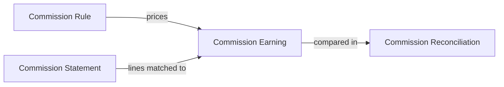

# Commission

Status: Deferred to phase 2. Last updated: 2026-11-16. OQ-020 is deferred.

This page explains how Dhanada will record the money KNAPS earns from a Provider or a Distribution Partner. It is a phase 2 design. Phase 1 does not track commission or payouts.

## In plain words

KNAPS earns commission when a Client buys or holds a product, opens an account, or takes a loan. The provider or the partner pays it.

Commission is revenue. It is not the Client's money. It is not part of AUM.

Phase 2 records and reconciles commission. It does not calculate it. See OQ-020.

## How it works

The model has four parts:

| Record | Answers the question | Example |
|---|---|---|
| Commission Rule | What should we earn? | 0.5% trail on a mutual fund plan |
| Commission Earning | What did we earn for a period? | ₹4,000 for April 2026 |
| Commission Statement | What did the payer say? | April statement from the AMC |
| Commission Reconciliation | Do the two agree? | ₹4,000 earning against ₹4,000 statement |

Track the **Business Source** and the **Distribution Partner** on the Application and the Holding. The national distributor can be the commission payer.

### Commission Rule

A rule records:

- Provider.
- Product or Plan.
- Transaction type.
- Basis: percentage of AUM, percentage of premium, or flat amount.
- Rate.
- Frequency: one-time, monthly, quarterly, or yearly.
- Effective dates.
- GST and TDS.
- Clawback terms.

A rule is effective-dated. Do not edit a rule that an Earning already used. Add a new rule.

### Commission Earning

An Earning links a Holding, a Transaction, or a Referral Case to a Rule for a period:

- Gross amount.
- GST.
- TDS.
- Net amount.
- Status.
- Payer.

### Commission Statement and Reconciliation

A Statement is the payer's file for a period. It has a payer, a period, the file, a total, and a status.

A Reconciliation compares each statement line to an Earning. It records the difference and the status. An unmatched line stays open until an employee resolves it.

## Phase 2 scope

- Record commission per Holding, Transaction, and Referral Case.
- Record provider and partner statements.
- Reconcile statement lines to Earnings.
- Show commission by product, provider, and period.
- Record the demat brokerage share, the CASA payout, and the loan payout on the disbursed amount.
- Do not calculate complex slab or trail commission. Do it manually or in the payer system.

## Rules and invariants

1. A Commission Earning links to one Rule and one Holding, Transaction, or Referral Case.
2. A Rule is effective-dated and is never edited after use.
3. A Reconciliation line links to one Statement line and at most one Earning.
4. Commission is revenue. It is never added to AUM.
5. A commission adjustment is a high-risk action. It needs maker-checker.
6. A statement file is private. It can contain client-level data.
7. Commission amounts are masked for roles without the permission.
8. Phase 1 stores no commission, payout, or reconciliation record.

## Records and fields

Phase 2 is not fully specified. These fields are a starting point.

Proposed field list: Commission Rule

| Field | Type | Required | Notes |
|---|---|---|---|
| name | Data (UUID) | Yes | Internal key. |
| provider | Link (Provider) | Yes | Who pays. |
| product | Link (Product) | No | Rule at product level. |
| plan | Link (Plan) | No | Rule at plan level. |
| transaction_type | Select | No | Purchase, SIP, Renewal, Trail, Claim, Referral, Other. |
| basis | Select | Yes | Percentage of AUM, Percentage of Premium, Percentage of Disbursed Amount, Flat per Account, Flat Amount. |
| rate | Percent or Currency | Yes | Depends on basis. |
| frequency | Select | Yes | One-time, Monthly, Quarterly, Yearly. |
| effective_from | Date | Yes | Start date. |
| effective_to | Date | No | End date. |
| gst_rate | Percent | No | Tax. |
| tds_rate | Percent | No | Tax. |
| clawback_terms | Small Text | No | When the payer can take it back. |
| notes | Small Text | No | Internal notes. |

Proposed field list: Commission Earning

| Field | Type | Required | Notes |
|---|---|---|---|
| name | Data (UUID) | Yes | Internal key. |
| rule | Link (Commission Rule) | Yes | Pricing rule. |
| holding | Link (Holding) | No | Source position. |
| transaction | Link (Transaction) | No | Source transaction. |
| referral_case | Link (Referral Case) | No | Source referral. |
| period_from | Date | Yes | Start of the earning period. |
| period_to | Date | Yes | End of the earning period. |
| gross_amount | Currency | Yes | Before tax. |
| gst_amount | Currency | No | Tax. |
| tds_amount | Currency | No | Tax. |
| net_amount | Currency | Yes | Amount expected. |
| payer | Link (Provider) | Yes | Provider or Distribution Partner. |
| status | Select | Yes | Expected, Received, Reconciled, Disputed, Written Off. |
| notes | Small Text | No | Internal notes. |

Proposed field list: Commission Statement

| Field | Type | Required | Notes |
|---|---|---|---|
| name | Data (UUID) | Yes | Internal key. |
| payer | Link (Provider) | Yes | Who sent the statement. |
| period_from | Date | Yes | Start of the period. |
| period_to | Date | Yes | End of the period. |
| file | Attach | Yes | Private statement file. |
| stated_total | Currency | Yes | Total on the statement. |
| status | Select | Yes | Received, In Review, Reconciled, Closed. |
| notes | Small Text | No | Internal notes. |

Proposed field list: Commission Reconciliation

| Field | Type | Required | Notes |
|---|---|---|---|
| name | Data (UUID) | Yes | Internal key. |
| statement | Link (Commission Statement) | Yes | Parent statement. |
| statement_line_reference | Data | Yes | Line on the payer file. |
| earning | Link (Commission Earning) | No | Matched earning. |
| statement_amount | Currency | Yes | Amount on the statement. |
| earning_amount | Currency | No | Amount in Dhanada. |
| difference | Currency | No | Statement minus earning. |
| status | Select | Yes | Matched, Short, Excess, Unmatched, Resolved. |
| resolution | Small Text | No | Why the difference exists and what was done. |
| notes | Small Text | No | Internal notes. |

## Who can see or change it

Commission amounts are sensitive. They are masked for roles without the permission.

- Management, Compliance, and Operations can read commission.
- A Team Lead and an RM see commission for their own or assigned records.
- A commission adjustment needs maker-checker.
- Commission is revenue. It never adds to AUM.

The full matrix is in [Access and audit](09-access-and-audit.md).

## Decisions and open questions

| Topic | Status | Decision | Record |
|---|---|---|---|
| Commission scope | Deferred | Record and reconcile in phase 2, not phase 1. Calculate later. | OQ-020 |
| Legal entity | Open | Which legal entity earns which commission? | OQ-019 |
| Maker-checker | Open | Does a commission adjustment need approval? | OQ-025 |
| P-125 | Open | Do you need commission by product and provider? | P-125 |

Related: [Products and providers](04-products-and-providers.md), [Holdings and investments](06-holdings-and-investments.md), [Referrals](10-referrals.md), and [Open questions](../03-reference/open-questions.md).
