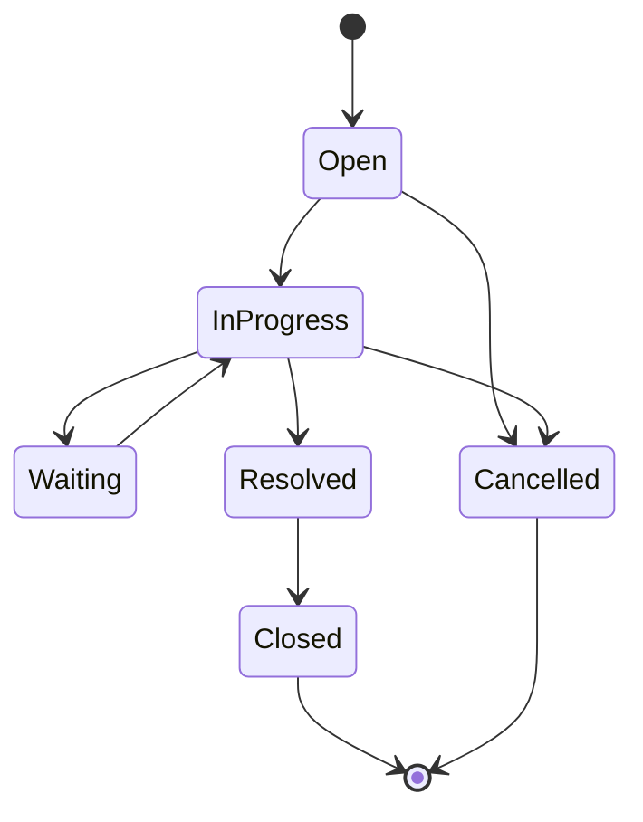

# Servicing

Status: Draft. Last updated: 2026-11-16.

This page explains what happens after a Client owns an Investment: requests, reminders, reviews, claims, and consent.

## In plain words

A sale is not the end of the relationship. A Client calls about a nominee change. A premium falls due. A deposit matures. A policy lapses. A client raises a grievance.

Dhanada tracks each of these as a record, with an owner and an outcome. The employee sees the next action for each Client without searching five screens.

## The three service records

| Record | What it is | Example |
|---|---|---|
| Service Request | A tracked client request or service event. | Claim assistance, grievance, bank change, nominee change |
| Review | A scheduled client or Family meeting. | Annual portfolio review |
| Reminder | A scheduled task for a future event. | Premium due, maturity, SIP failure, KYC expiry |

A Review is not a Service Request. A Reminder can create a Service Request when action is needed.

### Service Request

A Service Request has a type, a Client, an optional Holding, an owner, a status, and an outcome.

Types in phase 1:

- Claim
- Grievance
- Bank change
- Nominee change
- Address or contact change
- NPS partial withdrawal or annuity request
- Maturity instruction
- Document request
- Other

Rules:

- A Grievance is a Service Request type with its own SLA.
- A Claim is a Service Request type with document checks.
- A nominee change is a Service Request, then an update of the current Nominee rows. There is no separate nominee history table.
- A claim settlement records an Ownership Event and closes the Holding.
- A Service Request is not deleted. Use a final status.
- A Service Request links to one Client. It may link to one Holding.

### Review

A Review records a scheduled meeting and its outcome.

- A Review has a date, a Client or Family, an owner, and notes.
- A Review can create Reminders or Service Requests.
- A Review is separate from a Service Request.

### Reminder

A Reminder is a task for a future event. It has a due date, an owner, a status, and a link to the record that caused it.

Reminders cover:

- Premium due.
- Policy lapse.
- FD and RD maturity.
- NPS contribution.
- SIP failure.
- KYC expiry.
- Review due.
- License or registration expiry.
- Document expiry.

A Reminder that needs client action can create a Service Request.

## Consent

Consent is a recorded permission from a Party for a purpose and a channel.

- Capture consent per product and per channel.
- Keep the history. Do not overwrite an old consent.
- A withdrawn consent stops the use of that channel.
- Family visibility consent is a portal-phase feature. It uses a Visibility Grant, described in [Family](02-family.md#who-can-see-or-change-it).

## Lifecycle rules

- A status change records the date, user, and reason.
- Use a `status` field for a simple lifecycle.
- Use a Frappe Workflow only when approval steps are needed.
- Do not hard delete a record. Use a final status.
- A lifecycle change can create a Service Request or Reminder.

## Rules and invariants

1. A Service Request links to one Client. It may link to one Holding.
2. A Grievance has its own SLA.
3. A Claim needs document checks.
4. A Review is not a Service Request.
5. A Reminder has a due date and an owner.
6. Consent is captured per product and per channel, with history.
7. A withdrawn consent is not deleted.
8. A closed Service Request keeps its outcome and history.

## Records and fields

Phase 1 is not fully specified. These fields are a starting point.

Proposed field list: Service Request

| Field | Type | Required | Notes |
|---|---|---|---|
| name | Data | Yes | Naming series `SR-2026-00001`. |
| client | Link (Client) | Yes | Who raised it. |
| holding | Link (Holding) | No | Related position. |
| request_type | Select | Yes | Claim, Grievance, Bank Change, Nominee Change, Contact Change, NPS Request, Maturity Instruction, Document Request, Other. |
| description | Text | Yes | What the Client needs. |
| owner | Link (User) | Yes | Employee responsible. |
| status | Select | Yes | Open, In Progress, Waiting, Resolved, Closed, Cancelled. |
| priority | Select | No | Low, Normal, High, Urgent. |
| raised_on | Datetime | Yes | When the request arrived. |
| due_on | Datetime | No | SLA target. |
| resolved_on | Datetime | No | When resolved. |
| outcome | Small Text | No | What was done. |
| notes | Small Text | No | Internal notes. |

Proposed field list: Review

| Field | Type | Required | Notes |
|---|---|---|---|
| name | Data | Yes | Naming series. |
| client | Link (Client) | No | Individual review. |
| family | Link (Family) | No | Household review. |
| scheduled_on | Datetime | Yes | Meeting date. |
| owner | Link (User) | Yes | Employee responsible. |
| status | Select | Yes | Planned, Done, Cancelled. |
| notes | Small Text | No | Agenda and outcome. |

Use either `client` or `family`, not both.

Proposed field list: Reminder

| Field | Type | Required | Notes |
|---|---|---|---|
| name | Data | Yes | Naming series. |
| client | Link (Client) | No | Who must act. |
| holding | Link (Holding) | No | Related position. |
| license | Link (License) | No | Registration expiry. |
| reminder_type | Select | Yes | Premium Due, Lapse, Maturity, NPS Contribution, SIP Failure, KYC Expiry, Review Due, License Expiry, Document Expiry, Other. |
| due_on | Date | Yes | When it is due. |
| owner | Link (User) | Yes | Employee responsible. |
| status | Select | Yes | Open, Done, Snoozed, Cancelled. |
| notes | Small Text | No | Internal notes. |

## Who can see or change it

- An RM sees Service Requests and Reminders for assigned Clients.
- The Service Desk can create and edit Service Requests, and close them with an outcome.
- Operations supports claims and document checks.
- Compliance reads all and reviews grievances.
- A client sees their own requests in the portal, which is a later phase.
- The full matrix is in [Access and audit](09-access-and-audit.md).

## Decisions and open questions

| Topic | Status | Decision | Record |
|---|---|---|---|
| Servicing scope | Decided | Premium, lapse, maturity, NPS, SIP, KYC, review, claim, grievance | Requirements SV-01 to SV-13 |
| Grievance SLA | Open | What target applies? | Requirements SV-04 |
| Portal consent | Open | When is the portal planned, and how is consent captured? | OQ-029 |
| Maker-checker | Open | Does a bank or nominee change need approval? | OQ-025 |
| Retention | Open | How long are service records kept? | OQ-030 |

Related: [Holdings and investments](06-holdings-and-investments.md), [Family](02-family.md), and [Access and audit](09-access-and-audit.md).
