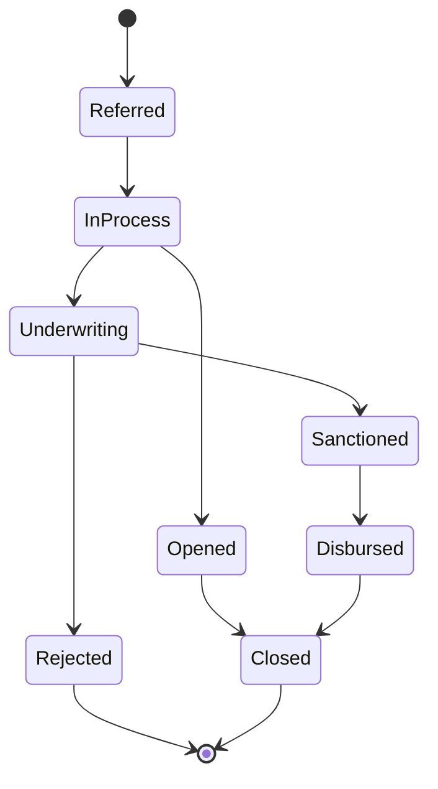

# Referrals

Status: Proposed. Last updated: 2026-11-16. OQ-034 and OQ-035 are open.

This page explains the three referral lines: demat, CASA, and loans. KNAPS opens or refers the account. A partner owns the account and serves it.

## In plain words

Some products are not KNAPS products. KNAPS introduces the Client to a partner, helps with the paperwork, and earns a payout. The Client's relationship with the partner is direct.

- **Demat.** KNAPS opens a demat account for the Client with Aditya Birla Money. The Client trades through the account. KNAPS gets a share of the brokerage.
- **CASA.** KNAPS opens a savings or current account for the Client with HDFC Bank. KNAPS gets a payout for the account.
- **Loan.** KNAPS refers the Client to a bank or an NBFC. The lender sanctions and disburses the loan. The payout is based on the disbursed amount.

A referral is not a Holding. KNAPS does not own the account, does not service it, and does not count it in AUM.

## The record

A **Referral Case** records one referral for one Client to one partner.

| Question | Answer |
|---|---|
| Who is the Client? | The Client record. |
| Who is the partner? | Aditya Birla Money, HDFC Bank, or a lender. |
| What type? | Demat, CASA, or Loan. |
| Where is it now? | The status. |
| What is the partner reference? | DP ID and UCC, account number, or loan number. |
| What is it worth? | The account opened, or the loan disbursed amount. |

A Referral Case can create a Service Request or a Reminder. It never creates an Application or a Holding.

## Referral types

| Type | Partner | Main fields | Payout basis, phase 2 |
|---|---|---|---|
| Demat | Aditya Birla Money | DP ID, UCC, account type | Share of brokerage |
| CASA | HDFC Bank | Account number, account type | Per account opened |
| Loan | Bank or NBFC | Lender, loan type, sanction amount, disbursed amount | Percentage of disbursed amount |

The payout basis is recorded now because it is a fact of the deal. Commission and payout tracking start in phase 2. See [Commission](07-commission.md).

## Lifecycle

Not every type uses every state.

- **Demat and CASA:** Referred, In Process, Opened, Rejected, Closed.
- **Loan:** Referred, In Process, Underwriting, Sanctioned, Disbursed, Rejected, Closed.

A demat account is opened, not sanctioned. A loan is sanctioned and then disbursed. Do not force one state list on all three.

## Rules and invariants

1. A Referral Case links to one Client and one partner.
2. A Referral Case is not a Product, a Plan, or a Holding.
3. A referral never adds to AUM.
4. A referral has one type: Demat, CASA, or Loan.
5. A loan records the sanctioned amount and the disbursed amount separately.
6. A partner reference is unique per partner and type.
7. A closed or rejected Referral Case stays readable.
8. Commission and payout tracking are phase 2.
9. The partner owns the account and the client data. Store only what KNAPS needs.
10. A referral that becomes a Client Holding later is a new record. Do not convert the referral.

## Records and fields

| Record | One row means | Example |
|---|---|---|
| Referral Case | One referral to one partner | Rahul's demat account with Aditya Birla Money |
| Referral Note | One follow-up note or status change | KYC pending with the partner |

Full field list: Referral Case

| Field | Type | Required | Notes |
|---|---|---|---|
| name | Data | Yes | Naming series `REF-2026-00001`. |
| client | Link (Client) | Yes | Who is referred. |
| referral_type | Select | Yes | Demat, CASA, Loan. |
| partner | Link (Provider) | Yes | Aditya Birla Money, HDFC Bank, or a lender. |
| partner_type | Select | No | Depository Participant, Bank, NBFC. |
| referred_on | Date | Yes | Date of the referral. |
| status | Select | Yes | Referred, In Process, Underwriting, Opened, Sanctioned, Disbursed, Rejected, Closed. |
| dp_id | Data | No | Demat only. |
| ucc | Data | No | Demat only. |
| account_number | Data | No | CASA only. |
| account_type | Select | No | Savings, Current, Demat, Other. |
| loan_type | Select | No | Home, Personal, Loan Against Property, Business, Vehicle, Other. |
| sanction_amount | Currency | No | Loan only. |
| disbursed_amount | Currency | No | Loan only. The payout basis. |
| disbursed_on | Date | No | Loan only. |
| partner_reference | Data | No | Partner case number. |
| opened_on | Date | No | Account opened date. |
| closed_on | Date | No | Account closed date. |
| owner | Link (User) | No | Employee who follows the case. |
| notes | Small Text | No | Internal notes. |

Rules:

- `dp_id` and `ucc` are required for Demat.
- `account_number` is required for CASA.
- `loan_type` and `disbursed_amount` are required for a loan that is Disbursed.
- Do not store a demat holding, a bank balance, or an EMI schedule in phase 1.

Proposed field list: Referral Note

| Field | Type | Required | Notes |
|---|---|---|---|
| name | Data | Yes | Naming series. |
| referral_case | Link (Referral Case) | Yes | Parent case. |
| note_on | Datetime | Yes | When it happened. |
| note | Text | Yes | What happened. |
| owner | Link (User) | Yes | Who recorded it. |
| next_follow_up_on | Date | No | Next action date. |

## Partners and codes

A partner is a Provider with `provider_type` = Depository Participant, Bank, or NBFC.

- Aditya Birla Money is a Depository Participant.
- HDFC Bank is a Bank.
- A lender is a Bank or an NBFC.

The firm's code with each partner sits in [Distributor Code](04-products-and-providers.md#distributor-code): a DP code, a bank code, or one NBFC code per lender.

## Who can see or change it

- An RM sees Referral Cases for assigned Clients.
- The Service Desk can create a Referral Case and update its status.
- Operations can correct a partner reference.
- Compliance can read all.
- A partner never sees Dhanada data.
- The full matrix is in [Access and audit](09-access-and-audit.md).

## Decisions and open questions

| Topic | Status | Decision | Record |
|---|---|---|---|
| Referral lines | Accepted | Demat, CASA, and loans are Referral Cases. Not Holdings. | [ADR-0009](../03-reference/decisions/adr-0009-phase-1-product-scope.md) |
| Referral scope | Open | Referral and payout only, or also balances and liability? | OQ-034 |
| Loan depth | Open | Which loan types, and do you track EMI or outstanding? | OQ-035 |
| Commission | Deferred | No payout tracking in phase 1. | OQ-020 |

## Worked example

Rahul Mehta becomes a Client. He asks for a demat account and a home loan.

| Step | Record | Value |
|---|---|---|
| 1 | Client | Rahul Mehta, `CL-000201` |
| 2 | Referral Case, Demat | Partner Aditya Birla Money, status Referred |
| 3 | Referral Note | KYC form sent to the partner |
| 4 | Referral Case update | DP ID `IN301549`, UCC `12345678`, status Opened |
| 5 | Referral Case, Loan | Partner HDFC Bank, loan type Home, status Underwriting |
| 6 | Referral Case update | Sanctioned ₹45,00,000, disbursed ₹44,20,000, status Disbursed |

Neither case creates a Holding. Neither case adds to AUM. The disbursed amount is stored because it is the future payout basis.
