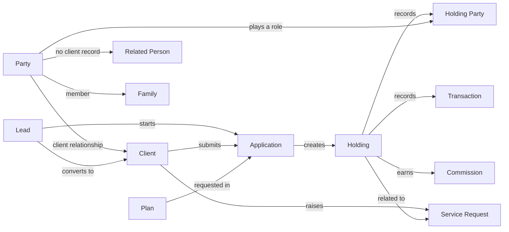

# Model overview

Status: Draft. Last updated: 2026-11-16.

The model pages explain the business in the order a new reader needs it. Each page is complete for its concept. You do not need to read another page to understand that concept.

## Reading order

1. [Party and Client](01-party-and-client.md): one identity per person or organization, and the client relationship.
2. [Family](02-family.md): how employees group Parties into a household.
3. [Related parties and ownership](03-related-parties-and-ownership.md): roles, owners, nominees, guardians, and AUM attribution.
4. [Products and providers](04-products-and-providers.md): the catalog, the Plan, and every product family.
5. [Leads and applications](05-leads-and-applications.md): the sales pipeline and the purchase request.
6. [Holdings and investments](06-holdings-and-investments.md): what the Client owns, how it is valued, and how it changes.
7. [Commission](07-commission.md): how KNAPS records and reconciles what it earns.
8. [Servicing](08-servicing.md): requests, reviews, reminders, claims, and consent.
9. [Access and audit](09-access-and-audit.md): who can see or change a record, and what is logged.

## How the concepts connect

The map is logical. It does not show database foreign keys.

## Contexts and boundaries

| Context | Responsibility | Key records | Main links |
|---|---|---|---|
| Identity and Party | One identity per person or organization. Client role. Identity documents. | Party, Client, Related Person, Identity Document | Family, Distribution, Marketing |
| Family | Grouping of Parties. Membership, Head, and the employee view. | Family, Family Membership | Identity, Servicing |
| Product and Provider | Product catalog, providers, plans, rate cards, NAV. | Provider, Product, Plan, category detail, Rate Card, NAV History | Distribution |
| Distribution | Leads, applications, holdings, owners, transactions, commission. | Lead, Application, Holding, Holding Party, Transaction, Commission | Identity, Product, Servicing, Compliance |
| Employee and Access | Employees, teams, client assignments. | Employee, Team, Client Assignment | Identity, Distribution, Compliance |
| Servicing | Client requests, reviews, reminders. | Service Request, Review, Reminder | Identity, Distribution |
| Marketing | Campaigns, segments, consent use. | Campaign, Segment, Consent | Identity, Servicing |
| Compliance | Licenses, audit, approvals. | License, Audit | All contexts |
| Channels | Public website, back-office UI, client portal. | Website forms | Distribution, Identity |

Boundaries:

1. Identity owns Party and Client. No other context stores name, PAN, or contact data.
2. Family links to Party. A Related Person can be a member before becoming a Client.
3. Product owns the catalog. Distribution stores a snapshot of the product and plan name on an Application or Holding, but the link is the source of truth.
4. Distribution owns Application, Holding, Holding Party, Transaction, and Commission. Servicing links to Holding.
5. An owner, nominee, or guardian role lives on Holding Party. Identity does not store it.
6. Marketing uses Consent from Identity. It does not keep a second consent state.
7. Compliance reads across contexts. It does not own client data.
8. The website is a channel. It creates Leads, Appointments, and Risk Profiler submissions through controlled forms.
9. Cross-context references use IDs. Do not share child tables across contexts.
10. A Related Person can become a Client without a data copy. The Party link stays.
11. Family, Holding, and Application records are never hard deleted. Use status and audit.

## Reference material

- [Data model](../03-reference/data-model.md): DocType rules, ERD, module split, migration, and build order.
- [Open questions](../03-reference/open-questions.md): the register of unresolved decisions.
- [Product question bank](../03-reference/product-question-bank.md): P-001 to P-126.
- [Decision records](../03-reference/decisions/): why each accepted rule exists.
- [Scenarios](../04-scenarios/README.md): the same cast across every rule.
