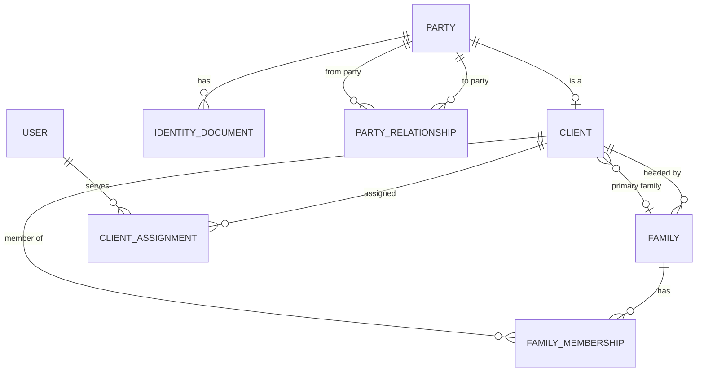
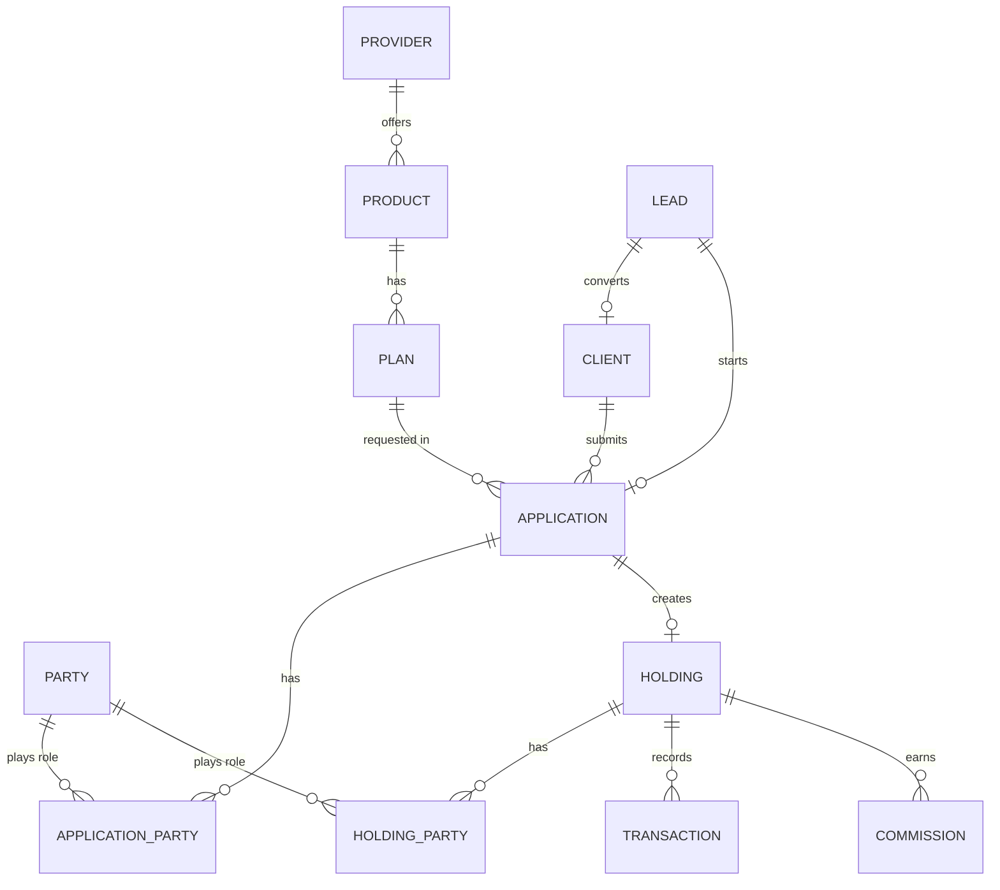

# Entity relationship diagrams

Status: Draft.

The diagrams show logical links. Some links are Frappe Link fields. Some are derived through a role or membership record. The diagrams do not show every field.

## 1. Identity and family

Notes:

- `Party` owns identity data. `Client` adds the client relationship.
- `Related Person` is a Party without a Client record. It is not a separate DocType.
- `Family Membership` is the only link between a Client and a Family.
- `Client.primary_family` is the pointer to the primary Family. The Family Membership row carries the role and status.
- Family lineage is derived. The schema stores no parent-family link and no tree fields.
- `Visibility Grant` is a portal-phase record. It is not part of the phase 1 schema.
- Addresses use Frappe `Address`. The link is dynamic and is not shown.

## 2. Distribution

Notes:

- A Holding links to owners and roles through Holding Party. There is no separate owner column.
- An Application has at most one Holding. One Client can have many Holdings.
- A Lead can convert to a Client or start an Application for an existing Client.
- `Product` and `Plan` store the catalog. The Application and Holding keep a snapshot of the name and code for audit.
- Commission links to the Holding and optionally to the Transaction or Application.
- `Provider` covers AMC, insurer, NBFC, post office, NPS, PMS manager, AIF manager, and national distributor.

## 3. Reading rules

1. A role links to Party. Never copy name or PAN into a role record.
2. Ownership is a Holding Party role. Do not add a second owner field.
3. Family membership is current state only. Inactive rows stay.
4. A Family cannot own a Holding.
5. A Related Person becomes a Client without a data copy.
6. An entity Client is the owner of its Holdings. Beneficial Owners are not Holding owners.

## 4. Field specifications

- [`field-dictionary/identity.md`](field-dictionary/identity.md)
- [`field-dictionary/family.md`](field-dictionary/family.md)
- [`field-dictionary/related-parties.md`](field-dictionary/related-parties.md)

## 5. Open questions

- OQ-010: Joint ownership shares.
- OQ-017: Product model.
- OQ-019: Legal entity.
- OQ-020: Commission scope.
