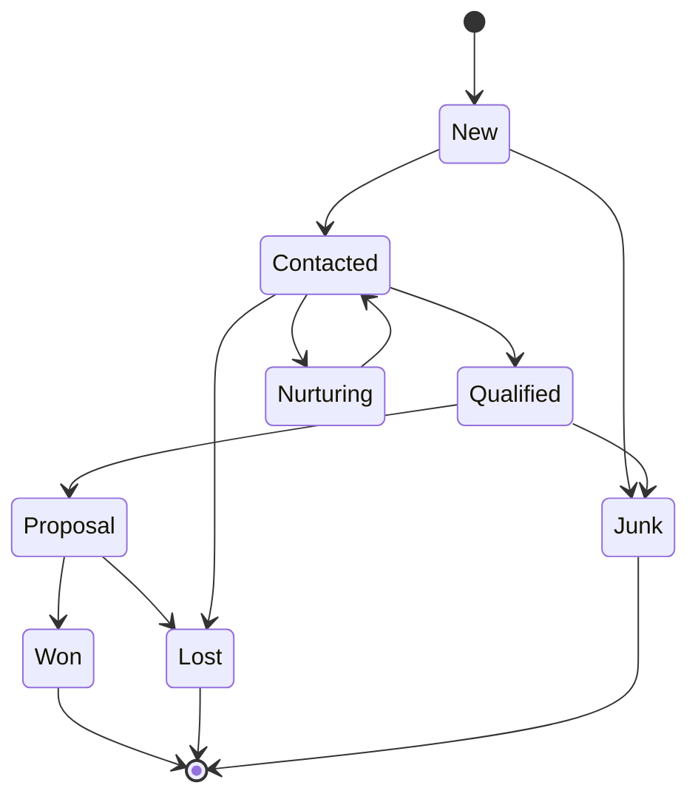
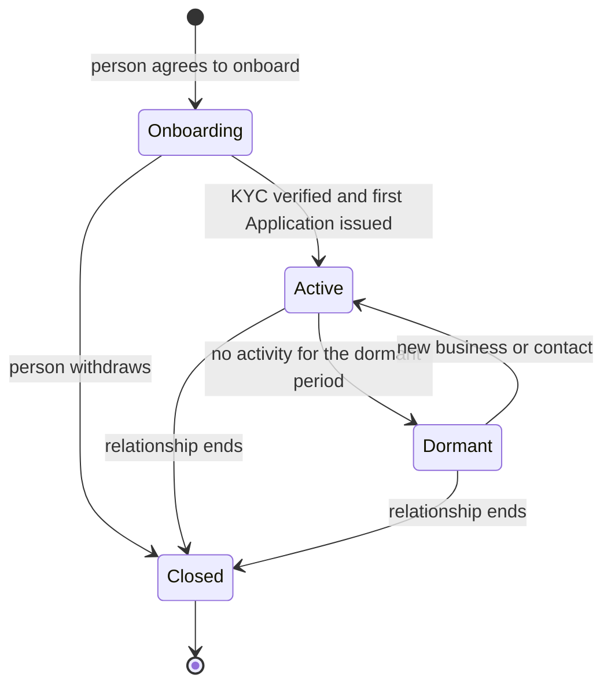
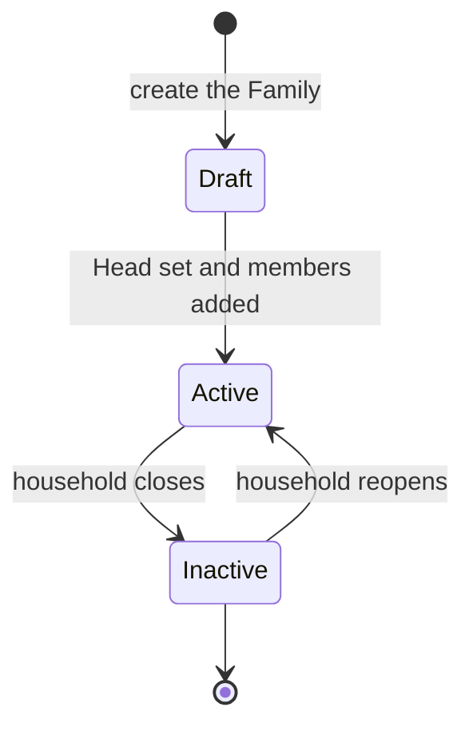
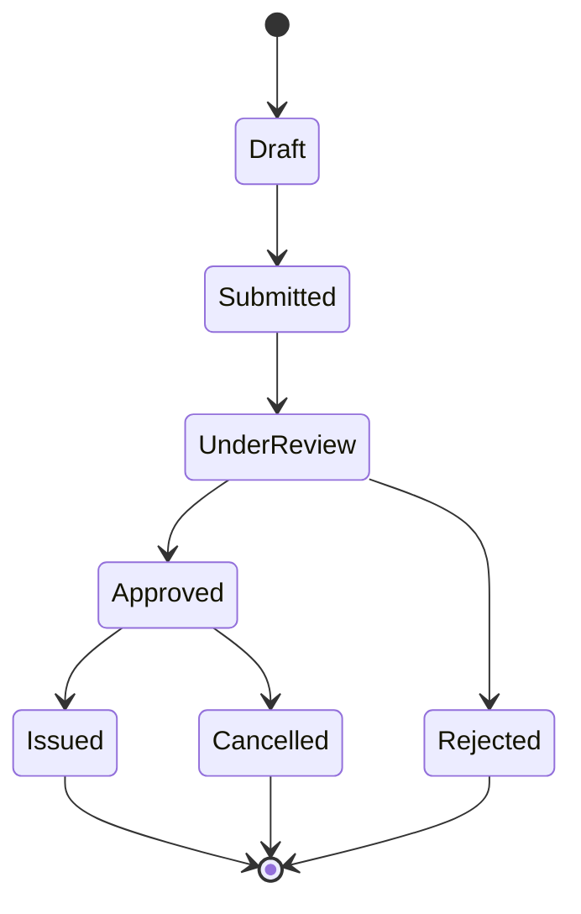
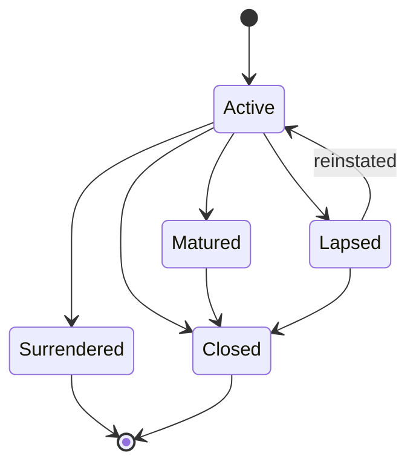
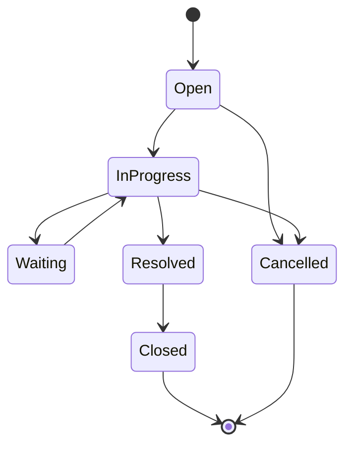

# Lifecycles

Status: Draft.

These state diagrams show the agreed lifecycles. Client and Family statuses are decided in [ADR-0004](../04-decisions/adr-0004-client-identity-and-lifecycle.md) and [ADR-0005](../04-decisions/adr-0005-family-scope-and-employee-view.md). The other diagrams are proposed.

## 1. Rules

- A status change records the date, user, and reason.
- Use a `status` field for a simple lifecycle.
- Use a Frappe Workflow only when approval steps are needed.
- Do not hard delete a record. Use a final status.
- A lifecycle change can create a Service Request or Reminder.
- The diagrams show the main path. Some products add states.

## 2. Lead

A Lead is separate from a Client. A Won Lead converts to a Client or starts an Application for an existing Client. The Client then starts at Onboarding.

## 3. Client

Notes:

- There is no Prospect state. A sales opportunity is a Lead. See [ADR-0004](../04-decisions/adr-0004-client-identity-and-lifecycle.md).
- A Client can be Active with zero Investments. A newly onboarded family member is an example.
- A Minor becomes an adult on the majority date. Create a review task. The status stays Active.
- A Closed Client keeps Holdings and history.
- A Client does not reopen. Create a new relationship instead.
- A death sets the status to Closed, with the reason Deceased, and starts a Family Head review.

## 4. Family

Notes:

- A Family starts as Draft.
- A Family cannot become Active without a Head. The Head is a required field.
- The Head must be an active Individual Client member.
- A Family with no Head stays in Draft.
- An Inactive Family keeps its memberships.
- A Family is never deleted.

## 5. Application

Notes:

- Issued means the Holding exists. The product may use Allotted or Policy Issued as the label.
- An Application can create at most one Holding.
- Manual entry can start at Issued for migrated data.

## 6. Holding

Notes:

- Not every product uses every state. An FD matures. A policy lapses. A folio closes.
- A maturity or lapse creates a Reminder and a Service Request.
- An ownership transfer is a separate event. It does not change the Holding status by itself.

## 7. Service Request

Notes:

- A Grievance is a Service Request type with its own SLA.
- A Claim is a Service Request type with document checks.
- A Review is a separate record, not a Service Request.
- A Reminder can create a Service Request when action is needed.

## 8. Open questions

- OQ-008: Can a Family contain a non-Client.
- OQ-009: Head limited to the primary Family.
- OQ-025: Maker-checker scope.
- OQ-030: Retention.
