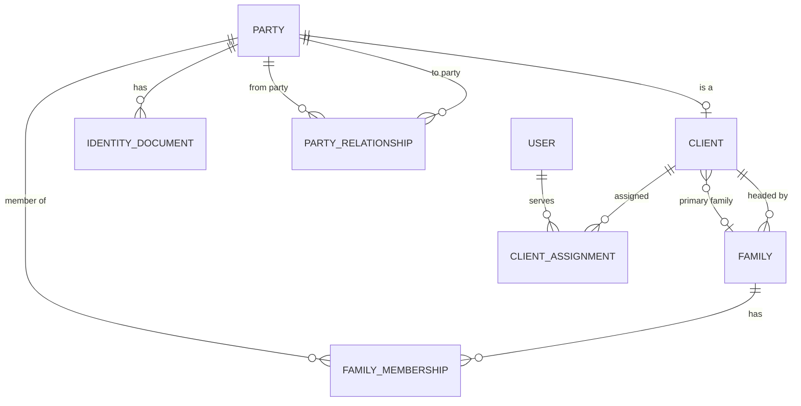
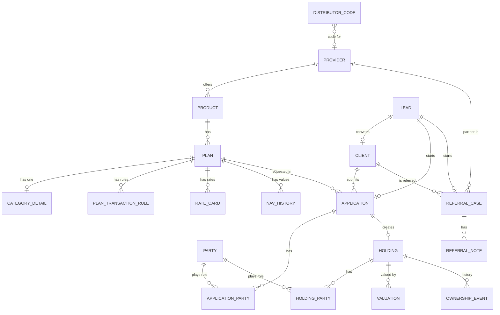

# Data model

Status: Draft. Last updated: 2026-11-16.

This page holds the reference rules for Frappe DocTypes in Dhanada. The model pages explain the business concepts. This page explains how to build the records.

## DocType names

- Use singular names in Title Case: `Client`, `Family`, `Family Membership`.
- Use business terms from the [glossary](../01-foundations/glossary.md).
- Do not use abbreviations in DocType names.
- Use a separate DocType when a record has its own identity, audit trail, or permissions.
- Use a child table when rows belong to one parent and have no independent life.

| Record | Type | Reason |
|---|---|---|
| Party | DocType | Independent identity. |
| Client | DocType | Independent role record. |
| Family | DocType | Independent grouping. |
| Family Membership | DocType | Many-to-many link with its own status and dates. |
| Party Relationship | DocType | Independent relationship with dates and status. |
| Identity Document | DocType | Needs verification status and audit. |
| Holding Party | DocType | Role on a Holding with rank, guardian link, and dates. |
| Valuation | DocType | One value on one date, with a source and audit. |
| Referral Case | DocType | One referral, with its own identity, status, and audit. |
| Referral Note | DocType | A follow-up note on a Referral Case. |
| Distributor Code | DocType | A firm registration or partner code with validity. |
| Visibility Grant | DocType | Portal phase. Consent record with evidence and expiry. |

Transaction and Commission are phase 2. Do not build them in phase 1.

## Keys and naming

### UUID

Party, Client, Family, Application, and Holding use a UUID as the DocType name. The UUID is the internal key. It is not shown as a business identifier.

Confirm the UUID naming method on Frappe 16 during implementation. If the framework method is not available, set the UUID in a controller before insert. This is an implementation detail, not a design change.

### Human-readable codes

| Record | Code | Example | Status |
|---|---|---|---|
| Client | `client_code` | `CL-000001` | Decided, ADR-0004 |
| Family | `family_code` | `FAM-000001` | Proposed |
| Lead | `name` | `LEAD-2026-00001` | Proposed |
| Application | `name` | `APP-2026-00001` | Proposed |
| Holding | `name` | `HLD-2026-00001` | Proposed |
| Referral Case | `name` | `REF-2026-00001` | Proposed |

A code is unique and immutable. It is not a security key. Do not use PAN, mobile, or email as a key.

### Naming series

Use a naming series only for records that employees must quote, such as Leads and Applications. Do not use a naming series as the only identifier for a Client or a Holding.

## Fields

- Use `snake_case` for field names.
- Use clear words. Do not abbreviate. Use `mobile_no`, not `mob`.
- Use `_date` for Date fields and `_on` for Datetime fields.
- Use `is_*` for Check fields. Example: `is_primary`.
- Use `has_*` for Check fields that describe a state. Example: `has_guardian`.
- Use Title Case for Select options.
- Use a Select when the option list is stable. Use a Link when the list is managed data.
- Use a Link for a fixed target. Use a Dynamic Link only when the target DocType varies.
- Add a `notes` field only when a comment is not enough. Prefer the Frappe comment stream for discussion.

## Links and relationships

- A link stores the DocType name of the target record.
- A role links to `Party`, not to a copied name or PAN.
- An ownership row links to `Party` and `Holding`. It carries `holder_rank`, not a share.
- A Family membership links to `Party` and `Family`. The optional Client link is read-only.
- Do not share child tables across DocTypes.
- Do not store the same fact in two places. Derive it or link it.

## Status and workflow

- Use a `status` Select field for a simple lifecycle.
- Use Frappe Workflow only when a record needs approval steps and role-based transitions.
- Do not mix a status field and a workflow on the same record.
- High-risk actions need a separate approval record. Examples: client merge, bank change, nominee change, commission adjustment.

## PII and security

- Store PII once, in Party or Identity Document.
- Mask PAN, mobile, email, and bank details in list views.
- Restrict full values with field-level permissions.
- Do not collect Aadhaar in phase 1. See OQ-004.
- Mark attachments private. Do not use public file URLs.
- Do not expose PAN in URLs, logs, or error messages.
- Encrypt sensitive fields at rest. Confirm the method during implementation.
- Reuse Frappe `Address` for addresses and `User` for login identities.
- Do not use Frappe `Contact` as the master for a person or organization.

The role rules are in [Access and audit](../02-model/09-access-and-audit.md).

## Deletion and merge

- Do not hard delete Party, Client, Family, Holding, or Application.
- Use status to close a record.
- Merge duplicate Parties through an audited process.
- The merged Party is marked `Merged Into`. Links move to the surviving Party.
- A merge needs approval from Compliance or an Administrator.
- Keep the old UUID as a legacy reference.

## Indexes and constraints

- Unique: `client_code`, `family_code`, PAN when present.
- Unique: Family Membership on `family` and `party`.
- Unique: one Client per Party.
- Unique: one active Head per Family.
- Unique: one primary Family per Client.
- Maximum three Owner rows per Holding.
- Unique: one Owner per `holder_rank` per Holding.
- Unique: one active Guardian per minor Party per Holding.
- Nominee shares on one Holding total 100 when there is more than one nominee.
- Unique: one Valuation per Holding per date.
- Unique: one active Referral Case per Client, partner, and type.
- Unique: one active Distributor Code per code type and provider.
- Search: legal name, mobile, email, client code.
- Index: status, primary RM, primary Family, PAN.

## Dates, currency, and locale

- Dates use the `Date` field. Timestamps use the `Datetime` field.
- Time zone: Asia/Kolkata.
- Currency: INR in phase 1. See OQ-031.
- Store amounts as Currency fields. Do not store money as text.
- Store percentages as Percent fields.

## Module split

Proposed Frappe modules:

- **Dhanada Core:** Party, Client, Family, Identity, Visibility.
- **Dhanada Distribution:** Provider, Product, Plan, Plan Transaction Rule, Distributor Code, Lead, Application, Holding, Valuation.
- **Dhanada Referral:** Referral Case, Referral Note.
- **Dhanada Servicing:** Service Request, Review, Reminder.
- **Dhanada Marketing:** Campaign, Segment, Consent use.

Commission and Transaction are phase 2.

The split is proposed. See OQ-028.

## Entity relationship diagrams

The diagrams show logical links. Some links are Frappe Link fields. Some are derived through a role or membership record. The diagrams do not show every field.

### Identity and family

Notes:

- `Party` owns identity data. `Client` adds the client relationship.
- `Related Person` is a Party without a Client record. It is not a separate DocType.
- `Family Membership` links a Party to a Family. The optional Client link is read-only.
- `Client.primary_family` points to the primary Family. The Family Membership row carries the role and status.
- Family lineage is derived. The schema stores no parent-family link and no tree fields.
- `Visibility Grant` is a portal-phase record. It is not part of the phase 1 schema.
- Addresses use Frappe `Address`. The link is dynamic and is not shown.

### Distribution

Notes:

- A Holding links to owners and roles through Holding Party. There is no separate owner column and no owner share.
- `holder_rank` orders the owners. Rank 1 is the Primary Holder. A Holding has at most three owners.
- `CATEGORY_DETAIL` is a logical name. Each category group has one detail DocType, linked one-to-one to Plan.
- `Plan Transaction Rule` holds purchase, redemption, SIP, STP, SWP, and switch rules. One row per plan and transaction type.
- `Rate Card` holds time-based rates for FD and post office. `NAV History` holds time-based values for market-linked products.
- An Application has at most one Holding. One Client can have many Holdings.
- A Holding has one or more Valuation rows. The latest row supplies the current value.
- A Lead can convert to a Client, start an Application, or start a Referral Case.
- A Referral Case links one Client to one partner. It never creates a Holding.
- `Product` and `Plan` store the catalog. The Application and Holding keep a snapshot of the name and code for audit.
- `Ownership Event` is append-only history. The current owners stay in Holding Party.
- `Distributor Code` holds the ARN, APMI, AMC codes, and NBFC codes.
- `Provider` covers AMC, insurer, bank, NBFC, corporate, post office, NPS, PMS manager, AIF manager, national distributor, and depository participant.
- Commission and Transaction are phase 2. They are not in the phase 1 schema.

### Reading rules

1. A role links to Party. Never copy name or PAN into a role record.
2. Ownership is a Holding Party role. Do not add a second owner field and do not store an owner share.
3. A Holding has at most three owners, ordered by `holder_rank`.
4. A Guardian is a Holding Party role with `acts_for`. There is no client-level guardian.
5. Family membership is current state only. Inactive rows stay.
6. A Family cannot own a Holding.
7. A Related Person becomes a Client without a data copy.
8. An entity Client is the owner of its Holdings. Beneficial Owners are not Holding owners.
9. A Referral Case links to a Client, not to a Holding. It never adds to AUM.
10. A Valuation belongs to one Holding. A new value is a new row.

## Field specifications

Every model page carries its own full field list in a collapsed block:

- [Party and Client](../02-model/01-party-and-client.md#records-and-fields)
- [Family](../02-model/02-family.md#records-and-fields)
- [Related parties and ownership](../02-model/03-related-parties-and-ownership.md#records-and-fields)
- [Products and providers](../02-model/04-products-and-providers.md#records-and-fields)
- [Leads and applications](../02-model/05-leads-and-applications.md#records-and-fields)
- [Holdings and investments](../02-model/06-holdings-and-investments.md#records-and-fields)
- [Referrals](../02-model/10-referrals.md#records-and-fields)
- [Commission](../02-model/07-commission.md#records-and-fields)
- [Servicing](../02-model/08-servicing.md#records-and-fields)

## Where a report joins

| Report | Reads | Joins |
|---|---|---|
| Client portfolio | Holding, Holding Party | Plan, Product |
| AUM by category | Holding, Product | Plan |
| Maturity calendar | Holding | Plan, Product |
| Valuation history | Valuation | Holding, Plan |
| Referral pipeline | Referral Case | Client, Provider |
| Website product page | Product, Plan, Plan Transaction Rule | None |
| Rate history | Rate Card | Plan |
| NAV chart | NAV History | Plan |
| Commission by product | Commission, Holding | Plan, Product, Provider. Phase 2. |

The client portfolio and the website never share a query path. That keeps client data out of the public tier.

## Build order

| Step | Build | Why first |
|---|---|---|
| 1 | Provider, Product, Plan, Distributor Code | The catalog is the base. |
| 2 | MF and FD detail, Plan Transaction Rule, Rate Card, NAV History | These cover most of the book. |
| 3 | Application and Holding | The core position flow. |
| 4 | Valuation | Every manual value update. |
| 5 | Holding Party | Owners, nominees, and guardian. |
| 6 | Referral Case | Demat, CASA, and loan referrals. |
| 7 | Insurance, NPS, bond, post office, PMS, and AIF detail | The remaining families. |
| 8 | Website product pages | Public read of the catalog. |
| 9 | Reports | After the data exists. |

Do not build in phase 1:

- A Transaction record or a transaction engine.
- Commission or payout records.
- AMFI, BSE Star, RTA, or provider feeds.
- A separate portfolio DocType per category.
- Fund accounting for PMS or AIF.
- Insurance quotes or benefit illustrations.
- Order placement with a provider.
- A public NAV or rate feed integration.
- A client portal view of the catalog.

## Migration

The existing branches contain `Client`, `Family`, `Family Member`, and `Lead`.

Migration rules:

1. Map each existing `Client` to one Party and one Client.
2. Map `Family` to Family.
3. Map `Family Member` to Family Membership.
4. Map `Client.family` and `Client.family_role` to Family Membership. Remove the duplicate source.
5. Map `Lead` to Lead. Keep the existing Lead ID as a legacy reference.
6. Deduplicate by PAN, mobile, email, and name.
7. Keep a legacy ID field on migrated records.
8. Do not migrate the duplicate `client` and `converted_client` links on Lead without review.

See OQ-032.

## Open questions

- OQ-026: Naming.
- OQ-028: Module split.
- OQ-031: Currency.
- OQ-032: Migration.
- OQ-034: Referral case scope.
- OQ-039: Scheme master import.
- OQ-040: Valuation history.

See [Open questions](open-questions.md).
