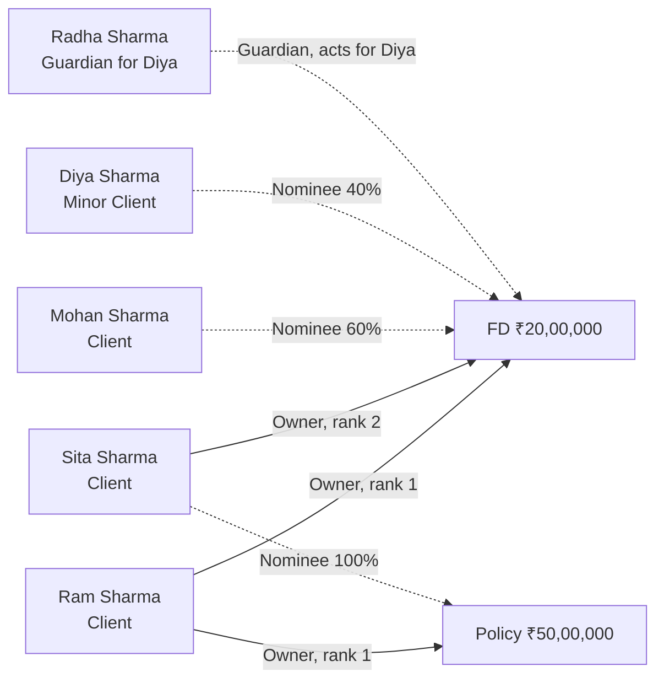

# Joint holders and nominee

Status: Draft. Last updated: 2026-11-16.

## In plain words

Ram and Sita open a fixed deposit of ₹20,00,000. Ram is the **Primary Holder**. Sita is the **Joint Holder**. The bank records first holder and second holder. It does not record a percentage, so Dhanada does not store one either.

They name two nominees on the deposit: Mohan gets 60% and Diya gets 40%. Diya is 8, so Radha is the guardian for Diya on this deposit.

Ram also has a life insurance policy of ₹50,00,000. Sita is the **nominee** on that policy, with 100%.

A nominee is not an owner. Sita has a nominee role on the policy. She owns nothing until Ram dies and the insurer settles the claim. A joint holder is an owner. Sita is an owner of the deposit from day one, in second position.

## What the employee does

| Step | Who | Action | Record created or changed |
|---|---|---|---|
| 1 | RM | Creates the FD Application for Ram and Sita. | Application, two applicants. Ram is applicant rank 1. |
| 2 | Operations | Records the FD after issue. | Holding, FD, ₹20,00,000, mode Joint. |
| 3 | Operations | Records the holders in order. | Holding Party: Ram Owner rank 1, Sita Owner rank 2. |
| 4 | Operations | Records the two nominees with their shares. | Holding Party: Mohan Nominee 60%, Diya Nominee 40%. |
| 5 | Operations | Records the guardian for the minor nominee. | Holding Party: Radha Guardian, `acts_for` Diya. |
| 6 | Operations | Records the policy. | Holding, Policy, ₹50,00,000. |
| 7 | Operations | Records the policy owner and nominee. | Holding Party: Ram Owner rank 1. Holding Party: Sita Nominee 100%. |

## What the system stores

| Holding | Party | Role | Rank | Nominee share | Acts for |
|---|---|---|---|---|---|
| FD | Ram Sharma | Owner | 1 | - | - |
| FD | Sita Sharma | Owner | 2 | - | - |
| FD | Mohan Sharma | Nominee | - | 60% | - |
| FD | Diya Sharma | Nominee | - | 40% | - |
| FD | Radha Sharma | Guardian | - | - | Diya Sharma |
| Policy | Ram Sharma | Owner | 1 | - | - |
| Policy | Sita Sharma | Nominee | - | 100% | - |

The owner rows have no share. One owner is rank 1, the other is rank 2. The nominee rows total 100. A nominee never adds to the owner count.

## AUM

This page covers only the two Holdings in the story. The full family total is in [The Sharma family](sharma-family.md).

| Report | Value |
|---|---|
| Ram, personal | ₹20,00,000 from the FD, plus ₹50,00,000 from the policy |
| Sita, personal | ₹0 from these Holdings. She is a Joint Holder on the FD. |
| Family A | ₹70,00,000, counting each Holding once |
| Firm total | ₹70,00,000, counting each Holding once |

Ram is the Primary Holder, so the FD value counts in his personal AUM. Sita sees the FD in her portfolio with a Joint badge and no value. If Sita were the Primary Holder instead, the value would count for her.

If Ram and Sita were in different Families, each Family would show the full FD and the firm total would still count it once. A joint holder outside the Family sees a memo row: "Joint interest in FD with Ram Sharma". The memo row has no value.

## The claim

Ram dies. Three things happen.

### 1. The joint deposit

The bank transfers the deposit to the surviving joint holder. Dhanada records an ownership event:

- Ram's Owner row becomes Inactive.
- Sita's row becomes rank 1.
- The nominee rows and the guardian row become Inactive. The survivor takes the deposit.
- An `Ownership Event` records Survivor Transfer, from Ram to Sita, with the date and the supporting document.

Sita is now the Primary Holder of the full deposit.

### 2. The policy claim

Sita files a claim. The claim is a **Service Request** of type Claim.

- Operations records the documents.
- The insurer settles.
- The Holding moves to Closed.
- Sita's nominee role expires.
- A new Holding records the proceeds, with Sita as Owner rank 1.

The nominee becomes an owner only through the recorded claim.

### 3. The Family Head

Ram was the Head of Family A. A Head must be an active Individual Client and must head their primary Family. Ram's Client status becomes Closed, with reason Deceased.

Family A cannot stay Active without a Head. The employee sets Sita as the new Head. Family A stays Active.

## The shape

## Why it matters

- Ownership and roles are separate records. A nominee does not appear in the owner list.
- A joint holder does appear in the owner list, with a rank and no share.
- AUM follows the Primary Holder. It does not split by a made-up percentage.
- A minor nominee needs a guardian on the Holding, not an appointee field.
- A death creates recorded events. Nothing is overwritten.
- The Head rule is real. A death forces a Head change, and the system enforces it.
- The same Holding appears in two Client portfolios. The Family report counts it once.
