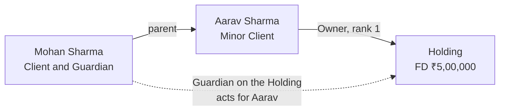

# Minor and guardian

Status: Draft. Last updated: 2026-11-16.

## In plain words

Aarav Sharma is 12. His father Mohan invests ₹5,00,000 in a fixed deposit for him. Aarav is the owner. Aarav is a **Client**, because a minor can hold an Investment.

Aarav has no PAN and cannot sign. His father Mohan acts for him as **Guardian** on that deposit. The guardian role has an end date: Aarav's 18th birthday.

A guardian belongs to the **Holding**, not to the Client. If Sita opened another deposit for Aarav, she could be the guardian on that one. The system holds both facts without conflict.

When Aarav turns 18, the guardian roles expire. KNAPS creates a review task to refresh KYC and hand control to Aarav.

## What the employee does

| Step | Who | Action | Record created or changed |
|---|---|---|---|
| 1 | RM | Records Aarav's details from the birth certificate. | Party, type Individual, date of birth. |
| 2 | RM | Creates the Client as a Minor. | Client, `CL-000105`, type Minor, status Onboarding. |
| 3 | Operations | Records the birth certificate. No PAN is available. | Identity Document, type Birth Certificate. |
| 4 | Operations | Verifies KYC and sets the Client to Active. | Client status Active. No guardian is added here. |
| 5 | RM | Creates the Application for the FD. Aarav is the only applicant. Mohan acts for him. | Application, applicant Aarav. Application Party: Aarav, Guardian Mohan. |
| 6 | Operations | Records the FD. | Holding, FD, ₹5,00,000. |
| 7 | Operations | Records Aarav as the only owner. | Holding Party: Aarav, Owner, rank 1. |
| 8 | Operations | Records Mohan as the guardian on this Holding. | Holding Party: Mohan, Guardian, `acts_for` Aarav, end date 2032-08-14. |

## What the system stores

| Record | Key values |
|---|---|
| Party | Aarav Sharma, date of birth. No PAN. |
| Client | `CL-000105`, type Minor, status Active, `majority_date` 2032-08-14 |
| Identity Document | Birth certificate, verified |
| Holding | FD, ₹5,00,000, start date, maturity date |
| Holding Party | Aarav, Owner, rank 1 |
| Holding Party | Mohan, Guardian, `acts_for` Aarav, ends on the majority date |

There is no Guardian row on the Client and no Guardian row in Party Relationship. The parent link between Mohan and Aarav is a separate Party Relationship of type Parent. It exists for the family map and has no legal power.

## The shape

## A second deposit

Suppose Sita opens a second deposit for Aarav. The new Holding has:

- Aarav, Owner, rank 1.
- Sita, Guardian, `acts_for` Aarav.

Both deposits are correct. The Client record is unchanged. No employee has to choose one guardian for Aarav.

## At majority

On 2032-08-14:

1. Every Guardian row that acts for Aarav expires.
2. A review task opens: refresh KYC, collect PAN, confirm the bank account, and confirm contact details.
3. `client_type` changes from Minor to Individual.
4. Aarav becomes the decision maker.
5. An employee removes any remaining guardian access.

Until step 1, every instruction from Aarav needs the guardian named on that Holding.

## Why it matters

- A minor is a Client, not a note on the parent's record. The Investment belongs to Aarav.
- PAN is optional. The model does not block a Client who has no PAN.
- A minor owner is the only owner. Aarav is never a joint holder.
- The guardian role is dated. It ends without manual guesswork.
- The guardian does not own the Investment. Mohan is a role, not an owner.
- The guardian can change from Holding to Holding. One parent may act on one deposit, the other parent on another.
- The Family stays unchanged. Aarav remains in Family B before and after majority.
- A guardian can be a Related Person. In this case Mohan is already a Client.

## Related rules

- Ownership: [related parties and ownership](../02-model/03-related-parties-and-ownership.md).
- A Client can be Active with no Investments. Aarav is Active before the FD is opened.
- The Family Head is an Individual Client. A minor can be a member and cannot be a Head.
- A minor cannot be a nominee without a Guardian row on the Holding.
