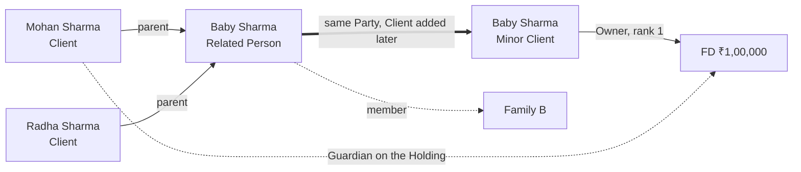

# Newborn in the family

Status: Draft. Last updated: 2026-11-16.

## In plain words

Mohan and Radha have a baby, Baby Sharma. The grandparents want the baby on the family record. The baby has no PAN, no bank account, and no Investment. She is not a Client.

Dhanada adds her as a **Related Person** to Family B. The family view is complete from day one. The client list stays clean.

Four months later, Mohan opens a fixed deposit of ₹1,00,000 for Baby. Now she becomes a Client. The family membership row does not change. The same Party gets a Client record.

## What the employee does

### Part 1: add the baby

| Step | Who | Action | Record created or changed |
|---|---|---|---|
| 1 | RM | Records the baby's name and date of birth. | Party, type Individual, no PAN. |
| 2 | RM | Adds the baby to the household. | Family Membership: Family B, Party Baby Sharma, role Child, status Active. |
| 3 | RM | Records the mother and father. | Party Relationship: Mohan to Baby, Parent. Radha to Baby, Parent. |

The family view now shows Baby with a **Related Person** badge. No Client code exists.

### Part 2: open the deposit

| Step | Who | Action | Record created or changed |
|---|---|---|---|
| 4 | RM | Creates the Client when the parents agree to invest. | Client, type Minor, status Onboarding. Same Party. |
| 5 | Operations | Records the birth certificate. | Identity Document, type Birth Certificate. |
| 6 | Operations | Verifies KYC and sets the Client to Active. | Client status Active. |
| 7 | RM | Creates the Application for the FD. | Application, applicant Baby, guardian Mohan. |
| 8 | Operations | Records the FD. | Holding, FD, ₹1,00,000. |
| 9 | Operations | Records the owner and the guardian. | Holding Party: Baby Owner rank 1. Mohan Guardian, `acts_for` Baby. |

## What the system stores

| Record | Before the deposit | After the deposit |
|---|---|---|
| Party | Baby Sharma, date of birth | Unchanged |
| Client | None | `CL-000112`, type Minor, Active |
| Family Membership | Family B, Baby, Child, Active | Unchanged |
| Party Relationship | Mohan Parent, Radha Parent | Unchanged |
| Holding | None | FD ₹1,00,000 |
| Holding Party | None | Baby Owner rank 1, Mohan Guardian |

## The shape

The dotted line shows the same Party. No name, date of birth, or parent link is copied. The membership row points to the Party throughout.

## What the employee must not do

- Do not create a Client record at step 1. The baby has no relationship with KNAPS yet.
- Do not create a Lead. The family did not ask for a product.
- Do not create a second Party at step 4. Use the same Party.
- Do not create a second Family Membership. Update the existing row.
- Do not add the baby to the AUM report before she owns a Holding.

## Why it matters

- The Family is a grouping of Parties, not a grouping of client records.
- A family record can be complete before anyone onboards.
- The client list stays clean. A Client record is created only when there is a reason.
- A Related Person becomes a Client without a data copy.
- A minor can be a Client with no PAN and no guardian until a Holding needs one.
- The family view and the client list answer different questions. Both stay correct.
- The new deposit adds ₹1,00,000 to Family B personal AUM when it is recorded. The AUM tables in [The Sharma family](sharma-family.md) cover the older Holdings.
