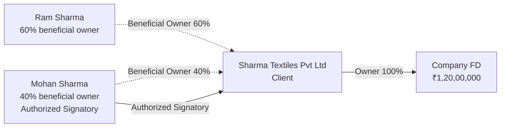
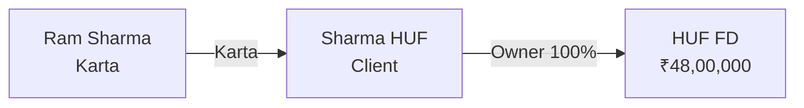

# Company and HUF

Status: Draft.

## In plain words

The Sharma family runs two entities. **Sharma Textiles Pvt Ltd** is a private company. **Sharma HUF** is a Hindu Undivided Family.

Both are **Clients**. Both own Investments in their own name. Ram and Mohan control the company. Ram manages the HUF. Neither man owns the entity's money in his personal name.

Dhanada must show the entity as a member of Family A, and still keep the entity's money out of the family's personal total.

## The two Clients

| Client | Code | Type | Identifier | Family |
|---|---|---|---|---|
| Sharma Textiles Pvt Ltd | CL-000109 | Company | CIN and PAN | Family A, role Family Business |
| Sharma HUF | CL-000108 | HUF | PAN | Family A, role HUF |

## Sharma Textiles Pvt Ltd

### People and roles

| Party | Role on the company | Share |
|---|---|---|
| Mohan Sharma | Authorized Signatory, scope: banking and investments | None |
| Ram Sharma | Beneficial Owner | 60% |
| Mohan Sharma | Beneficial Owner | 40% |

### What the system stores

| Record | Key values |
|---|---|
| Party | Sharma Textiles Pvt Ltd, type Organization, date of incorporation |
| Client | `CL-000109`, type Company, status Active |
| Identity Document | CIN, PAN, both verified |
| Party Relationship | Mohan to company, Authorized Signatory, scope, no end date |
| Party Relationship | Ram to company, Beneficial Owner, 60% |
| Party Relationship | Mohan to company, Beneficial Owner, 40% |
| Holding | Company FD, ₹1,20,00,000 |
| Holding Party | Sharma Textiles, Primary Owner, 100% |

The company is the only owner of the company FD. The two shareholders are beneficial owners of the company. They are not owners of the FD.

### The shape

## Sharma HUF

### People and roles

| Party | Role on the HUF | Note |
|---|---|---|
| Ram Sharma | Karta | Manages the HUF. |
| Sita Sharma | Member | Coparcener by family status. |
| Mohan Sharma | Member | Coparcener by family status. |

### What the system stores

| Record | Key values |
|---|---|
| Party | Sharma HUF, type Organization, organization type HUF |
| Client | `CL-000108`, type HUF, status Active |
| Identity Document | PAN, verified |
| Party Relationship | Ram to HUF, Karta |
| Holding | HUF FD, ₹48,00,000 |
| Holding Party | Sharma HUF, Primary Owner, 100% |

The HUF owns the FD. Ram acts for the HUF as Karta. Family members do not own the HUF assets in their personal names.

### The shape

## AUM

| Report | Value |
|---|---|
| Family A, personal | ₹1,36,00,000 |
| Family A, entity | ₹1,68,00,000 |
| Sharma Textiles | ₹1,20,00,000 |
| Sharma HUF | ₹48,00,000 |
| Firm total | ₹4,01,00,000, counting every Holding once |

Family A shows two lines. The personal line covers Ram, Sita, Mohan, and Suresh. The entity line covers the two entity Clients. The two lines are never added into one family figure.

## What the employee does

1. Open Family A. Read the personal line and the entity line.
2. Open the company record to see the signatory and the beneficial owners.
3. Open the HUF record to see the Karta.
4. Record an entity Investment against the entity Client, never against Ram or Mohan.
5. On a Karta change, end the old Karta relationship and start a new one. Keep both rows.

## Why it matters

- An entity is a Client. It can own Investments and hold a Family membership.
- The entity is the owner. Directors, shareholders, and the Karta are roles.
- Entity AUM is separate. The family report does not double count.
- Beneficial ownership is tracked for compliance, not for AUM.
- A Karta change is a recorded event, not an edit that erases history.
- An entity can be a Family member but never a Family. A Family has no PAN and cannot own assets.

## Related rules

- [Related parties](../02-domain/related-parties.md): ownership and role rules.
- [The Sharma family](sharma-family.md): the full cast and the AUM split.
- OQ-015: beneficial owner depth in phase 1.
- OQ-019: legal entity structure for licenses and commission.
