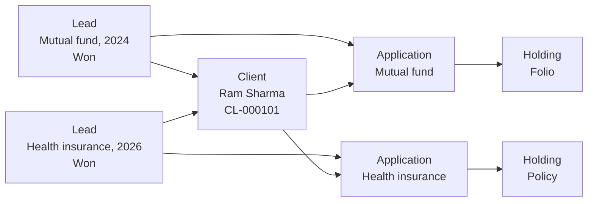

# Existing client cross-sell

Status: Draft.

## In plain words

Ram Sharma already has a Client record, a Family, and several Investments. He asks his RM about health insurance for himself and Sita.

This is new business, not a new client. Dhanada creates a new **Lead** linked to Ram's existing Client. The Lead runs its own sales stages. When Ram agrees, the Application starts. Ram keeps his one Client record.

## What the employee does

| Step | Who | Action | Record created or changed |
|---|---|---|---|
| 1 | RM | Opens Ram's Client record and checks the Family. | No new Client. |
| 2 | RM | Records the interest in health insurance. | Lead, linked to Ram's Client. `client` set. |
| 3 | RM | Meets Ram and Sita. Records the requirement and sum insured. | Lead, status Qualified. |
| 4 | RM | Confirms the quote with the insurer outside Dhanada. | No quote record in phase 1. |
| 5 | RM | Ram agrees. Starts the Application. | Application, status Draft, then Submitted. |
| 6 | Operations | Records the policy after issue. | Holding, type Policy. Application Issued. |
| 7 | RM | Records Sita as a joint applicant or a member covered by the policy, as the insurer requires. | Application Party and Holding Party rows. |
| 8 | RM | Closes the Lead as Won. | Lead, status Won, `converted_client` points to the same Client. |

## What the system stores

| Record | Change |
|---|---|
| Client | Unchanged. Same `CL-000101`. |
| Family | Unchanged. Family A already exists. |
| Lead | New row, linked to Ram's Client, product interest Health Insurance |
| Application | New row, same Client, new Plan |
| Holding | New row, type Policy |
| Holding Party | Ram as Primary Owner, or the insurer's required owner structure |

## The shape

## What the system does not do

- It does not create a second Client or a second Party for Ram.
- It does not create a second Family.
- It does not reopen the old Lead from 2024.
- It does not store an insurer quote. Quotes are out of scope in phase 1.

## Why it matters

- One Client holds all products. The portfolio view stays complete.
- Each sales attempt has its own Lead and its own outcome. A failed health insurance Lead does not touch the mutual fund history.
- The Client list does not grow when an existing Client buys again.
- Attribution stays correct. The new Lead can carry a campaign or referral source.
