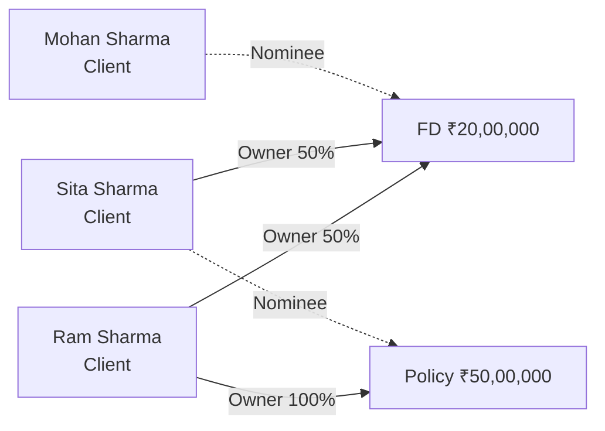

# Joint holders and nominee

Status: Draft.

## In plain words

Ram and Sita open a fixed deposit of ₹20,00,000. They are **joint holders** with 50% each. They name their son Mohan as **nominee**.

Ram also has a life insurance policy of ₹50,00,000. Sita is the **nominee** on that policy.

A nominee is not an owner. Sita has a nominee role on the policy. She owns nothing until Ram dies and the insurer settles the claim. A joint holder is an owner. Ram and Sita each own half of the deposit from day one.

## What the employee does

| Step | Who | Action | Record created or changed |
|---|---|---|---|
| 1 | RM | Creates the FD Application for Ram and Sita. | Application, two applicants. |
| 2 | Operations | Records the FD after issue. | Holding, type FD, ₹20,00,000. |
| 3 | Operations | Records both owners with shares. | Holding Party: Ram 50%, Sita 50%. |
| 4 | Operations | Records the nominee. | Holding Party: Mohan, Nominee. |
| 5 | Operations | Records the policy. | Holding, type Policy, ₹50,00,000. |
| 6 | Operations | Records the policy owner and nominee. | Holding Party: Ram 100%. Holding Party: Sita, Nominee. |

## What the system stores

| Holding | Party | Role | Share |
|---|---|---|---|
| FD | Ram Sharma | Primary Owner | 50% |
| FD | Sita Sharma | Joint Holder | 50% |
| FD | Mohan Sharma | Nominee | None |
| Policy | Ram Sharma | Primary Owner | 100% |
| Policy | Sita Sharma | Nominee | None |

Owner shares on each Holding sum to 100%. A nominee share is empty. A nominee never adds to the owner total.

## AUM

This page covers only the two Holdings in the story. The full family total is in [The Sharma family](sharma-family.md).

| Report | Value |
|---|---|
| Ram, personal | ₹10,00,000 from the FD, plus ₹50,00,000 from the policy |
| Sita, personal | ₹10,00,000 from the FD |
| Family A | ₹70,00,000, counting each Holding once |
| Firm total | ₹70,00,000, counting each Holding once |

Ram and Sita are in the same Family, so Family A counts the FD once. If they were in different Families, each Family would show its own half and the firm total would still count the FD once.

## The claim

Ram dies. Three things happen.

### 1. The joint deposit

The bank transfers the deposit to the surviving joint holder. Dhanada records an ownership change:

- Ram's 50% row becomes Inactive.
- Sita's row becomes 100%.
- The event is logged with the date and the reason.

Sita now owns the full deposit.

### 2. The policy claim

Sita files a claim. The claim is a **Service Request** of type Claim.

- Operations records the documents.
- The insurer settles.
- The Holding moves to Closed.
- Sita's nominee role expires.
- A new Holding records the proceeds, with Sita as owner.

The nominee becomes an owner only through the recorded claim.

### 3. The Family Head

Ram was the Head of Family A. A Head must be an active Individual Client. Ram's Client status becomes Closed, with reason Deceased.

Family A cannot stay Active without a Head. The employee sets Sita as the new Head. Family A stays Active.

## The shape

## Why it matters

- Ownership and roles are separate records. A nominee does not appear in the owner list.
- A joint holder does appear in the owner list, with a share.
- AUM follows owners. It does not follow roles.
- A death creates recorded events. Nothing is overwritten.
- The Head rule is real. A death forces a Head change, and the system enforces it.
- The same Holding appears in two Client reports and once in the Family report.
