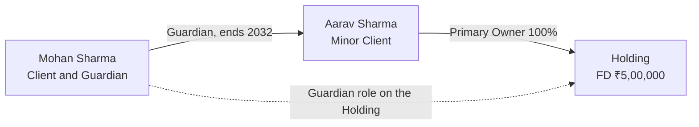

# Minor and guardian

Status: Draft.

## In plain words

Aarav Sharma is 12. His father Mohan invests ₹5,00,000 in a fixed deposit for him. Aarav is the owner. Aarav is a **Client**, because a minor can hold an Investment.

Aarav has no PAN and cannot sign. His father Mohan acts for him as **Guardian**. The guardian role has an end date: Aarav's 18th birthday.

When Aarav turns 18, the guardian role expires. KNAPS creates a review task to refresh KYC and hand control to Aarav.

## What the employee does

| Step | Who | Action | Record created or changed |
|---|---|---|---|
| 1 | RM | Records Aarav's details from the birth certificate. | Party, type Individual, date of birth. |
| 2 | RM | Creates the Client as a Minor. | Client, `CL-000105`, type Minor, status Onboarding. |
| 3 | Operations | Records the birth certificate. No PAN is available. | Identity Document, type Birth Certificate. |
| 4 | RM | Links Mohan as guardian. | Party Relationship, Guardian, end date at majority. |
| 5 | Operations | Verifies KYC and sets the Client to Active. | Client status Active. |
| 6 | RM | Creates the Application for the FD. | Application, applicant Aarav, guardian Mohan. |
| 7 | Operations | Records the FD. | Holding, type FD. |
| 8 | Operations | Records the owner and the guardian. | Holding Party: Aarav Primary Owner 100%, Mohan Guardian. |

## What the system stores

| Record | Key values |
|---|---|
| Party | Aarav Sharma, date of birth. No PAN. |
| Client | `CL-000105`, type Minor, status Active, `majority_date` |
| Identity Document | Birth certificate, verified |
| Party Relationship | From Mohan to Aarav, type Guardian, end date 2032-08-14 |
| Holding | FD, ₹5,00,000, start date, maturity date |
| Holding Party | Aarav, Primary Owner, 100% |
| Holding Party | Mohan, Guardian, ends on the majority date |

## The shape

## At majority

On 2032-08-14:

1. The Guardian relationship expires.
2. The Guardian role on each Holding expires.
3. A review task opens: refresh KYC, collect PAN, confirm the bank account, and confirm contact details.
4. `client_type` changes from Minor to Individual.
5. Aarav becomes the decision maker.
6. An employee removes any guardian access.

Until step 1, every instruction from Aarav needs Mohan's confirmation.

## Why it matters

- A minor is a Client, not a note on the parent's record. The Investment belongs to Aarav.
- PAN is optional. The model does not block a Client who has no PAN.
- The guardian role is dated. It ends without manual guesswork.
- The guardian does not own the Investment. Mohan is a role, not an owner.
- The Family stays unchanged. Aarav remains in Family B before and after majority.
- A guardian can be a Related Person. In this case Mohan is already a Client.

## Related rules

- Ownership: [related parties](../02-domain/related-parties.md).
- A Client can be Active with no Investments. Aarav is Active before the FD is opened.
- The Family Head is an Individual Client. A minor can be a member and cannot be a Head.
