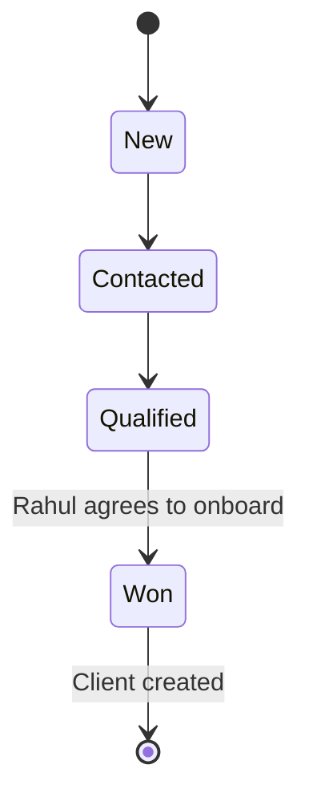
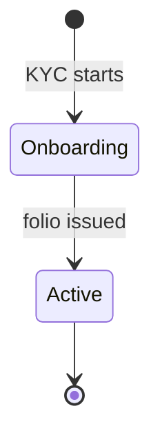

# New client journey

Status: Draft.

## In plain words

Rahul Mehta is 31. He finds KNAPS on the website and asks about a mutual fund. He gives his name and mobile number. He is a **Lead**, not a Client.

The RM calls him. Rahul agrees to invest and shares his PAN, KYC documents, bank details, and address. Aadhaar is not collected. Now KNAPS creates a Client record with status **Onboarding**. The Lead stays linked as the source.

The folio is issued. The Client becomes **Active**.

## What the employee does

| Step | Who | Action | Record created or changed |
|---|---|---|---|
| 1 | Website | Rahul submits the contact form. | Lead, status New. Source: Website. |
| 2 | RM | Calls Rahul and records the note. | Lead, status Contacted. |
| 3 | RM | Confirms interest in a mutual fund and the amount. | Lead, status Qualified. Product interest set. |
| 4 | RM | Checks for a duplicate by mobile, email, and name. | No match. Review item closed. |
| 5 | RM | Rahul agrees to onboard. | Party, Client, status Onboarding. `source_lead` set. |
| 6 | Operations | Records PAN and the identity documents. | Identity Documents. KYC In Progress. |
| 7 | Operations | Verifies KYC and records the bank and address. | KYC Verified. Bank account linked. |
| 8 | RM | Creates the Application for the chosen Plan. | Application, status Submitted. |
| 9 | Operations | Records the folio after allotment. | Holding, status Active. Application Issued. |
| 10 | Operations | Sets the Client to Active. | Client, status Active. `onboarding_date` set. |

## What the system stores

| Record | Key values |
|---|---|
| Lead | Name, mobile, email, source Website, status Won, `converted_client` |
| Party | Legal name Rahul Mehta, date of birth, mobile, email |
| Client | `CL-000112`, type Individual, status Active, `source_lead`, primary RM |
| Identity Document | PAN, verified. No Aadhaar record. |
| Application | Client, Plan, amount, business source Direct, RM |
| Holding | Plan, folio number, start date, value |
| Holding Party | Rahul, Primary Owner, 100% |

## Status flow

## What the system does not create

- No Client record at step 1. A website form is not a relationship.
- No Prospect record at any step. The Lead covers the sales stage.
- No Family. Rahul has no Family until he asks for one.
- No Aadhaar record.
- No second Lead at step 5. The first Lead becomes Won.

## Why it matters

- The client list contains only people who agreed to onboard.
- A failed call leaves a Lead, not a Client.
- The Lead keeps the marketing source. The Client keeps the relationship.
- If Rahul later wants another product, the story continues in [existing client cross-sell](existing-client-cross-sell.md).
