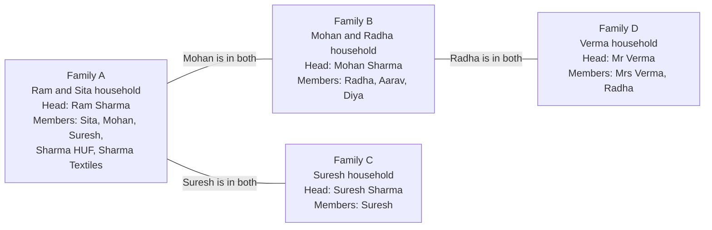
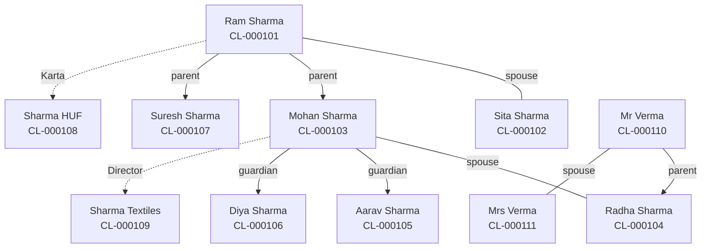

# The Sharma family

Status: Draft.

## In plain words

Ram Sharma is 68. He lives with his wife Sita. Their elder son Mohan is married to Radha and has two children, Aarav and Diya. Their younger son Suresh lives on his own. The family also runs an HUF and a textile company.

KNAPS serves all of them. Employees need one place to see that these Clients belong together, without pretending that the HUF or the company is the same as Ram.

Dhanada groups them into four Families. A person can be in two Families. That is how one generation links to the next.

## The cast

| Client | Code | Type | Age | Status |
|---|---|---|---|---|
| Ram Sharma | CL-000101 | Individual | 68 | Active |
| Sita Sharma | CL-000102 | Individual | 65 | Active |
| Mohan Sharma | CL-000103 | Individual | 40 | Active |
| Radha Sharma | CL-000104 | Individual | 38 | Active |
| Aarav Sharma | CL-000105 | Minor | 12 | Active |
| Diya Sharma | CL-000106 | Minor | 8 | Active |
| Suresh Sharma | CL-000107 | Individual | 35 | Active |
| Sharma HUF | CL-000108 | HUF | Not applicable | Active |
| Sharma Textiles Pvt Ltd | CL-000109 | Company | Not applicable | Active |
| Mr Verma | CL-000110 | Individual | 70 | Active |
| Mrs Verma | CL-000111 | Individual | 66 | Active |

## The Families

| Family | Code | Head | Status |
|---|---|---|---|
| Family A | FAM-000001 | Ram Sharma | Active |
| Family B | FAM-000002 | Mohan Sharma | Active |
| Family C | FAM-000003 | Suresh Sharma | Active |
| Family D | FAM-000004 | Mr Verma | Active |

## Memberships

| Family | Member | Role | Primary Family |
|---|---|---|---|
| Family A | Ram Sharma | Head | Yes |
| Family A | Sita Sharma | Spouse | Yes |
| Family A | Mohan Sharma | Child | No. Family B is primary. |
| Family A | Suresh Sharma | Child | No. Family C is primary. |
| Family A | Sharma HUF | HUF | Not applicable |
| Family A | Sharma Textiles Pvt Ltd | Family Business | Not applicable |
| Family B | Mohan Sharma | Head | Yes |
| Family B | Radha Sharma | Spouse | No. Family D is primary. |
| Family B | Aarav Sharma | Child | Yes |
| Family B | Diya Sharma | Child | Yes |
| Family C | Suresh Sharma | Head | Yes |
| Family D | Mr Verma | Head | Yes |
| Family D | Mrs Verma | Spouse | Yes |
| Family D | Radha Sharma | Child | Yes |

Radha has a primary Family and a married Family. The primary Family is the household she grew up in. Family B is the household she runs now. Both facts are true, and the model holds both.

## View 1: Families as nodes

The employee reads this as: Ram's household is the root. Mohan and Suresh have their own households. Radha's parents have their own household. The lines are people, not parent Families.

## View 2: People as nodes

Sita is also a parent of Mohan and Suresh. The drawing leaves those lines out to stay readable.

## AUM split

Values are illustrative.

| Client | Personal value | Family A | Family B | Family C | Family D |
|---|---|---|---|---|---|
| Ram Sharma | ₹64,00,000 | Yes | | | |
| Sita Sharma | ₹38,00,000 | Yes | | | |
| Mohan Sharma | ₹22,00,000 | Yes | Yes | | |
| Radha Sharma | ₹32,00,000 | | Yes | | Yes |
| Suresh Sharma | ₹12,00,000 | Yes | | Yes | |
| Aarav Sharma | ₹5,00,000 | | Yes | | |
| Diya Sharma | ₹0 | | Yes | | |
| Mr Verma | ₹40,00,000 | | | | Yes |
| Mrs Verma | ₹20,00,000 | | | | Yes |
| Sharma HUF | ₹48,00,000 | Entity | | | |
| Sharma Textiles | ₹1,20,00,000 | Entity | | | |

| Report | Personal AUM | Entity AUM |
|---|---|---|
| Family A | ₹1,36,00,000 | ₹1,68,00,000 |
| Family B | ₹59,00,000 | None |
| Family C | ₹12,00,000 | None |
| Family D | ₹92,00,000 | None |
| Firm total | ₹2,33,00,000 | ₹1,68,00,000 |

Notes:

- Mohan's ₹22,00,000 appears in Family A and Family B. Both reports are correct. The firm total counts it once.
- Radha's ₹32,00,000 appears in Family B and Family D. The firm total counts it once.
- The HUF and the company are never added to Family A's personal total.
- Aarav holds one FD. Diya is a Client with zero Investments. A Client can be Active with no Investments.

## What the employee does

1. Open the Family list. Search by name, member, or RM.
2. Open Family A. Read the Head, members, personal AUM, and entity AUM.
3. Click a member to open the Client record.
4. Open the people map to answer "how is Mohan related to Radha?"
5. Leave a note for the next review.

## Why it matters

- A Family is a grouping. It is not an owner and holds no assets.
- One Client can sit in two Families. The model does not force a choice.
- Lineage comes from shared Clients. No tree is stored.
- Entity money is separate. The report never double counts.
- Every Active Family has a Head. Family A cannot go Active until Ram is set.
