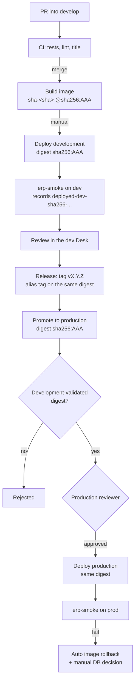

# Deployment pipeline

How code moves from a pull request to the development and production servers.

The short version: **one image per commit, promoted by digest.** The image is
built once when a change lands on `develop`. Development deploys that digest,
and production deploys the *same* digest after a reviewer approves it. Nothing
is rebuilt for production.

The receiving half lives in the `knapsfs/deployment` repository (Ansible,
host access, `erp-deploy`, `erp-smoke`). This repository only builds and
promotes.

## Principles

1. **Build once.** The image is built on merge to `develop` and never again.
   Rebuilding the same source does not produce the same digest.
2. **Digest is the identity.** Deploys accept `sha256:...` only. Tags are names.
3. **The image does not know its environment.** Configuration is injected at
   deploy time; there are no `-dev` or `-prod` images.
4. **Production promotes, it does not test.** A digest must have completed a
   development deploy and smoke test before production accepts it.
5. **Approval is a risk decision, not a test.** All technical checks run before
   the reviewer is asked.

## Branches

| Branch | Purpose |
|---|---|
| `feature/*`, `fix/*`, … | Short-lived work. PR into `develop`. |
| `develop` | Trunk. Merge here builds the image. |
| `main` | Release ledger. Updated only by a PR from `develop` (or `hotfix/*`). |
| `vX.Y.Z` (tags) | Point at the exact commit that produced a released digest. |

A PR into `main` is rejected unless its source is `develop`, `release/*`, or
`hotfix/*` (the `guard-source` check).

## Flow

## Workflows

| Workflow | Trigger | What it does |
|---|---|---|
| `ci.yml` | PR, push to `develop` | Tests and lint. The `tests` check is required. |
| `build.yml` | `CI` completes on `develop` | Builds and pushes `sha-<full-sha>` and `develop`. Never builds on failure. |
| `deploy-dev.yml` | Manual | Resolves the digest for a `develop` commit and dispatches it to the deployment repository. |
| `release.yml` | Manual | Tags the built commit `vX.Y.Z` and adds the version alias to the same digest. No rebuild. |
| `promote.yml` | Manual | Starts the production deploy of a digest. Also the rollback path. |
| `guard.yml` | PR into `main` | Fails unless the source branch is `develop`, `release/*`, or `hotfix/*`. |
| `linter.yml` | PR | pre-commit, Frappe Semgrep rules, `pip-audit`. |
| `pr-title-check.yml` | PR | Semantic title and issue reference. |

## Deploying to development

1. Merge a PR into `develop`. Wait for **CI** to pass; **Build image** then runs
   automatically and prints the digest.
2. Open **Actions → Deploy development → Run workflow**. Leave `sha` empty to
   deploy the current `develop` head, or paste a commit SHA that is on
   `develop`.
3. The workflow resolves the digest for `sha-<commit>` from GHCR and dispatches
   it to `knapsfs/deployment`.
4. `Deploy Application` in the deployment repository deploys it, runs
   `erp-smoke`, and only then records the digest as development-validated
   (`deployed-dev-sha256-<hex>` tag).

You cannot deploy a commit that has no image, or a commit that is not on
`develop`.

## Releasing and promoting

1. Validate the change in development.
2. Run **Release** with a version such as `1.10.0` and, optionally, the commit
   SHA. It:
   - creates the annotated tag `v1.10.0` on the commit that was built;
   - adds `ghcr.io/knapsfs/dhanada:1.10.0` as an alias of the same digest
     (`imagetools create`, no rebuild).
3. Run **Promote to production** with the digest printed by **Build image** /
   **Release**.
4. Approve the run in the deployment repository's `production` environment.
5. After production succeeds, open the `develop → main` PR and merge it.
   `main` is the ledger of what is deployed, not a build trigger. Open the PR
   by hand: a PR created by `GITHUB_TOKEN` does not trigger the required
   checks.

## Rollback

Deploy an older digest through **Promote to production**. It must have a
successful development deploy, which an older release normally does.

If the host's health check fails during a deploy, `erp-deploy` rolls the image
back to the previous digest automatically. It does **not** restore the database.
A failed migration needs the pre-deploy backup and the deployment repository's
restore runbook.

## Database migrations

Migrations are the real risk in a Frappe release, not the image.

- `erp-deploy` takes a backup before touching a production stack.
- Prefer **expand/contract** changes: add columns and write both shapes for one
  release, then remove the old shape in a later release. A release that renames
  or drops data cannot be rolled back by changing the image.
- Restore a recent production backup into development and run the migration
  there before releasing. This is the highest-value release gate available.

## One-time setup

### This repository

| Kind | Name | Value |
|---|---|---|
| Secret | `DEPLOYMENT_REPO_DISPATCH_TOKEN` | Fine-grained token for `knapsfs/deployment`: Contents read/write, Actions write |
| Variable | `ERPNEXT_IMAGE` | Base image matching the Frappe version, e.g. `frappe/erpnext:v16.0.0` or a digest |

Enable Actions write access to packages for the repository (GHCR) and make the
package private. A public package publishes the application source.

### Deployment repository

See `docs/RUNBOOK.md` section 13 in `knapsfs/deployment`: environments
`development` and `production`, the `ci-deploy` key, and the host variables.

### Rulesets

`develop`:

- require a PR (1 approval), linear history, no force push, no deletion;
- required checks: `tests`, `Frappe Linter`, the PR title check;
- remove the organization-admin bypass if "no direct push" must be literal.

`main`:

- the same, plus `guard-source` and CODEOWNERS review;
- squash-only merges (repository setting, not a ruleset).

## Troubleshooting

| Symptom | Check |
|---|---|
| No **Build image** run after merging | CI must pass first; the build is triggered by CI completion on `develop` |
| "No image for sha-…" in **Deploy development** | The build for that commit has not finished or failed |
| Production rejected before approval | The digest has no successful development deploy (`deployed-dev-sha256-…` tag missing) |
| Production waits forever | The `production` environment has required reviewers and self-review is disabled; approve it, or allow self-review for a single maintainer |
| `docker compose pull` fails on the host | The private registry credential is missing or expired (`vault_registry_read_token`) |
| Deploy rolls back | The new image failed its health check; read the `erp-deploy` output and the deploy log on the host |
| Migration failed in production | Roll back the image, then restore the pre-deploy backup per the deployment runbook |

## Boundaries

- This repository cannot reach a server, read a vault, or run Ansible.
- The deployment repository cannot build an image.
- The only thing they share is the image digest.
